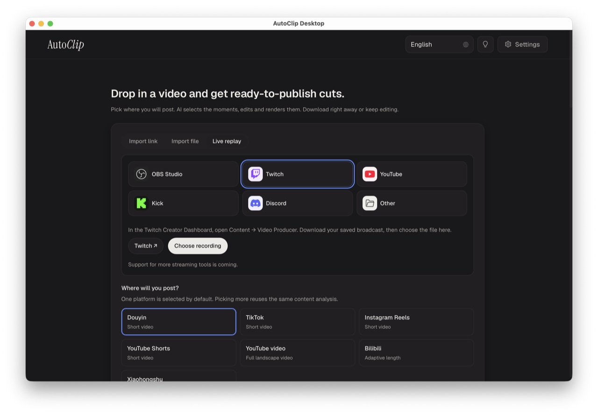
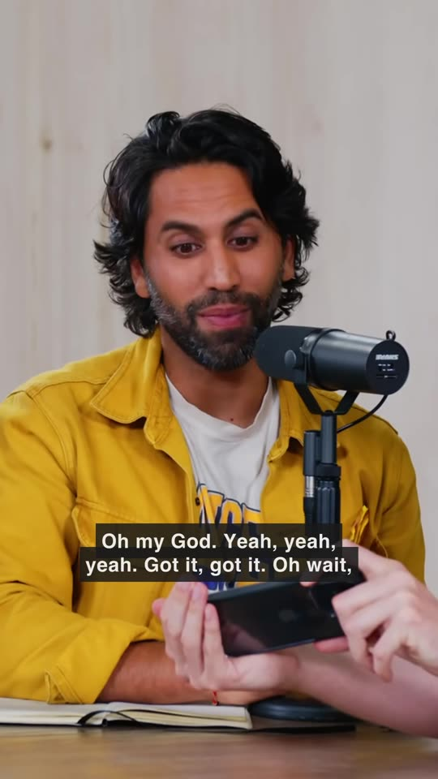

<!-- mcp-name: io.github.zhouxiaoka/autoclip-mcp -->

<div align="center">


# AutoClip

### Turn any video, link, or live stream into ready-to-post clips.

Open-source, local-first AI clipping for **podcasts, interviews, and gaming streams** — with smart reframing, captions, covers, and titles built in.

<br>

<p>
  <a href="https://github.com/zhouxiaoka/autoclip/releases/latest"></a>&nbsp;
  <a href="https://github.com/zhouxiaoka/autoclip/stargazers"></a>&nbsp;
  <a href="https://github.com/zhouxiaoka/autoclip/releases"></a>&nbsp;
  &nbsp;
  <a href="LICENSE"></a>
</p>

<br>

<p>
  <a href="https://trendshift.io/repositories/25801"></a>
</p>

<br>

<p>
  <a href="https://zhouxiaoka.github.io/autoclip_intro/"><strong>Website</strong></a>
  &nbsp;&middot;&nbsp;
  <a href="https://github.com/zhouxiaoka/autoclip/releases/latest"><strong>Download</strong></a>
  &nbsp;&middot;&nbsp;
  <a href="https://zhouxiaoka.github.io/autoclip_intro/features/game-streams/"><strong>Live Replays (v1.6)</strong></a>
  &nbsp;&middot;&nbsp;
  <a href="https://zhouxiaoka.github.io/autoclip_intro/cases/?lang=en"><strong>Showcase</strong></a>
  &nbsp;&middot;&nbsp;
  <a href="#quick-start"><strong>Quick Start</strong></a>
  &nbsp;&middot;&nbsp;
  <a href="#documentation"><strong>Docs</strong></a>
  &nbsp;&middot;&nbsp;
  <a href="https://github.com/zhouxiaoka/autoclip/issues/new/choose"><strong>Issues</strong></a>
</p>

<p>
  <strong>English</strong> · <a href="docs/i18n/README-ZH.md">简体中文</a> · <a href="docs/i18n/README-ZH-TW.md">繁體中文</a> · <a href="docs/i18n/README-JA.md">日本語</a> · <a href="docs/i18n/README-KO.md">한국어</a> · <a href="docs/i18n/README-ES.md">Español</a> · <a href="docs/i18n/README-PT.md">Português</a> · <a href="docs/i18n/README-RU.md">Русский</a> · <a href="docs/i18n/README-FR.md">Français</a> · <a href="docs/i18n/README-ID.md">Bahasa Indonesia</a> · <a href="docs/i18n/README-TR.md">Türkçe</a> · <a href="docs/i18n/README-VI.md">Tiếng Việt</a> · <a href="docs/i18n/README-DE.md">Deutsch</a>
</p>

<br>

<p>
  ⭐ <em>Free, MIT-licensed, zero subscriptions — everything cuts and renders on your machine. Star the repo if you find it useful!</em>
</p>

</div>

---

## Overview

Drop in a link, local video, or **live stream replay** — AutoClip finds the best moments, tracks the speaker, burns in captions, generates covers, and exports ready-to-post clips for TikTok, Shorts, Reels, YouTube, Douyin, Xiaohongshu, and Bilibili.

**Local-first by design:** cutting and rendering run directly on your computer with no upload queues and no monthly fee. Bring your own API key or run 100% offline with **Ollama / LM Studio + Whisper / SenseVoice**.


<p align="center"><em>Home → 6 Live Replay sources → OBS WebSocket setup → Twitch import → Finished clip with captions &amp; one-click publish.</em></p>

---

## What's New in v1.6

| Feature | Details |
| :--- | :--- |
| **6 Live Replay Sources** | Dedicated **Live Replay** tab supporting **OBS Studio, Twitch, YouTube, Kick, Discord, and local recordings**. |
| **OBS Auto-Capture** | Connect OBS WebSocket (`4455`), trim losslessly (`-c copy`), and auto-queue clips right after you end stream. |
| **Game Highlights** | Generalized highlight detection supporting **8s+** standalone plays with tighter vision/OCR budgets. |
| **One-Click Repurpose** | Unified playable clip cards — switch target platforms in one click without losing previous exports. |
| **13 Languages** | Full desktop UI, tray menus, and docs in 13 languages (`+ zh-TW, de, id, tr, vi`) plus Arabic RTL captions. |

<details>
<summary>📸 Inside the App (5 screenshots)</summary>

<table width="100%">
<tr>
<td align="center" valign="top" width="50%">
<br>
<em>Home screen — Link, File, and Live Replay</em>
</td>
<td align="center" valign="top" width="50%">
<br>
<em>Live Replay — 6 replay sources</em>
</td>
</tr>
<tr>
<td align="center" valign="top" width="50%">
<br>
<em>Inline OBS Studio WebSocket settings</em>
</td>
<td align="center" valign="top" width="50%">
<br>
<em>Twitch import &amp; local recording picker</em>
</td>
</tr>
<tr>
<td align="center" valign="top" colspan="2">
<br>
<em>Finished clip — source attribution, 9:16 crop, captions, and one-click Download / Publish / Redo</em>
</td>
</tr>
</table>

</details>

---

## Examples

Click any thumbnail or **▶ Play** to watch full clips rendered by AutoClip. Language labels indicate burned-in subtitle language.

### Vertical · Interview &amp; Podcast

<table width="100%">
<tr>
<td align="center" valign="top" width="25%">
<a href="https://pub-3fb92949b9c2480b89feec5ec03f3540.r2.dev/cases/gates-ezra/01.mp4?v=2026-10-01g"></a><br>
<strong>Bill Gates</strong><br>
Interview · Douyin · ZH<br>
<a href="https://pub-3fb92949b9c2480b89feec5ec03f3540.r2.dev/cases/gates-ezra/01.mp4?v=2026-10-01g">▶ Play 1:01</a> · <a href="https://www.youtube.com/watch?v=A_156w0aYtU">Source</a>
</td>
<td align="center" valign="top" width="25%">
<a href="https://pub-3fb92949b9c2480b89feec5ec03f3540.r2.dev/cases/ai-labs-debate/01.mp4?v=2026-10-01g"></a><br>
<strong>AI Experts Debate</strong><br>
Interview · Shorts · EN<br>
<a href="https://pub-3fb92949b9c2480b89feec5ec03f3540.r2.dev/cases/ai-labs-debate/01.mp4?v=2026-10-01g">▶ Play 1:25</a> · <a href="https://www.youtube.com/watch?v=OhOmLqR5nN4">Source</a>
</td>
<td align="center" valign="top" width="25%">
<a href="https://pub-3fb92949b9c2480b89feec5ec03f3540.r2.dev/cases/robbins-36months/01.mp4?v=2026-10-01g"></a><br>
<strong>Tony Robbins</strong><br>
Podcast · Douyin · ZH<br>
<a href="https://pub-3fb92949b9c2480b89feec5ec03f3540.r2.dev/cases/robbins-36months/01.mp4?v=2026-10-01g">▶ Play 1:45</a> · <a href="https://www.youtube.com/watch?v=DuRcrbP3kag">Source</a>
</td>
<td align="center" valign="top" width="25%">
<a href="https://pub-3fb92949b9c2480b89feec5ec03f3540.r2.dev/cases/garfield-poehler/01.mp4?v=2026-10-01g"></a><br>
<strong>Garfield × Poehler</strong><br>
Podcast · Shorts · EN<br>
<a href="https://pub-3fb92949b9c2480b89feec5ec03f3540.r2.dev/cases/garfield-poehler/01.mp4?v=2026-10-01g">▶ Play 1:01</a> · <a href="https://www.youtube.com/watch?v=OJV8AaWCxQQ">Source</a>
</td>
</tr>
</table>

### Landscape · Original Aspect Ratio

<table width="100%">
<tr>
<td align="center" valign="top" width="50%">
<a href="https://pub-3fb92949b9c2480b89feec5ec03f3540.r2.dev/cases/luyu-tongliya/01.mp4?v=2026-10-01g"></a><br>
<strong>佟丽娅 × 鲁豫</strong> · 16:9 · Bilibili · ZH<br>
<a href="https://pub-3fb92949b9c2480b89feec5ec03f3540.r2.dev/cases/luyu-tongliya/01.mp4?v=2026-10-01g">▶ Play 1:41</a> · <a href="https://www.bilibili.com/video/BV1qheu6kEFV/">Source</a>
</td>
<td align="center" valign="top" width="50%">
<a href="https://pub-3fb92949b9c2480b89feec5ec03f3540.r2.dev/cases/altman-uses-ai/01.mp4?v=2026-10-01g"></a><br>
<strong>Sam Altman</strong> · 16:9 · Bilibili · ZH<br>
<a href="https://pub-3fb92949b9c2480b89feec5ec03f3540.r2.dev/cases/altman-uses-ai/01.mp4?v=2026-10-01g">▶ Play 2:02</a> · <a href="https://www.youtube.com/watch?v=jZh55CQwSh8">Source</a>
</td>
</tr>
</table>

<details>
<summary>See 10 more clips</summary>

<table width="100%">
<tr>
<td align="center" valign="top" width="25%">
<a href="https://pub-3fb92949b9c2480b89feec5ec03f3540.r2.dev/cases/neumann-doac/01.mp4?v=2026-10-01g"></a><br>
<strong>Adam Neumann</strong><br>
Podcast · TikTok · EN<br>
<a href="https://pub-3fb92949b9c2480b89feec5ec03f3540.r2.dev/cases/neumann-doac/01.mp4?v=2026-10-01g">▶ Play 0:59</a> · <a href="https://www.youtube.com/watch?v=IQ4JVWdj4Q0">Source</a>
</td>
<td align="center" valign="top" width="25%">
<a href="https://pub-3fb92949b9c2480b89feec5ec03f3540.r2.dev/cases/luyu-xiaoqi/02.mp4?v=2026-10-01g"></a><br>
<strong>小奇 × 鲁豫</strong><br>
Interview · Douyin · ZH<br>
<a href="https://pub-3fb92949b9c2480b89feec5ec03f3540.r2.dev/cases/luyu-xiaoqi/02.mp4?v=2026-10-01g">▶ Play 0:50</a> · <a href="https://www.bilibili.com/video/BV1ighy6AEPz/">Source</a>
</td>
<td align="center" valign="top" width="25%">
<a href="https://pub-3fb92949b9c2480b89feec5ec03f3540.r2.dev/cases/luyu-guokeyu/01.mp4?v=2026-10-01g"></a><br>
<strong>郭柯宇 × 鲁豫</strong><br>
Interview · Douyin · ZH<br>
<a href="https://pub-3fb92949b9c2480b89feec5ec03f3540.r2.dev/cases/luyu-guokeyu/01.mp4?v=2026-10-01g">▶ Play 1:11</a> · <a href="https://www.bilibili.com/video/BV1LDYV6HEXR/">Source</a>
</td>
<td align="center" valign="top" width="25%">
<a href="https://pub-3fb92949b9c2480b89feec5ec03f3540.r2.dev/cases/dafoe-hot-ones/01.mp4?v=2026-10-01g"></a><br>
<strong>Willem Dafoe</strong><br>
Podcast · TikTok · EN<br>
<a href="https://pub-3fb92949b9c2480b89feec5ec03f3540.r2.dev/cases/dafoe-hot-ones/01.mp4?v=2026-10-01g">▶ Play 1:07</a> · <a href="https://www.youtube.com/watch?v=YqugY2zTIoI">Source</a>
</td>
</tr>
<tr>
<td align="center" valign="top" width="25%">
<a href="https://pub-3fb92949b9c2480b89feec5ec03f3540.r2.dev/cases/tim-luoyonghao/01.mp4?v=2026-10-01g"></a><br>
<strong>TIM × 罗永浩</strong><br>
Interview · Douyin · ZH<br>
<a href="https://pub-3fb92949b9c2480b89feec5ec03f3540.r2.dev/cases/tim-luoyonghao/01.mp4?v=2026-10-01g">▶ Play 1:05</a> · <a href="https://www.bilibili.com/video/BV1B5xkzPEhx/">Source</a>
</td>
<td align="center" valign="top" width="25%">
<a href="https://pub-3fb92949b9c2480b89feec5ec03f3540.r2.dev/cases/jensen-dwarkesh/01.mp4?v=2026-10-01g"></a><br>
<strong>Jensen Huang</strong><br>
Interview · Xiaohongshu · ZH<br>
<a href="https://pub-3fb92949b9c2480b89feec5ec03f3540.r2.dev/cases/jensen-dwarkesh/01.mp4?v=2026-10-01g">▶ Play 1:17</a> · <a href="https://www.youtube.com/watch?v=Hrbq66XqtCo">Source</a>
</td>
<td align="center" valign="top" width="25%">
<a href="https://pub-3fb92949b9c2480b89feec5ec03f3540.r2.dev/cases/karpathy-dwarkesh/01.mp4?v=2026-10-01g"></a><br>
<strong>Andrej Karpathy</strong><br>
Interview · Douyin · ZH<br>
<a href="https://pub-3fb92949b9c2480b89feec5ec03f3540.r2.dev/cases/karpathy-dwarkesh/01.mp4?v=2026-10-01g">▶ Play 0:43</a> · <a href="https://www.youtube.com/watch?v=lXUZvyajciY">Source</a>
</td>
<td align="center" valign="top" width="25%">
<a href="https://pub-3fb92949b9c2480b89feec5ec03f3540.r2.dev/cases/apple-a20/01.mp4?v=2026-10-01g"></a><br>
<strong>A20 Pro</strong><br>
Interview · Xiaohongshu · ZH<br>
<a href="https://pub-3fb92949b9c2480b89feec5ec03f3540.r2.dev/cases/apple-a20/01.mp4?v=2026-10-01g">▶ Play 2:00</a> · <a href="https://www.bilibili.com/video/BV1e4Y96FEaJ/">Source</a>
</td>
</tr>
<tr>
<td align="center" valign="top" width="25%">
<a href="https://pub-3fb92949b9c2480b89feec5ec03f3540.r2.dev/cases/stallone-nyt/01.mp4?v=2026-10-01g"></a><br>
<strong>Sylvester Stallone</strong><br>
Interview · Douyin · ZH<br>
<a href="https://pub-3fb92949b9c2480b89feec5ec03f3540.r2.dev/cases/stallone-nyt/01.mp4?v=2026-10-01g">▶ Play 1:39</a> · <a href="https://www.youtube.com/watch?v=ccs-B_nTfZs">Source</a>
</td>
<td align="center" valign="top" width="25%">
<a href="https://pub-3fb92949b9c2480b89feec5ec03f3540.r2.dev/cases/mrbeast-colin-samir/01.mp4?v=2026-10-01g"></a><br>
<strong>MrBeast</strong><br>
Podcast · TikTok · EN<br>
<a href="https://pub-3fb92949b9c2480b89feec5ec03f3540.r2.dev/cases/mrbeast-colin-samir/01.mp4?v=2026-10-01g">▶ Play 1:42</a> · <a href="https://www.youtube.com/watch?v=9IQ_ldV9z_A">Source</a>
</td>
<td></td>
<td></td>
</tr>
</table>

</details>

Browse 16+ clips, covers, and post copy in the **[Showcase →](https://zhouxiaoka.github.io/autoclip_intro/cases/?lang=en)**, or [share your own clips](https://github.com/zhouxiaoka/autoclip/discussions/new?category=show-and-tell). Source copyrights remain with their original creators.

---

<a id="quick-start"></a>

## Quick Start

| Use case | Recommended setup | Requirements |
| :--- | :--- | :--- |
| **Desktop app (easiest)** | Download `.dmg` / `-setup.exe` from [Releases](https://github.com/zhouxiaoka/autoclip/releases/latest) | Apple Silicon macOS or Windows 10/11 x64 (Python &amp; FFmpeg bundled) |
| **AI agents / CLI / MCP** | `uvx autoclip-mcp` or `npx skills add zhouxiaoka/autoclip` | Python 3.10+ (3.11 recommended) &amp; FFmpeg |
| **Self-hosted / Linux / Intel Mac** | `docker compose up -d --build` | Docker &amp; Compose v2 |

### 1. Desktop App

1. Download the latest installer from **[GitHub Releases](https://github.com/zhouxiaoka/autoclip/releases/latest)** (`aarch64.dmg` for Apple Silicon macOS, `x64-setup.exe` for Windows). Portable Python and FFmpeg are bundled.
2. Open **Settings**, pick a cloud provider (or start Ollama / LM Studio), test the connection, and save — or click **Try the built-in example** with no API key.
3. Paste a video link, drop a file, or switch to **Live Replay** to connect OBS or import a stream recording. Pick your platforms and click **Generate**.

> Installers are built publicly on GitHub Actions (`Desktop Build`) with `build-provenance.json` SHA-256 verification. Code signing and Apple notarization are tracked in [#119](https://github.com/zhouxiaoka/autoclip/issues/119).

### 2. CLI &amp; MCP (Claude Code, Codex, OpenCode &amp; scripts)

```bash
uvx autoclip-mcp
npx skills add zhouxiaoka/autoclip

autoclip --version
autoclip produce talk.mp4 --srt talk.srt --platform tiktok --portrait-style podcast --json
autoclip outputs PROJECT_ID --export-kits
```

<details>
<summary>Offline wheel, source install &amp; MCPB packaging</summary>

```bash
# Install from a downloaded CLI/MCP release ZIP wheel
python3 -m venv .venv && source .venv/bin/activate
python -m pip install -r requirements.txt
python -m pip install --force-reinstall --no-deps autoclip_mcp-*-py3-none-any.whl

# Or install from source
python -m pip install --no-deps .
```

To build a local MCPB bundle without publishing, run `python scripts/pack_mcpb.py` (never run `smithery mcp publish` automatically).

</details>


### 3. Docker / Web

```bash
git clone https://github.com/zhouxiaoka/autoclip.git
cd autoclip
cp env.example .env
mkdir -p data logs uploads
docker compose up -d --build
```

Open the web UI at `http://localhost:3000` (API docs at `http://localhost:8000/docs`). See [Docker Guide](docs/DOCKER.en.md) for bind-mount permissions and custom origins.

---

## Benchmarks

Measured on an Apple Silicon Mac (LLM cost estimated with `qwen-plus`; excludes cloud ASR and AI image generation; check your provider bill for exact usage):

| Input | Source | Time &amp; Output | Est. LLM Cost |
| :--- | :--- | ---: | ---: |
| **With existing subtitles** | Jensen Huang · 1h 43m (EN → Xiaohongshu) | **7.5 min / 10 clips** | **¥0.09** |
| **No subtitles (local Whisper)** | TIM × Luo Yonghao · 2h 52m (ZH → Douyin) | 29.5 min / 10 clips | ¥0.20 |

---

## Sponsor ❤️

<table>
  <tr>
    <td align="center" width="140">
      <a href="https://go.apimart.ai/tw-autoclip"></a><br>
      <a href="https://go.apimart.ai/tw-autoclip"><strong>APIMart</strong></a>
    </td>
    <td>
      Thanks to <strong>APIMart</strong> for sponsoring AutoClip! <strong>APIMart</strong> is a low-cost API platform for AI image &amp; video generation — GPT-Image-2 from <strong>$0.006/image</strong> (<strong>160+</strong> images per dollar). One async API covers both image and video: submit a task, get an ID, fetch results via polling or callback. Batch tens of thousands of images without timeouts and switch models without changing code. Pay-as-you-go with no monthly fee — <a href="https://go.apimart.ai/tw-autoclip">sign up here</a>.
    </td>
  </tr>
</table>

## Cloud Transcription (Alibaba Cloud)

*Affiliate link (separate from the sponsor above):* sign up on Alibaba Cloud, create an API key in the Bailian console, and enable Bailian cloud ASR under **Settings → Default models → Speech to subtitles**.

1. [Alibaba Cloud signup](https://www.aliyun.com/benefit?userCode=qmyj6jch) (affiliate link)
2. [Bailian console](https://bailian.console.aliyun.com/) — create your API key

---

## FAQ

<details>
<summary>Is AutoClip free? Do I need an API key?</summary>

Yes — AutoClip is free and MIT-licensed. Cloud analysis, transcription, and AI covers use your own API keys at provider rates (local cover layout is free by default). Ollama and LM Studio require no cloud key. Direct publishing uses your own Bilibili or [Upload-Post](https://www.upload-post.com) account.

</details>

<details>
<summary>Does my video get uploaded to the cloud?</summary>

Cutting and rendering run locally. Cloud analysis only sends transcript text; vision models only receive sampled frames; cloud ASR uploads audio. Running local LLMs + Whisper / SenseVoice keeps everything offline. Analytics and crash reports can be turned off in Settings. See [Privacy](docs/PRIVACY.en.md).

</details>

<details>
<summary>What kind of videos work best?</summary>

Podcasts, interviews, talks, courses, and gaming live stream replays (OBS / Twitch / YouTube / Kick / Discord). Sources with existing subtitles are fastest; otherwise use local Whisper / SenseVoice or cloud ASR. For gameplay or low-dialogue streams, enable a vision-capable model.

</details>

<details>
<summary>Why weren't any clips generated?</summary>

Check the failed stage: subtitles/transcription, model connection, FFmpeg, disk space, or platform length limits (YouTube long-form requires ≥180s; use Shorts, TikTok, or Bilibili for shorter clips). If it still fails, open an issue with `autoclip --version`, OS, model, and redacted logs, or check [Known Issues (#96)](https://github.com/zhouxiaoka/autoclip/issues/96).

</details>

[Troubleshooting](docs/FAQ.en.md) · [Known Issues](https://github.com/zhouxiaoka/autoclip/issues/96)

---

<a id="documentation"></a>

## Documentation

| Topic | Guide |
| :--- | :--- |
| Install &amp; first clips | [Installation Guide](docs/USER_INSTALLATION_GUIDE.en.md) |
| Self-hosting &amp; agents | [Docker](docs/DOCKER.en.md) · [CLI &amp; MCP](docs/CLI_AND_MCP.md) (ZH) · [Agent Skill](skills/autoclip/SKILL.md) (ZH) · [OpenCode](docs/OPENCODE.en.md) |
| Models &amp; troubleshooting | [Multi-LLM Setup](docs/MULTI_LLM_PROVIDER_GUIDE.md) (ZH) · [FAQ](docs/FAQ.en.md) |
| Releases &amp; privacy | [Changelog](CHANGELOG.md) · [Roadmap](docs/ROADMAP.md) (ZH) · [Community Board](docs/COMMUNITY_BOARD.md) (ZH) · [Privacy](docs/PRIVACY.en.md) |
| Research | [Pick the Moment, Not the Effect](docs/research/2026-10-what-drives-views/article-en.md) · [中文](docs/research/2026-10-what-drives-views/article-zh.md) |
| Contributing &amp; i18n | [Contributing](CONTRIBUTING.md) (ZH) · [Translation Guide](docs/i18n.md) (ZH) |

## Contribute

PRs, bug reports, sample clips, and translations are welcome. If AutoClip saves you time, a ⭐ star helps!

- **Community:** [GitHub Discussions](https://github.com/zhouxiaoka/autoclip/discussions) · [First-Clip Q&amp;A](https://github.com/zhouxiaoka/autoclip/discussions/128) · [Feature Ideas](https://github.com/zhouxiaoka/autoclip/discussions/129)
- **Bug reports:** use the [issue template](https://github.com/zhouxiaoka/autoclip/issues/new/choose) with OS, version, model, repro steps, and redacted logs
- **Partnerships:** [christine_zhouye@163.com](mailto:christine_zhouye@163.com)

AutoClip is maintained solo — please expect async replies (no live or 1-on-1 setup support).


Built with FastAPI, React, Tauri, FFmpeg, yt-dlp, Whisper, and FunASR. [MIT License](LICENSE).
