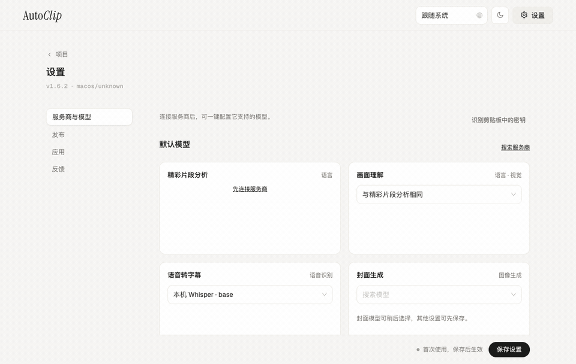
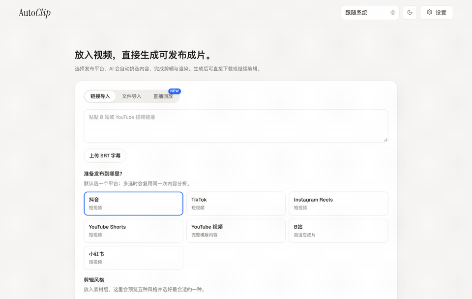
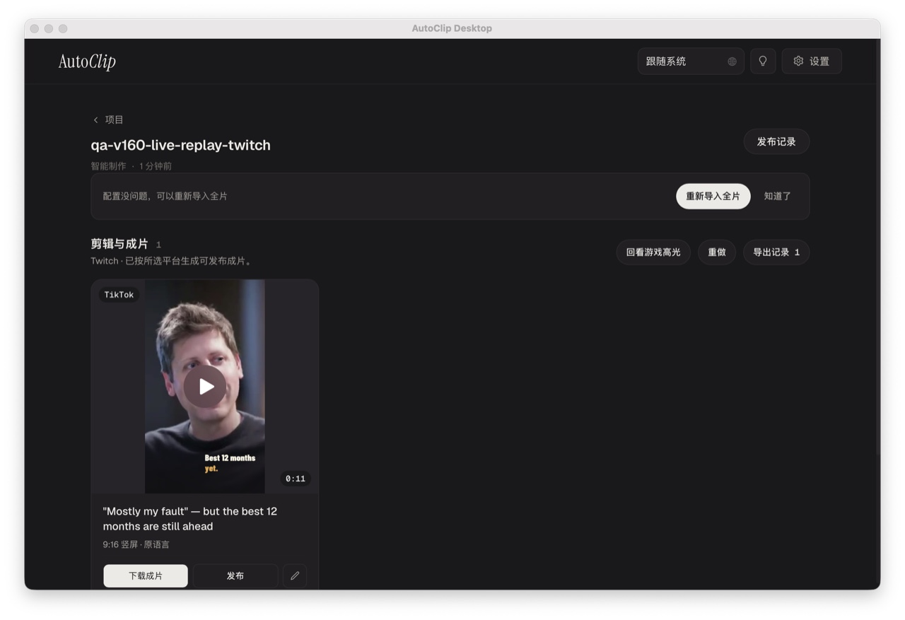

# AutoClip 桌面版 2 分钟快速上手

> AutoClip 是**免费开源的本地桌面软件**（macOS / Windows 安装包），不需要买会员、不需要写代码、也不需要找人付费代配置。按下面 3 步，2 分钟即可跑出第一条成片。

---

## 第 1 步：下载并安装桌面客户端

前往 **[GitHub Releases 最新版](https://github.com/zhouxiaoka/autoclip/releases/latest)**（或 [AutoClip 官网](https://zhouxiaoka.github.io/autoclip_intro/)），根据电脑系统下载对应安装包：

| 你的电脑 | 下载文件 | 安装方式 |
| --- | --- | --- |
| **Windows 10 / 11（64 位）** | `AutoClip_*_x64-setup.exe` | 双击安装 |
| **macOS（M1 / M2 / M3 / M4 芯片）** | `AutoClip_*_aarch64.dmg` | 双击打开，拖入「应用程序」文件夹 |

### 遇到系统安全提示怎么办？
因为开源项目暂未购买高额商业签名，首次打开可能会看到系统提醒，属于正常现象：
- **Windows（Microsoft Defender SmartScreen 蓝屏提示）**：点击 **「更多信息」** → 点击 **「仍要运行」**。
- **macOS（无法验证开发者 / 无法打开）**：点击「完成」，然后打开 **系统设置 → 隐私与安全性**，滑到底部点击 **「仍要打开」** 即可。

---

## 第 2 步：30 秒配置 AI 模型（任选一种）

AutoClip 软件本身完全免费，只需要填入一个用于理解视频内容的大模型 API Key（或使用免费的本地 Ollama 模型）。按常见 1 小时视频估算，云端 API 费用通常只需 **¥0.1 – ¥0.3**。

### 推荐方式 A：云端 API（速度最快、无需好显卡）
1. 打开以下任意一家官方控制台注册并创建 API Key：
   - **阿里云百炼（通义千问）**：[bailian.console.aliyun.com](https://bailian.console.aliyun.com/)（新用户通常有免费额度）
   - **DeepSeek**：[platform.deepseek.com](https://platform.deepseek.com/)
   - **火山引擎（豆包）**：[console.volcengine.com](https://console.volcengine.com/)
   - **OpenRouter / Gemini / OpenAI**：也均已内置预设
2. **复制你的 API Key，直接切回 AutoClip 窗口**：
   - AutoClip 会自动识别剪贴板里的密钥并在底部弹出 **「填入服务商」**，点一下确认即可自动填入并校验。
   - 也可以手动进入右上角 **设置 → 服务商与模型**，选择对应服务商、粘贴 API Key 并点击 **测试并启用**，看到通过后点击 **保存设置** 即可。

### 推荐方式 B：本地 Ollama（完全免费、离线可跑）
如果你电脑内存 ≥ 16GB 或有独立显卡，安装 [Ollama](https://ollama.com/) 并拉取模型（如 `qwen2.5:7b`）后，在 AutoClip **设置 → AI 模型** 中选择 **Ollama** 即可 0 成本运行。

---

## 第 3 步：导入视频，一键出片

1. **导入素材**：把本地长视频（MP4 / MOV / MKV 等）直接拖进首页，或直接粘贴 **B 站 / YouTube / 直播回放** 链接。
2. **选择目标平台与模板**：
   - **发抖音 / 小红书 / 视频号 / Reels / Shorts**：选竖屏平台，并挑选一个喜欢的视觉模板（支持一键开关成片字幕和片尾品牌）。
   - **发 B 站 / YouTube 横屏**：选横屏平台，自动保留 16:9 画面并生成封面与发布文案。
3. **点击「生成成片」**：
   - AutoClip 会自动完成语音转写、挑选高光片段、人脸构图/裁切、生成标题封面与发布文案。
   - 生成完成后，可直接点击预览、微调起止点或文案，再一键导出到你指定的默认目录。

---

## 新手常见 4 问

1. **为什么软件要填 API Key，是不是要收费？**
   AutoClip 本身开源免费，API Key 是你自己在模型官网申请的，费用直接按量付给模型厂商（几毛钱一条），我们不经手任何费用，也从未授权第三方收费代配置。
2. **导入链接下载失败或很慢怎么办？**
   先检查本地网络/代理设置；如果是需要登录态才能看的视频，在导入页勾选从浏览器读取 Cookie，或先将视频下载到本地 MP4 再拖入 AutoClip。
3. **成片效果不满意可以改吗？**
   可以。成片卡片支持直接改标题、换模板、调起止时间，也可以在成片卡片上点 `👎` 快速勾选问题标签反馈给我们。
4. **遇到报错怎么最快排查？**
   在 [常见问题 FAQ](./FAQ.md) 里搜索关键词，或在 [GitHub Issues](https://github.com/zhouxiaoka/autoclip/issues/new/choose) 附上版本与截图提交反馈。
