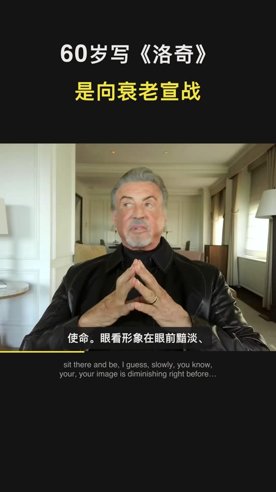

<div align="center">


# AutoClip

### Ein Link. Ein Klick.

Open Source, mit lokalem Schnitt und Rendering auf deinem Computer. Link einfügen, Plattform wählen und direkt <b>Video, Cover und Post-Text</b> erhalten,<br>
für Douyin, Xiaohongshu, TikTok, Reels, YouTube Shorts, Bilibili oder YouTube.<br>
Die App ist kostenlos; Cloud-Modelle werden nach Verbrauch abgerechnet. Öffne jederzeit den Editor, wenn du etwas anpassen möchtest.

<p>
  <a href="https://github.com/zhouxiaoka/autoclip/releases/latest"></a>
  <a href="https://github.com/zhouxiaoka/autoclip/stargazers"></a>
  <a href="https://github.com/zhouxiaoka/autoclip/releases"></a>
  <a href="../../LICENSE"></a>
</p>

<a href="https://trendshift.io/repositories/25801"></a>

**[Website](https://zhouxiaoka.github.io/autoclip_intro/)** · **[Desktop-App herunterladen](https://github.com/zhouxiaoka/autoclip/releases/latest)** · [Beispielsammlung](https://zhouxiaoka.github.io/autoclip_intro/cases/) · [Research](../research/2026-10-what-drives-views/article-en.md) · [Schnellstart](#quick-start) · [Dokumentation](#documentation) · [Problem melden](https://github.com/zhouxiaoka/autoclip/issues/new/choose)

[English](../../README.md) · [简体中文](README-ZH.md) · [繁體中文](README-ZH-TW.md) · [日本語](README-JA.md) · [한국어](README-KO.md) · [Español](README-ES.md) · [Português](README-PT.md) · [Русский](README-RU.md) · [Français](README-FR.md) · [Bahasa Indonesia](README-ID.md) · [Türkçe](README-TR.md) · [Tiếng Việt](README-VI.md) · **Deutsch**

</div>


**[Das neueste Release](https://github.com/zhouxiaoka/autoclip/releases/latest)** entspricht der Ausgabe von `autoclip --version`, wobei Desktop-App, CLI und MCP gemeinsam aktualisiert werden. Im [Changelog](../../CHANGELOG.md) findest du Details zu Quick-Output, Untertitel-Seitenumbruch, Speaker-Framing und Fixes für die Warteschlange bei langen Videos. Bitte aktualisiere ältere Installationen.

## Echte Clips

Klicke auf einen Screenshot oder auf „Abspielen“, um den vollständigen Clip anzusehen. Die Sprachangaben beziehen sich auf die ausgegebenen Untertitel. Unten sind sechs Beispiele zu sehen; klappe die Liste auf für zehn weitere.

### Hochformat · Interview und Vollbild-Podcast

<table width="100%">
<tr>
<td align="center" valign="top" width="25%">
<a href="https://pub-3fb92949b9c2480b89feec5ec03f3540.r2.dev/cases/gates-ezra/01.mp4?v=2026-10-01g"></a><br>
<strong>Bill Gates</strong><br>
Interview · Douyin · Chinesisch<br>
<a href="https://pub-3fb92949b9c2480b89feec5ec03f3540.r2.dev/cases/gates-ezra/01.mp4?v=2026-10-01g">▶ Abspielen 1:01</a> · <a href="https://www.youtube.com/watch?v=A_156w0aYtU">Quelle</a>
</td>
<td align="center" valign="top" width="25%">
<a href="https://pub-3fb92949b9c2480b89feec5ec03f3540.r2.dev/cases/ai-labs-debate/01.mp4?v=2026-10-01g"></a><br>
<strong>AI Experts Debate</strong><br>
Interview · Shorts · Englisch<br>
<a href="https://pub-3fb92949b9c2480b89feec5ec03f3540.r2.dev/cases/ai-labs-debate/01.mp4?v=2026-10-01g">▶ Abspielen 1:25</a> · <a href="https://www.youtube.com/watch?v=OhOmLqR5nN4">Quelle</a>
</td>
<td align="center" valign="top" width="25%">
<a href="https://pub-3fb92949b9c2480b89feec5ec03f3540.r2.dev/cases/robbins-36months/01.mp4?v=2026-10-01g"></a><br>
<strong>Tony Robbins</strong><br>
Vollbild-Podcast · Douyin · Chinesisch<br>
<a href="https://pub-3fb92949b9c2480b89feec5ec03f3540.r2.dev/cases/robbins-36months/01.mp4?v=2026-10-01g">▶ Abspielen 1:45</a> · <a href="https://www.youtube.com/watch?v=DuRcrbP3kag">Quelle</a>
</td>
<td align="center" valign="top" width="25%">
<a href="https://pub-3fb92949b9c2480b89feec5ec03f3540.r2.dev/cases/garfield-poehler/01.mp4?v=2026-10-01g"></a><br>
<strong>Andrew Garfield × Amy Poehler</strong><br>
Vollbild-Podcast · Shorts · Englisch<br>
<a href="https://pub-3fb92949b9c2480b89feec5ec03f3540.r2.dev/cases/garfield-poehler/01.mp4?v=2026-10-01g">▶ Abspielen 1:01</a> · <a href="https://www.youtube.com/watch?v=OJV8AaWCxQQ">Quelle</a>
</td>
</tr>
</table>

### Querformat · Original-Bildformat

<table width="100%">
<tr>
<td align="center" valign="top" width="50%">
<a href="https://pub-3fb92949b9c2480b89feec5ec03f3540.r2.dev/cases/luyu-tongliya/01.mp4?v=2026-10-01g"></a><br>
<strong>佟丽娅 × 鲁豫</strong><br>
Original-Bildformat · Bilibili · Chinesisch<br>
<a href="https://pub-3fb92949b9c2480b89feec5ec03f3540.r2.dev/cases/luyu-tongliya/01.mp4?v=2026-10-01g">▶ Abspielen 1:41</a> · <a href="https://www.bilibili.com/video/BV1qheu6kEFV/">Quelle</a>
</td>
<td align="center" valign="top" width="50%">
<a href="https://pub-3fb92949b9c2480b89feec5ec03f3540.r2.dev/cases/altman-uses-ai/01.mp4?v=2026-10-01g"></a><br>
<strong>Sam Altman</strong><br>
Original-Bildformat · Bilibili · Chinesisch<br>
<a href="https://pub-3fb92949b9c2480b89feec5ec03f3540.r2.dev/cases/altman-uses-ai/01.mp4?v=2026-10-01g">▶ Abspielen 2:02</a> · <a href="https://www.youtube.com/watch?v=jZh55CQwSh8">Quelle</a>
</td>
</tr>
</table>

<details>
<summary>10 weitere echte Clips anzeigen</summary>

<table width="100%">
<tr>
<td align="center" valign="top" width="25%">
<a href="https://pub-3fb92949b9c2480b89feec5ec03f3540.r2.dev/cases/neumann-doac/01.mp4?v=2026-10-01g"></a><br>
<strong>Adam Neumann</strong><br>
Vollbild-Podcast · TikTok · Englisch<br>
<a href="https://pub-3fb92949b9c2480b89feec5ec03f3540.r2.dev/cases/neumann-doac/01.mp4?v=2026-10-01g">▶ Abspielen 0:59</a> · <a href="https://www.youtube.com/watch?v=IQ4JVWdj4Q0">Quelle</a>
</td>
<td align="center" valign="top" width="25%">
<a href="https://pub-3fb92949b9c2480b89feec5ec03f3540.r2.dev/cases/luyu-xiaoqi/02.mp4?v=2026-10-01g"></a><br>
<strong>小奇 × 鲁豫</strong><br>
Interview · Douyin · Chinesisch<br>
<a href="https://pub-3fb92949b9c2480b89feec5ec03f3540.r2.dev/cases/luyu-xiaoqi/02.mp4?v=2026-10-01g">▶ Abspielen 0:50</a> · <a href="https://www.bilibili.com/video/BV1ighy6AEPz/">Quelle</a>
</td>
<td align="center" valign="top" width="25%">
<a href="https://pub-3fb92949b9c2480b89feec5ec03f3540.r2.dev/cases/luyu-guokeyu/01.mp4?v=2026-10-01g"></a><br>
<strong>郭柯宇 × 鲁豫</strong><br>
Interview · Douyin · Chinesisch<br>
<a href="https://pub-3fb92949b9c2480b89feec5ec03f3540.r2.dev/cases/luyu-guokeyu/01.mp4?v=2026-10-01g">▶ Abspielen 1:11</a> · <a href="https://www.bilibili.com/video/BV1LDYV6HEXR/">Quelle</a>
</td>
<td align="center" valign="top" width="25%">
<a href="https://pub-3fb92949b9c2480b89feec5ec03f3540.r2.dev/cases/dafoe-hot-ones/01.mp4?v=2026-10-01g"></a><br>
<strong>Willem Dafoe</strong><br>
Vollbild-Podcast · TikTok · Englisch<br>
<a href="https://pub-3fb92949b9c2480b89feec5ec03f3540.r2.dev/cases/dafoe-hot-ones/01.mp4?v=2026-10-01g">▶ Abspielen 1:07</a> · <a href="https://www.youtube.com/watch?v=YqugY2zTIoI">Quelle</a>
</td>
</tr>
<tr>
<td align="center" valign="top" width="25%">
<a href="https://pub-3fb92949b9c2480b89feec5ec03f3540.r2.dev/cases/tim-luoyonghao/01.mp4?v=2026-10-01g"></a><br>
<strong>TIM × 罗永浩</strong><br>
Interview · Douyin · Chinesisch<br>
<a href="https://pub-3fb92949b9c2480b89feec5ec03f3540.r2.dev/cases/tim-luoyonghao/01.mp4?v=2026-10-01g">▶ Abspielen 1:05</a> · <a href="https://www.bilibili.com/video/BV1B5xkzPEhx/">Quelle</a>
</td>
<td align="center" valign="top" width="25%">
<a href="https://pub-3fb92949b9c2480b89feec5ec03f3540.r2.dev/cases/jensen-dwarkesh/01.mp4?v=2026-10-01g"></a><br>
<strong>Jensen Huang</strong><br>
Interview · Xiaohongshu · Chinesisch<br>
<a href="https://pub-3fb92949b9c2480b89feec5ec03f3540.r2.dev/cases/jensen-dwarkesh/01.mp4?v=2026-10-01g">▶ Abspielen 1:17</a> · <a href="https://www.youtube.com/watch?v=Hrbq66XqtCo">Quelle</a>
</td>
<td align="center" valign="top" width="25%">
<a href="https://pub-3fb92949b9c2480b89feec5ec03f3540.r2.dev/cases/karpathy-dwarkesh/01.mp4?v=2026-10-01g"></a><br>
<strong>Andrej Karpathy</strong><br>
Interview · Douyin · Chinesisch<br>
<a href="https://pub-3fb92949b9c2480b89feec5ec03f3540.r2.dev/cases/karpathy-dwarkesh/01.mp4?v=2026-10-01g">▶ Abspielen 0:43</a> · <a href="https://www.youtube.com/watch?v=lXUZvyajciY">Quelle</a>
</td>
<td align="center" valign="top" width="25%">
<a href="https://pub-3fb92949b9c2480b89feec5ec03f3540.r2.dev/cases/apple-a20/01.mp4?v=2026-10-01g"></a><br>
<strong>A20 Pro</strong><br>
Interview · Xiaohongshu · Chinesisch<br>
<a href="https://pub-3fb92949b9c2480b89feec5ec03f3540.r2.dev/cases/apple-a20/01.mp4?v=2026-10-01g">▶ Abspielen 2:00</a> · <a href="https://www.bilibili.com/video/BV1e4Y96FEaJ/">Quelle</a>
</td>
</tr>
<tr>
<td align="center" valign="top" width="25%">
<a href="https://pub-3fb92949b9c2480b89feec5ec03f3540.r2.dev/cases/stallone-nyt/01.mp4?v=2026-10-01g"></a><br>
<strong>Sylvester Stallone</strong><br>
Interview · Douyin · Chinesisch<br>
<a href="https://pub-3fb92949b9c2480b89feec5ec03f3540.r2.dev/cases/stallone-nyt/01.mp4?v=2026-10-01g">▶ Abspielen 1:39</a> · <a href="https://www.youtube.com/watch?v=ccs-B_nTfZs">Quelle</a>
</td>
<td align="center" valign="top" width="25%">
<a href="https://pub-3fb92949b9c2480b89feec5ec03f3540.r2.dev/cases/mrbeast-colin-samir/01.mp4?v=2026-10-01g"></a><br>
<strong>MrBeast</strong><br>
Vollbild-Podcast · TikTok · Englisch<br>
<a href="https://pub-3fb92949b9c2480b89feec5ec03f3540.r2.dev/cases/mrbeast-colin-samir/01.mp4?v=2026-10-01g">▶ Abspielen 1:42</a> · <a href="https://www.youtube.com/watch?v=9IQ_ldV9z_A">Quelle</a>
</td>
<td></td>
<td></td>
</tr>
</table>

</details>

Videos, Cover und Post-Texte findest du in der **[Beispielsammlung →](https://zhouxiaoka.github.io/autoclip_intro/cases/?lang=en)** – dort kannst du auch [deine eigenen Clips teilen](https://github.com/zhouxiaoka/autoclip/discussions/new?category=show-and-tell). Die Quellvideos gehören ihren jeweiligen Urhebern; die Clips dienen ausschließlich zu Demonstrationszwecken.

## Was AutoClip kann

### Link einfügen, Clips erhalten

Wähle eine Plattform, um Clips passend zu deren Bildformat- und Längenregeln zu generieren. Pro Plattform werden automatisch bis zu 10 am höchsten bewertete geeignete Clips gerendert; alle weiteren stehen bei Bedarf als On-Demand-Alternativen bereit. Jeder Clip enthält Cover, Titel, Beschreibung, Hashtags und ein ZIP-Veröffentlichungspaket.

### Packaging inklusive

Douyin / Xiaohongshu verwenden standardmäßig den Interview-Stil; TikTok / Reels / Shorts nutzen standardmäßig den Vollbild-Podcast-Stil. Du kannst jedes vertikale Layout frei wählen, ohne die Sprache von Untertiteln oder Post-Texten der Plattform zu verändern. Bilibili / YouTube nutzen das Querformat. Das Framing folgt der sprechenden Person und behält das volle Bild bei, wenn keine Person erkannt wird. Das Marken-Outro ist standardmäßig aktiv und lässt sich in den Einstellungen deaktivieren; kopierte Post-Texte enthalten keinen AutoClip-Hinweis.

### Bleibt auf deinem Computer

Schnitt, Framing und Rendering laufen lokal. Wähle dein Analysemodell und nutze vorhandene Creator-Untertitel, lokales Whisper / SenseVoice oder eine konfigurierte Cloud-Transkription. CLI und MCP teilen sich die Quick-Output-Pipeline der Desktop-App.

## Zeit und Kosten bei realen Quellen

Dies sind Messwerte aus drei verschiedenen Quellen während der Entwicklung, kein kontrollierter Vergleich derselben Eingabedatei. Die Kosten schätzen den Verbrauch des Textmodells qwen-plus zum damaligen Zeitpunkt und schließen Cloud-ASR, KI-Bilder sowie Publishing-Dienste aus. Maßgeblich ist die Abrechnung deines jeweiligen Anbieters.

| Version | Quelle | Ausgabe | Geschätzte Textmodell-Kosten (CNY) |
| --- | --- | ---: | ---: |
| **Neu · mit Untertiteln** | Jensen · 1h43m (EN → Xiaohongshu) | **7,5 Min. / 10 Clips** | **¥0,09** |
| Neu · ohne Untertitel | TIM × Luo Yonghao · 2h52m (ZH → Douyin) | 29,5 Min. / 10 Clips | ¥0,20 |
| Vorherige | MrBeast · 2h06m (EN → TikTok) | 65 Min. | ¥0,64 |

<details>
<summary>Bedingungen und Messwerte</summary>

1. Oktober 2026, derselbe Apple-Silicon-Mac. Die ersten beiden Durchläufe nutzten die neue Pipeline und renderten 10 Clips; die alte Pipeline renderte 33, mit unterschiedlicher Eingabe und Ausgabeanzahl. Bei Jensen wurden Creator-Untertitel genutzt, bei TIM lokales Whisper base.

Creator-Untertitel überspringen die Transkription; andernfalls wählst du lokales oder Cloud-ASR. Zusätzliche Plattformen und On-Demand-Clips erhöhen Laufzeit und Verbrauch. Details zu den einzelnen Phasen und Annahmen findest du unter [Messwerte und Kostenrechnung](../COST_PER_VIDEO.md) (Chinesisch).

</details>

## Modelle und Datenfluss frei wählen

Schnitt und Rendering laufen auf deinem Computer. Bei einer Cloud-Analyse werden relevante Untertitel und Post-Texte gesendet; visuelle Analyse oder Referenzbild-Generierung übertragen benötigte Sample-Frames, und Cloud-ASR überträgt Audio. Lokale Analyse und Transkription benötigen keine entsprechende Cloud-API. Fertige Clips werden nur dann an verbundene Plattformen hochgeladen, wenn du sie veröffentlichst. Analyse- und Fehlerberichte lassen sich in den Einstellungen deaktivieren. Siehe [Datenschutz](../PRIVACY.en.md).

<a id="quick-start"></a>

## Schnellstart

| Dein Ziel | Nutze | Voraussetzung |
| --- | --- | --- |
| Clips direkt auf diesem Computer erstellen | **Desktop** | macOS Apple Silicon oder Windows x64 |
| Self-Hosting / Linux | **Docker** | Docker und Compose v2 |
| Batch-Verarbeitung / Agents | **CLI / MCP** | Python 3.10+ (3.11 empfohlen) und FFmpeg |

### Desktop

1. **Installieren.** Lade die App unter [Releases](https://github.com/zhouxiaoka/autoclip/releases/latest) herunter. macOS Apple Silicon: `.dmg`. Windows 10 / 11 x64: `-setup.exe`. Python und FFmpeg sind bereits enthalten. Ab macOS 15 einmal doppelklicken; falls blockiert, öffne Systemeinstellungen → Datenschutz & Sicherheit → Dennoch öffnen ([Hinweis von Apple](https://developer.apple.com/news/?id=saqachfa)). Bei älterem macOS mit Rechtsklick auf die App klicken und „Öffnen“ wählen. Wenn Windows SmartScreen erscheint, wähle „Weitere Informationen“ → „Trotzdem ausführen“.
2. **Modell konfigurieren.** Wähle einen Anbieter und gib deinen API-Key ein, wähle ein verfügbares Analysemodell, teste die Verbindung und speichere. Für lokale Modelle starte zuerst Ollama / LM Studio und lade ein Modell.
3. **Beispiel ansehen, dann eigenes Video nutzen.** Wenn auf der Startseite noch keine Projekte vorhanden sind, klicke auf „用示例项目看看效果“ (Beispielprojekt ansehen). Dafür ist kein API-Key nötig; das Beispiel ist im Installer enthalten. Verwende danach dein eigenes Interview oder deinen Podcast und wähle ein vertikales Layout. Wenn die Quelle keine Untertitel hat oder lokales Whisper sich nicht installieren lässt bzw. zu langsam ist, öffne Einstellungen → Standardmodelle → „Speech to subtitles“ und wechsle zur Bailian-Cloud-Transkription (`qwen-audio-3.1-asr-flash`, ca. 0,1 Yuan pro Stunde Audio; die Alibaba-Cloud-Rechnung zeigt den tatsächlichen Betrag). Dabei wird das Audio in die Cloud hochgeladen. Wenn der Import blockiert ist, klicke auf „Use cloud transcription instead“. Eine erste lokale Installation lädt etwa 220 MB herunter, was bei langsamer Verbindung rund 15 Minuten dauern kann.
4. **Prüfen und herunterladen.** Kontrolliere Untertitel, Framing und inhaltliche Vollständigkeit, speichere dann das Veröffentlichungspaket oder verbinde ein Konto zum direkten Veröffentlichen. Erstelle bei Bedarf On-Demand-Alternativen für weitere Clips.

Für Intel-Macs gibt es keinen Desktop-Build. Intel-Macs und Linux nutzen Docker oder die CLI. Die Desktop-Installer sind derzeit nicht signiert (Code Signing / Notarization wird in [#119](https://github.com/zhouxiaoka/autoclip/issues/119) verfolgt), daher können Windows SmartScreen, Antiviren-Heuristiken oder macOS Gatekeeper bei neuen Builds warnen; jedes Paket wird öffentlich über GitHub Actions (`Desktop Build`) erstellt und mit `build-provenance.json` ausgeliefert, sodass du exakte SHA-256-Prüfsummen vor der Ausführung verifizieren kannst (oder alternativ Docker / CLI / Quellcode nutzt). Siehe die [Installationsanleitung](../USER_INSTALLATION_GUIDE.en.md) und das [neueste Release](https://github.com/zhouxiaoka/autoclip/releases/latest).

[Vollständige Installationsanleitung](../USER_INSTALLATION_GUIDE.en.md) · [Fehlerbehebung](../FAQ.en.md)

**CLI / MCP (Claude Code, Codex, OpenCode & Skripte)**

```bash
uvx autoclip-mcp
npx skills add zhouxiaoka/autoclip

autoclip --version
autoclip produce talk.mp4 --srt talk.srt --platform tiktok --portrait-style podcast --json
autoclip outputs PROJECT_ID --export-kits
```

<details>
<summary>Offline wheel, source install &amp; MCPB packaging</summary>

```bash
# Install from a downloaded CLI/MCP release ZIP wheel
python3 -m venv .venv && source .venv/bin/activate
python -m pip install -r requirements.txt
python -m pip install --force-reinstall --no-deps autoclip_mcp-*-py3-none-any.whl

# Or install from source
python -m pip install --no-deps .
```

To build a local MCPB bundle without publishing, run `python scripts/pack_mcpb.py` (never run `smithery mcp publish` automatically).

</details>


**Docker / Web**

```bash
git clone https://github.com/zhouxiaoka/autoclip.git
cd autoclip
cp env.example .env
mkdir -p data logs uploads
docker compose up -d --build
```

Öffne die Web-UI unter `http://localhost:3000` (API-Dokumentation unter `http://localhost:8000/docs`). Siehe die [Docker-Anleitung](../DOCKER.en.md) für Bind-Mount-Berechtigungen und eigene Domains.
## Modell-Einrichtung

| Option | Einrichtung |
| --- | --- |
| Cloud API | Wähle einen Anbieter in den Einstellungen und gib deinen API-Key ein. OpenAI-kompatible Dienste akzeptieren zusätzlich eine Base URL. |
| Ollama | Standard `http://localhost:11434/v1`; lade ein lokales Modell herunter, starte es und wähle ein von deinem Server bereitgestelltes Modell. Kein API-Key nötig. |
| LM Studio | Lade ein Modell und starte den Local Server, Standard `http://localhost:1234/v1`. |

Innerhalb von Docker verweist `localhost` auf den Container selbst. Gib dort eine Host-Adresse an, die vom Container aus erreichbar ist.

[Modell-Einrichtung](../MULTI_LLM_PROVIDER_GUIDE.md) (Chinesisch) · [Lokale Modelle und Container](../CLI_AND_MCP.md) (Chinesisch)

## Besonderer Dank ❤️

<table>
  <tr>
    <td align="center" width="140">
      <a href="https://go.apimart.ai/tw-autoclip"></a><br>
      <a href="https://go.apimart.ai/tw-autoclip"><strong>APIMart</strong></a>
    </td>
    <td>
      Vielen Dank an <strong>APIMart</strong> für das Sponsoring dieses Projekts! <strong>APIMart</strong> ist eine günstige API-Plattform für KI-Bild- &amp; Videogenerierung — GPT-Image-2 ab <strong>$0.006/Bild</strong>, über <strong>160</strong> Bilder pro Dollar. Eine asynchrone API deckt Bild und Video ab: Aufgabe absenden, ID erhalten, Ergebnisse per Polling oder Callback abrufen. Zehntausende Bilder im Batch ohne Timeouts verarbeiten und Modelle wechseln, ohne Code zu ändern. Pay-as-you-go ohne monatliche Grundgebühr — <a href="https://go.apimart.ai/tw-autoclip">hier registrieren</a> und loslegen.
    </td>
  </tr>
  </table>

## Empfehlungslink

Dies ist der persönliche Empfehlungslink des Autors. Er ist unabhängig von den oben genannten Sponsoren.

Nutze ihn, um dich bei Alibaba Cloud zu registrieren oder das Angebot zu sichern, und erstelle anschließend einen API-Key in der Bailian-Konsole. Öffne in AutoClip Einstellungen → Standardmodelle → „Speech to subtitles“, um die Bailian-Cloud-Transkription zu nutzen. Das Audio wird dabei in die Cloud hochgeladen.

1. [Empfehlungslink des Autors](https://www.aliyun.com/benefit?userCode=qmyj6jch): registrieren oder Angebot einlösen.
2. [Bailian-Konsole](https://bailian.console.aliyun.com/): API-Key erstellen.

## FAQ

<details>
<summary>Ist es kostenlos? Brauche ich einen API-Key?</summary>

Die App ist kostenlos und steht unter der MIT-Lizenz. Cloud-Analyse, Transkription und KI-Bilder nutzen deine Zugangsdaten und die Tarife deines Anbieters; die automatische Cover-Erstellung nutzt standardmäßig keine kostenpflichtige Bildgenerierung. Ollama / LM Studio benötigen keinen Cloud-Key, setzen aber passende Hardware voraus. Für direktes Veröffentlichen ist ein eigenes Bilibili- oder [Upload-Post](https://www.upload-post.com)-Konto erforderlich.

</details>

<details>
<summary>Werden meine Videos hochgeladen?</summary>

Schnitt und Rendering laufen auf deinem Computer. Bei einer Cloud-Analyse werden relevante Untertitel und Post-Texte gesendet; visuelle Analyse oder Referenzbild-Generierung übertragen benötigte Sample-Frames, und Cloud-ASR überträgt Audio. Lokale Analyse und Transkription benötigen keine entsprechende Cloud-API. Fertige Clips werden nur dann an verbundene Plattformen hochgeladen, wenn du sie veröffentlichst. Analyse- und Fehlerberichte lassen sich in den Einstellungen deaktivieren. Siehe [Datenschutz](../PRIVACY.en.md).

</details>

<details>
<summary>Welche Videos eignen sich am besten?</summary>

Interviews, Podcasts, Kurse und Talking-Head-Aufnahmen sind die wichtigsten validierten Anwendungsfälle. Creator-Untertitel sind am schnellsten; ansonsten nutze lokale oder Cloud-Transkription. Bei Gameplay oder Videos mit wenig Dialog aktiviere die visuelle Analyse mit einem bildfähigen Modell und überprüfe die ausgewählten Stellen.

</details>

<details>
<summary>Warum wurden keine Clips generiert?</summary>

Prüfe den fehlgeschlagenen Schritt: Untertitel/Transkription, Modellverbindung, FFmpeg, Speicherplatz und Plattformanforderungen. YouTube-Langformate erfordern vollständige Clips von mindestens 180 Sekunden; nutze für kürzeres Material Shorts oder Bilibili. Falls es weiterhin fehlschlägt, gib die Version aus `autoclip --version`, Betriebssystem, Quelldauer, Modell und bereinigte Logs unter [bekannte Probleme](https://github.com/zhouxiaoka/autoclip/issues/96) an.

</details>

[Vollständige Fehlerbehebung](../FAQ.en.md) · [Bekannte Probleme](https://github.com/zhouxiaoka/autoclip/issues/96)

<a id="documentation"></a>

## Dokumentation

| Thema | Dokumentation |
| --- | --- |
| Installation und erste Clips | [Installation](../USER_INSTALLATION_GUIDE.en.md) |
| Self-Hosting und Automatisierung | [Docker](../DOCKER.en.md) · [CLI / MCP](../CLI_AND_MCP.md) (Chinesisch) · [Agent Skill](../../skills/autoclip/SKILL.md) (Chinesisch) · [OpenCode](../OPENCODE.en.md) |
| Modelle und Fehlerbehebung | [Modell-Einrichtung](../MULTI_LLM_PROVIDER_GUIDE.md) (Chinesisch) · [FAQ](../FAQ.en.md) |
| Versionen, Roadmap, Datenschutz | [Changelog](../../CHANGELOG.md) · [Roadmap](../ROADMAP.md) (Chinesisch) · [Community Board](../COMMUNITY_BOARD.md) (Chinesisch) · [Datenschutz](../PRIVACY.en.md) |
| Research | [Research Note #1: Pick the moment, not the effect](../research/2026-10-what-drives-views/article-en.md) · [中文](../research/2026-10-what-drives-views/article-zh.md) |
| Mitwirken und übersetzen | [Contributing](../../CONTRIBUTING.md) (Chinesisch) · [Translation Maintenance](../i18n.md) (Chinesisch) |

## Mitwirken

Fixes, Clip-Beispiele, Feedback und Verbesserungen an Übersetzungen sind herzlich willkommen. Wenn dir AutoClip hilft, freuen wir uns über einen Star.

- **Austausch:** [GitHub Discussions](https://github.com/zhouxiaoka/autoclip/discussions) · [First-clip Q&A](https://github.com/zhouxiaoka/autoclip/discussions/128) · [Ideen](https://github.com/zhouxiaoka/autoclip/discussions/129)
- **Bugs:** Nutze das [Issue-Formular](https://github.com/zhouxiaoka/autoclip/issues/new/choose) mit Betriebssystem, Version, Modell, Schritten zur Reproduktion und bereinigten Logs
- **Partnerschaften:** [christine_zhouye@163.com](mailto:christine_zhouye@163.com)

Wird von einer einzelnen Person gepflegt. Antworten erfolgen nicht sofort; es gibt keinen Live-Support und keine Eins-zu-eins-Deployment-Hilfe.


Vielen Dank an FastAPI, React, Tauri, FFmpeg, yt-dlp, Whisper, FunASR und alle Mitwirkenden. [MIT-Lizenz](../../LICENSE).
