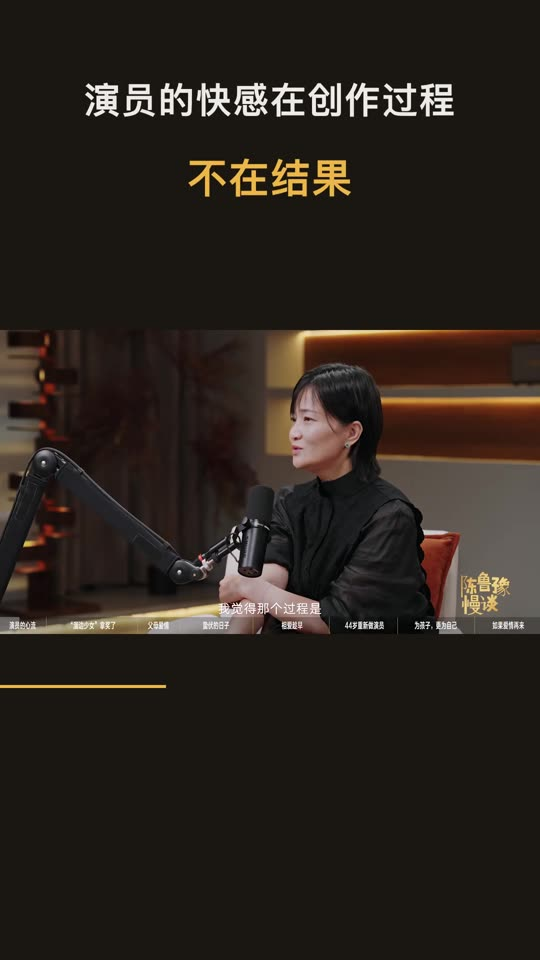
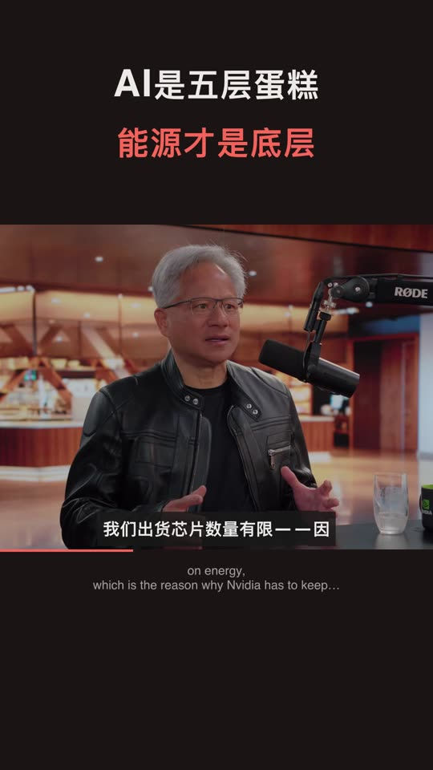

<!-- mcp-name: io.github.zhouxiaoka/autoclip-mcp -->

<div align="center">


# AutoClip

### किसी भी वीडियो, लिंक या लाइव स्ट्रीम को पोस्ट करने के लिए तैयार क्लिप्स में बदलें।

**ओपन-सोर्स OpusClip विकल्प** — **पॉडकास्ट, इंटरव्यू और गेमिंग स्ट्रीम्स** के लिए स्मार्ट रीफ़्रेमिंग, कैप्शन, कवर, शीर्षक और **AI एजेंट्स के लिए बिल्ट-इन MCP** के साथ लोकल-फ़र्स्ट AI क्लिपिंग। कोई सब्सक्रिप्शन नहीं, कोई पेवॉल नहीं।

<br>

<p>
  <a href="https://github.com/zhouxiaoka/autoclip/releases/latest"></a>&nbsp;
  <a href="https://github.com/zhouxiaoka/autoclip/stargazers"></a>&nbsp;
  <a href="https://github.com/zhouxiaoka/autoclip/releases"></a>&nbsp;
  &nbsp;
  <a href="../../LICENSE"></a>
</p>

<br>

<!-- hero-cta:start -->
<p>
  <a href="https://zhouxiaoka.github.io/autoclip_intro/"></a>&nbsp;&nbsp;
  <a href="https://trendshift.io/repositories/25801"></a>
</p>
<!-- hero-cta:end -->

<br>

<p>
  <a href="https://zhouxiaoka.github.io/autoclip_intro/"><strong>वेबसाइट</strong></a>
  &nbsp;&middot;&nbsp;
  <a href="https://github.com/zhouxiaoka/autoclip/releases/latest"><strong>डाउनलोड</strong></a>
  &nbsp;&middot;&nbsp;
  <a href="https://zhouxiaoka.github.io/autoclip_intro/features/game-streams/"><strong>लाइव रीप्ले (v1.6)</strong></a>
  &nbsp;&middot;&nbsp;
  <a href="https://zhouxiaoka.github.io/autoclip_intro/cases/?lang=en"><strong>शोकेस</strong></a>
  &nbsp;&middot;&nbsp;
  <a href="#quick-start"><strong>त्वरित शुरुआत</strong></a>
  &nbsp;&middot;&nbsp;
  <a href="#documentation"><strong>दस्तावेज़</strong></a>
  &nbsp;&middot;&nbsp;
  <a href="https://github.com/zhouxiaoka/autoclip/issues/new/choose"><strong>समस्याएं</strong></a>
</p>

<p>
  <a href="../../README.md">English</a> · <a href="README-ZH.md">简体中文</a> · <a href="README-ZH-TW.md">繁體中文</a> · <a href="README-JA.md">日本語</a> · <a href="README-KO.md">한국어</a> · <a href="README-ES.md">Español</a> · <a href="README-PT.md">Português</a> · <a href="README-RU.md">Русский</a> · <a href="README-FR.md">Français</a> · <a href="README-ID.md">Bahasa Indonesia</a> · <a href="README-TR.md">Türkçe</a> · <a href="README-VI.md">Tiếng Việt</a> · <a href="README-DE.md">Deutsch</a> · <a href="README-IT.md">Italiano</a> · <a href="README-PL.md">Polski</a> · <a href="README-TH.md">ไทย</a> · <a href="README-NL.md">Nederlands</a> · <a href="README-UK.md">Українська</a> · <strong>हिन्दी</strong> · <a href="README-AR.md">العربية</a>
</p>

<br>

<p>
  ⭐ <em>मुफ़्त, MIT-लाइसेंस प्राप्त, शून्य सब्सक्रिप्शन — सब कुछ आपकी अपनी मशीन पर कटता और रेंडर होता है। यदि यह आपको उपयोगी लगे, तो रिपॉजिटरी को स्टार जरूर दें!</em>
</p>

<!-- top-sponsors:start -->
<table width="100%">
  <tr>
    <td align="center" width="50%">
      <a href="https://go.apimart.ai/tw-autoclip"></a><br>
      <a href="https://go.apimart.ai/tw-autoclip"><strong>APIMart</strong></a><br>
      <sub>Low-cost AI image &amp; video API · GPT-Image-2 from $0.006/img</sub>
    </td>
    <td align="center" width="50%">
      <a href="mailto:christine_zhouye@163.com?subject=AutoClip%20Sponsor%20%2F%20Provider%20Partnership"><strong>Sponsor / Partner with AutoClip</strong></a><br>
      <sub>Put your AI API or creator tool in front of AutoClip users worldwide (cloud dynamic provider listing supported, zero client release needed).<br><a href="mailto:christine_zhouye@163.com">christine_zhouye@163.com</a></sub>
    </td>
  </tr>
</table>
<!-- top-sponsors:end -->

</div>

---

## परिचय

एक लिंक, लोकल वीडियो, या **लाइव स्ट्रीम रीप्ले** डालें — AutoClip बेहतरीन पल ढूंढता है, वक्ता को ट्रैक करता है, कैप्शन बर्न करता है, कवर बनाता है, और TikTok, Shorts, Reels, YouTube, Douyin, Xiaohongshu और Bilibili के लिए पोस्ट करने हेतु तैयार क्लिप्स एक्सपोर्ट करता है।

**डिज़ाइन से ही लोकल-फ़र्स्ट:** कटिंग और रेंडरिंग सीधे आपके कंप्यूटर पर चलते हैं, बिना किसी अपलोड कतार और बिना किसी मासिक शुल्क के। अपनी खुद की API की लाएं या **Ollama / LM Studio + Whisper / SenseVoice** के साथ 100% ऑफ़लाइन चलाएं।


<p align="center"><em>होम → 6 लाइव रीप्ले स्रोत → OBS WebSocket सेटअप → Twitch इम्पोर्ट → कैप्शन और वन-क्लिक पब्लिश के साथ तैयार क्लिप।</em></p>

---

## v1.6 में नया क्या है

| सुविधा | विवरण |
| :--- | :--- |
| **6 लाइव रीप्ले स्रोत** | **OBS Studio, Twitch, YouTube, Kick, Discord और लोकल रिकॉर्डिंग्स** को सपोर्ट करने वाला समर्पित **लाइव रीप्ले** टैब। |
| **OBS ऑटो-कैप्चर** | OBS WebSocket (`4455`) कनेक्ट करें, बिना गुणवत्ता हानि (`-c copy`) के ट्रिम करें, और स्ट्रीम समाप्त होते ही क्लिप्स को ऑटो-क्यू करें। |
| **गेम हाइलाइट्स** | सख्त विज़न/OCR बजट के साथ **8s+** स्टैंडअलोन प्ले को सपोर्ट करने वाला सामान्यीकृत हाइलाइट डिटेक्शन। |
| **वन-क्लिक रीपर्पस** | एकीकृत चलाने योग्य क्लिप कार्ड — पिछले एक्सपोर्ट खोए बिना एक क्लिक में लक्षित प्लेटफ़ॉर्म बदलें। |
| **13 भाषाएं** | 13 भाषाओं (`+ zh-TW, de, id, tr, vi`) में पूर्ण डेस्कटॉप UI, ट्रे मेनू और दस्तावेज़, साथ ही अरबी RTL कैप्शन। |

<details>
<summary>📸 ऐप के अंदर (5 स्क्रीनशॉट)</summary>

<table width="100%">
<tr>
<td align="center" valign="top" width="50%">
<br>
<em>होम स्क्रीन — Link, File और Live Replay</em>
</td>
<td align="center" valign="top" width="50%">
<br>
<em>Live Replay — 6 रीप्ले स्रोत</em>
</td>
</tr>
<tr>
<td align="center" valign="top" width="50%">
<br>
<em>इनलाइन OBS Studio WebSocket सेटिंग्स</em>
</td>
<td align="center" valign="top" width="50%">
<br>
<em>Twitch इम्पोर्ट और लोकल रिकॉर्डिंग पिकर</em>
</td>
</tr>
<tr>
<td align="center" valign="top" colspan="2">
<br>
<em>तैयार क्लिप — स्रोत एट्रिब्यूशन, 9:16 क्रॉप, कैप्शन और वन-क्लिक डाउनलोड / पब्लिश / फिर से करें</em>
</td>
</tr>
</table>

</details>

---

## उदाहरण

AutoClip द्वारा रेंडर किए गए पूरे क्लिप्स देखने के लिए किसी भी थंबनेल या **▶ चलाएं** पर क्लिक करें। भाषा लेबल वीडियो में बर्न किए गए सबटाइटल की भाषा दर्शाते हैं।

### वर्टिकल · इंटरव्यू और पॉडकास्ट

<table width="100%">
<tr>
<td align="center" valign="top" width="25%">
<a href="https://pub-3fb92949b9c2480b89feec5ec03f3540.r2.dev/cases/gates-ezra/01.mp4?v=2026-10-01g"></a><br>
<strong>Bill Gates</strong><br>
इंटरव्यू · Douyin · ZH<br>
<a href="https://pub-3fb92949b9c2480b89feec5ec03f3540.r2.dev/cases/gates-ezra/01.mp4?v=2026-10-01g">▶ चलाएं 1:01</a> · <a href="https://www.youtube.com/watch?v=A_156w0aYtU">स्रोत</a>
</td>
<td align="center" valign="top" width="25%">
<a href="https://pub-3fb92949b9c2480b89feec5ec03f3540.r2.dev/cases/ai-labs-debate/01.mp4?v=2026-10-01g"></a><br>
<strong>AI Experts Debate</strong><br>
इंटरव्यू · Shorts · EN<br>
<a href="https://pub-3fb92949b9c2480b89feec5ec03f3540.r2.dev/cases/ai-labs-debate/01.mp4?v=2026-10-01g">▶ चलाएं 1:25</a> · <a href="https://www.youtube.com/watch?v=OhOmLqR5nN4">स्रोत</a>
</td>
<td align="center" valign="top" width="25%">
<a href="https://pub-3fb92949b9c2480b89feec5ec03f3540.r2.dev/cases/robbins-36months/01.mp4?v=2026-10-01g"></a><br>
<strong>Tony Robbins</strong><br>
पॉडकास्ट · Douyin · ZH<br>
<a href="https://pub-3fb92949b9c2480b89feec5ec03f3540.r2.dev/cases/robbins-36months/01.mp4?v=2026-10-01g">▶ चलाएं 1:45</a> · <a href="https://www.youtube.com/watch?v=DuRcrbP3kag">स्रोत</a>
</td>
<td align="center" valign="top" width="25%">
<a href="https://pub-3fb92949b9c2480b89feec5ec03f3540.r2.dev/cases/garfield-poehler/01.mp4?v=2026-10-01g"></a><br>
<strong>Garfield × Poehler</strong><br>
पॉडकास्ट · Shorts · EN<br>
<a href="https://pub-3fb92949b9c2480b89feec5ec03f3540.r2.dev/cases/garfield-poehler/01.mp4?v=2026-10-01g">▶ चलाएं 1:01</a> · <a href="https://www.youtube.com/watch?v=OJV8AaWCxQQ">स्रोत</a>
</td>
</tr>
</table>

### लैंडस्केप · मूल आस्पेक्ट रेशियो

<table width="100%">
<tr>
<td align="center" valign="top" width="50%">
<a href="https://pub-3fb92949b9c2480b89feec5ec03f3540.r2.dev/cases/luyu-tongliya/01.mp4?v=2026-10-01g"></a><br>
<strong>佟丽娅 × 鲁豫</strong> · 16:9 · Bilibili · ZH<br>
<a href="https://pub-3fb92949b9c2480b89feec5ec03f3540.r2.dev/cases/luyu-tongliya/01.mp4?v=2026-10-01g">▶ चलाएं 1:41</a> · <a href="https://www.bilibili.com/video/BV1qheu6kEFV/">स्रोत</a>
</td>
<td align="center" valign="top" width="50%">
<a href="https://pub-3fb92949b9c2480b89feec5ec03f3540.r2.dev/cases/altman-uses-ai/01.mp4?v=2026-10-01g"></a><br>
<strong>Sam Altman</strong> · 16:9 · Bilibili · ZH<br>
<a href="https://pub-3fb92949b9c2480b89feec5ec03f3540.r2.dev/cases/altman-uses-ai/01.mp4?v=2026-10-01g">▶ चलाएं 2:02</a> · <a href="https://www.youtube.com/watch?v=jZh55CQwSh8">स्रोत</a>
</td>
</tr>
</table>

<details>
<summary>10 और क्लिप्स देखें</summary>

<table width="100%">
<tr>
<td align="center" valign="top" width="25%">
<a href="https://pub-3fb92949b9c2480b89feec5ec03f3540.r2.dev/cases/neumann-doac/01.mp4?v=2026-10-01g"></a><br>
<strong>Adam Neumann</strong><br>
पॉडकास्ट · TikTok · EN<br>
<a href="https://pub-3fb92949b9c2480b89feec5ec03f3540.r2.dev/cases/neumann-doac/01.mp4?v=2026-10-01g">▶ चलाएं 0:59</a> · <a href="https://www.youtube.com/watch?v=IQ4JVWdj4Q0">स्रोत</a>
</td>
<td align="center" valign="top" width="25%">
<a href="https://pub-3fb92949b9c2480b89feec5ec03f3540.r2.dev/cases/luyu-xiaoqi/02.mp4?v=2026-10-01g"></a><br>
<strong>小奇 × 鲁豫</strong><br>
इंटरव्यू · Douyin · ZH<br>
<a href="https://pub-3fb92949b9c2480b89feec5ec03f3540.r2.dev/cases/luyu-xiaoqi/02.mp4?v=2026-10-01g">▶ चलाएं 0:50</a> · <a href="https://www.bilibili.com/video/BV1ighy6AEPz/">स्रोत</a>
</td>
<td align="center" valign="top" width="25%">
<a href="https://pub-3fb92949b9c2480b89feec5ec03f3540.r2.dev/cases/luyu-guokeyu/01.mp4?v=2026-10-01g"></a><br>
<strong>郭柯宇 × 鲁豫</strong><br>
इंटरव्यू · Douyin · ZH<br>
<a href="https://pub-3fb92949b9c2480b89feec5ec03f3540.r2.dev/cases/luyu-guokeyu/01.mp4?v=2026-10-01g">▶ चलाएं 1:11</a> · <a href="https://www.bilibili.com/video/BV1LDYV6HEXR/">स्रोत</a>
</td>
<td align="center" valign="top" width="25%">
<a href="https://pub-3fb92949b9c2480b89feec5ec03f3540.r2.dev/cases/dafoe-hot-ones/01.mp4?v=2026-10-01g"></a><br>
<strong>Willem Dafoe</strong><br>
पॉडकास्ट · TikTok · EN<br>
<a href="https://pub-3fb92949b9c2480b89feec5ec03f3540.r2.dev/cases/dafoe-hot-ones/01.mp4?v=2026-10-01g">▶ चलाएं 1:07</a> · <a href="https://www.youtube.com/watch?v=YqugY2zTIoI">स्रोत</a>
</td>
</tr>
<tr>
<td align="center" valign="top" width="25%">
<a href="https://pub-3fb92949b9c2480b89feec5ec03f3540.r2.dev/cases/tim-luoyonghao/01.mp4?v=2026-10-01g"></a><br>
<strong>TIM × 罗永浩</strong><br>
इंटरव्यू · Douyin · ZH<br>
<a href="https://pub-3fb92949b9c2480b89feec5ec03f3540.r2.dev/cases/tim-luoyonghao/01.mp4?v=2026-10-01g">▶ चलाएं 1:05</a> · <a href="https://www.bilibili.com/video/BV1B5xkzPEhx/">स्रोत</a>
</td>
<td align="center" valign="top" width="25%">
<a href="https://pub-3fb92949b9c2480b89feec5ec03f3540.r2.dev/cases/jensen-dwarkesh/01.mp4?v=2026-10-01g"></a><br>
<strong>Jensen Huang</strong><br>
इंटरव्यू · Xiaohongshu · ZH<br>
<a href="https://pub-3fb92949b9c2480b89feec5ec03f3540.r2.dev/cases/jensen-dwarkesh/01.mp4?v=2026-10-01g">▶ चलाएं 1:17</a> · <a href="https://www.youtube.com/watch?v=Hrbq66XqtCo">स्रोत</a>
</td>
<td align="center" valign="top" width="25%">
<a href="https://pub-3fb92949b9c2480b89feec5ec03f3540.r2.dev/cases/karpathy-dwarkesh/01.mp4?v=2026-10-01g"></a><br>
<strong>Andrej Karpathy</strong><br>
इंटरव्यू · Douyin · ZH<br>
<a href="https://pub-3fb92949b9c2480b89feec5ec03f3540.r2.dev/cases/karpathy-dwarkesh/01.mp4?v=2026-10-01g">▶ चलाएं 0:43</a> · <a href="https://www.youtube.com/watch?v=lXUZvyajciY">स्रोत</a>
</td>
<td align="center" valign="top" width="25%">
<a href="https://pub-3fb92949b9c2480b89feec5ec03f3540.r2.dev/cases/apple-a20/01.mp4?v=2026-10-01g"></a><br>
<strong>A20 Pro</strong><br>
इंटरव्यू · Xiaohongshu · ZH<br>
<a href="https://pub-3fb92949b9c2480b89feec5ec03f3540.r2.dev/cases/apple-a20/01.mp4?v=2026-10-01g">▶ चलाएं 2:00</a> · <a href="https://www.bilibili.com/video/BV1e4Y96FEaJ/">स्रोत</a>
</td>
</tr>
<tr>
<td align="center" valign="top" width="25%">
<a href="https://pub-3fb92949b9c2480b89feec5ec03f3540.r2.dev/cases/stallone-nyt/01.mp4?v=2026-10-01g"></a><br>
<strong>Sylvester Stallone</strong><br>
इंटरव्यू · Douyin · ZH<br>
<a href="https://pub-3fb92949b9c2480b89feec5ec03f3540.r2.dev/cases/stallone-nyt/01.mp4?v=2026-10-01g">▶ चलाएं 1:39</a> · <a href="https://www.youtube.com/watch?v=ccs-B_nTfZs">स्रोत</a>
</td>
<td align="center" valign="top" width="25%">
<a href="https://pub-3fb92949b9c2480b89feec5ec03f3540.r2.dev/cases/mrbeast-colin-samir/01.mp4?v=2026-10-01g"></a><br>
<strong>MrBeast</strong><br>
पॉडकास्ट · TikTok · EN<br>
<a href="https://pub-3fb92949b9c2480b89feec5ec03f3540.r2.dev/cases/mrbeast-colin-samir/01.mp4?v=2026-10-01g">▶ चलाएं 1:42</a> · <a href="https://www.youtube.com/watch?v=9IQ_ldV9z_A">स्रोत</a>
</td>
<td></td>
<td></td>
</tr>
</table>

</details>

**[शोकेस →](https://zhouxiaoka.github.io/autoclip_intro/cases/?lang=en)** में 16+ क्लिप्स, कवर और पोस्ट कॉपी देखें, या [अपने खुद के क्लिप्स साझा करें](https://github.com/zhouxiaoka/autoclip/discussions/new?category=show-and-tell)। स्रोत कॉपीराइट उनके मूल क्रिएटर्स के पास रहते हैं।

---

<a id="quick-start"></a>

## त्वरित शुरुआत

| उपयोग केस | अनुशंसित सेटअप | आवश्यकताएं |
| :--- | :--- | :--- |
| **डेस्कटॉप ऐप (सबसे आसान)** | [Releases](https://github.com/zhouxiaoka/autoclip/releases/latest) से `.dmg` / `-setup.exe` डाउनलोड करें | Apple Silicon macOS या Windows 10/11 x64 (Python और FFmpeg बंडल्ड) |
| **AI एजेंट्स / CLI / MCP** | `uvx autoclip-mcp` या `npx skills add zhouxiaoka/autoclip` | Python 3.10+ (3.11 अनुशंसित) और FFmpeg |
| **सेल्फ़-होस्टेड / Linux / Intel Mac** | `docker compose up -d --build` | Docker और Compose v2 |

### 1. डेस्कटॉप ऐप

1. **[GitHub Releases](https://github.com/zhouxiaoka/autoclip/releases/latest)** से नवीनतम इंस्टॉलर डाउनलोड करें (Apple Silicon macOS के लिए `aarch64.dmg`, Windows के लिए `x64-setup.exe`)। पोर्टेबल Python और FFmpeg इसमें शामिल हैं।
2. **सेटिंग्स** खोलें, एक क्लाउड प्रोवाइडर चुनें (या Ollama / LM Studio शुरू करें), कनेक्शन टेस्ट करें, और सहेजें — या बिना किसी API की के **बिल्ट-इन उदाहरण आज़माएं** पर क्लिक करें।
3. एक वीडियो लिंक पेस्ट करें, फ़ाइल छोड़ें, या OBS कनेक्ट करने अथवा स्ट्रीम रिकॉर्डिंग इम्पोर्ट करने के लिए **लाइव रीप्ले** पर स्विच करें। अपने प्लेटफ़ॉर्म चुनें और **जेनरेट करें** पर क्लिक करें।

> इंस्टॉलर सार्वजनिक रूप से GitHub Actions (`Desktop Build`) पर `build-provenance.json` SHA-256 सत्यापन के साथ बनाए जाते हैं। अनसाइन्ड बिल्ड पर पहली बार लॉन्च करने के लिए: **macOS** पर `xattr -dr com.apple.quarantine "/Applications/AutoClip Desktop.app"` चलाएं (या *System Settings → Privacy & Security → Open Anyway*); **Windows** पर SmartScreen पर **More info → Run anyway** क्लिक करें। **[कोड साइनिंग और सत्यापन नीति](../../CODE_SIGNING.md)** देखें (नोटराइज़ेशन [#119](https://github.com/zhouxiaoka/autoclip/issues/119) में ट्रैक किया गया है)।

### 2. CLI और MCP (Claude Code, Cursor, Codex, OpenCode और स्क्रिप्ट्स)

AI कोडिंग एजेंट्स को सीधे आपके टर्मिनल से वीडियो क्लिप करने दें (`claude mcp add autoclip -- uvx autoclip-mcp`)। पूर्ण MCP सेटअप गाइड: **[English](../MCP.en.md)** · [简体中文](../CLI_AND_MCP.md) · [日本語](../MCP.ja.md) · [한국어](../MCP.ko.md) · [Español](../MCP.es.md) · [Deutsch](../MCP.de.md)।

```bash
uvx autoclip-mcp
npx skills add zhouxiaoka/autoclip

autoclip --version
autoclip produce talk.mp4 --srt talk.srt --platform tiktok --portrait-style podcast --json
autoclip outputs PROJECT_ID --export-kits
```

<details>
<summary>ऑफ़लाइन व्हील, स्रोत इंस्टॉल और MCPB पैकेजिंग</summary>

```bash
# Install from a downloaded CLI/MCP release ZIP wheel
python3 -m venv .venv && source .venv/bin/activate
python -m pip install -r requirements.txt
python -m pip install --force-reinstall --no-deps autoclip_mcp-*-py3-none-any.whl

# Or install from source
python -m pip install --no-deps .
```

बिना पब्लिश किए लोकल MCPB बंडल बनाने के लिए, `python scripts/pack_mcpb.py` चलाएं (कभी भी `smithery mcp publish` स्वचालित रूप से न चलाएं)।

</details>


### 3. Docker / वेब

```bash
git clone https://github.com/zhouxiaoka/autoclip.git
cd autoclip
cp env.example .env
mkdir -p data logs uploads
docker compose up -d --build
```

`http://localhost:3000` पर वेब UI खोलें (`http://localhost:8000/docs` पर API दस्तावेज़)। बाइंड-माउंट अनुमतियों और कस्टम ओरिजिन के लिए [Docker गाइड](../DOCKER.en.md) देखें।

---

## बेंचमार्क

Apple Silicon Mac पर मापा गया (LLM लागत `qwen-plus` से अनुमानित; इसमें क्लाउड ASR और AI इमेज जेनरेशन शामिल नहीं है; सटीक उपयोग के लिए अपने प्रोवाइडर का बिल देखें):

| इनपुट | स्रोत | समय और आउटपुट | अनुमानित LLM लागत |
| :--- | :--- | ---: | ---: |
| **मौजूदा सबटाइटल के साथ** | Jensen Huang · 1h 43m (EN → Xiaohongshu) | **7.5 मि / 10 क्लिप्स** | **¥0.09** |
| **बिना सबटाइटल (लोकल Whisper)** | TIM × Luo Yonghao · 2h 52m (ZH → Douyin) | 29.5 मि / 10 क्लिप्स | ¥0.20 |

---

## प्रायोजक ❤️

<table>
  <tr>
    <td align="center" width="140">
      <a href="https://go.apimart.ai/tw-autoclip"></a><br>
      <a href="https://go.apimart.ai/tw-autoclip"><strong>APIMart</strong></a>
    </td>
    <td>
      AutoClip को प्रायोजित करने के लिए <strong>APIMart</strong> का धन्यवाद! <strong>APIMart</strong> AI इमेज और वीडियो जेनरेशन के लिए एक किफ़ायती API प्लेटफ़ॉर्म है — GPT-Image-2 केवल <strong>$0.006/इमेज</strong> से शुरू (प्रति डॉलर <strong>160+</strong> इमेज)। एक एसिंक्रोनस API इमेज और वीडियो दोनों को कवर करता है: टास्क सबमिट करें, ID प्राप्त करें, पोलिंग या कॉलबैक के माध्यम से परिणाम प्राप्त करें। बिना टाइमआउट के दसियों हज़ार इमेज बैच करें और कोड बदले बिना मॉडल स्विच करें। बिना किसी मासिक शुल्क के उपयोग के अनुसार भुगतान करें — <a href="https://go.apimart.ai/tw-autoclip">यहां साइन अप करें</a>।
    </td>
  </tr>
</table>

## क्लाउड ट्रांसक्रिप्शन (Alibaba Cloud)

*सहबद्ध लिंक (ऊपर दिए प्रायोजक से अलग):* Alibaba Cloud पर साइन अप करें, Bailian कंसोल में API की बनाएं, और **Settings → Default models → Speech to subtitles** के अंतर्गत Bailian क्लाउड ASR सक्षम करें।

1. [Alibaba Cloud साइनअप](https://www.aliyun.com/benefit?userCode=qmyj6jch) (सहबद्ध लिंक)
2. [Bailian कंसोल](https://bailian.console.aliyun.com/) — अपनी API की बनाएं

---

## सामान्य प्रश्न (FAQ)

<details>
<summary>क्या AutoClip मुफ़्त है? क्या मुझे API की चाहिए?</summary>

हां — AutoClip मुफ़्त है और MIT-लाइसेंस प्राप्त है। क्लाउड विश्लेषण, ट्रांसक्रिप्शन और AI कवर प्रोवाइडर की दरों पर आपकी खुद की API की का उपयोग करते हैं (लोकल कवर लेआउट डिफ़ॉल्ट रूप से मुफ़्त है)। Ollama और LM Studio के लिए किसी क्लाउड की की आवश्यकता नहीं होती। डायरेक्ट पब्लिशिंग के लिए आपके खुद के Bilibili या [Upload-Post](https://www.upload-post.com) अकाउंट की आवश्यकता होती है।

</details>

<details>
<summary>क्या मेरा वीडियो क्लाउड पर अपलोड होता है?</summary>

कटिंग और रेंडरिंग लोकल रूप से चलते हैं। क्लाउड विश्लेषण केवल ट्रांसक्रिप्ट टेक्स्ट भेजता है; विज़न मॉडल केवल सैंपल किए गए फ्रेम प्राप्त करते हैं; क्लाउड ASR ऑडियो अपलोड करता है। लोकल LLMs + Whisper / SenseVoice चलाने से सब कुछ ऑफ़लाइन रहता है। सेटिंग्स में एनालिटिक्स और क्रैश रिपोर्ट बंद किए जा सकते हैं। [गोपनीयता](../PRIVACY.en.md) देखें।

</details>

<details>
<summary>किस तरह के वीडियो सबसे बेहतर काम करते हैं?</summary>

पॉडकास्ट, इंटरव्यू, वार्ता, पाठ्यक्रम और गेमिंग लाइव स्ट्रीम रीप्ले (OBS / Twitch / YouTube / Kick / Discord)। मौजूदा सबटाइटल वाले स्रोत सबसे तेज़ हैं; अन्यथा लोकल Whisper / SenseVoice या क्लाउड ASR का उपयोग करें। गेमप्ले या कम संवाद वाली स्ट्रीम्स के लिए, विज़न-सक्षम मॉडल चालू करें।

</details>

<details>
<summary>कोई क्लिप क्यों नहीं बनी?</summary>

विफल चरण जांचें: सबटाइटल/ट्रांसक्रिप्शन, मॉडल कनेक्शन, FFmpeg, डिस्क स्थान, या प्लेटफ़ॉर्म लंबाई सीमाएं (YouTube लॉन्ग-फ़ॉर्म के लिए ≥180s आवश्यक है; छोटे क्लिप्स के लिए Shorts, TikTok या Bilibili का उपयोग करें)। यदि यह फिर भी विफल रहता है, तो `autoclip --version`, OS, मॉडल और सैनिटाइज़्ड लॉग के साथ एक इश्यू खोलें, या [ज्ञात समस्याएं (#96)](https://github.com/zhouxiaoka/autoclip/issues/96) देखें।

</details>

[समस्या निवारण](../FAQ.en.md) · [ज्ञात समस्याएं](https://github.com/zhouxiaoka/autoclip/issues/96)

---

<a id="documentation"></a>

## दस्तावेज़

| विषय | गाइड |
| :--- | :--- |
| इंस्टॉलेशन और पहले क्लिप्स | [इंस्टॉलेशन गाइड](../USER_INSTALLATION_GUIDE.en.md) |
| सेल्फ़-होस्टिंग और एजेंट्स | [Docker](../DOCKER.en.md) · [MCP और AI एजेंट्स](../MCP.en.md) ([ZH](../CLI_AND_MCP.md) · [JA](../MCP.ja.md) · [KO](../MCP.ko.md) · [ES](../MCP.es.md) · [DE](../MCP.de.md)) · [एजेंट स्किल](../../skills/autoclip/SKILL.md) (ZH) · [OpenCode](../OPENCODE.en.md) |
| मॉडल और समस्या निवारण | [मल्टी-LLM सेटअप](../MULTI_LLM_PROVIDER_GUIDE.md) (ZH) · [FAQ](../FAQ.en.md) |
| रिलीज़ और गोपनीयता | [चेंजलॉग](../../CHANGELOG.md) · [कोड साइनिंग](../../CODE_SIGNING.md) · [रोडमैप](../ROADMAP.md) (ZH) · [कम्युनिटी बोर्ड](../COMMUNITY_BOARD.md) (ZH) · [गोपनीयता](../PRIVACY.en.md) |
| शोध | [प्रभाव नहीं, पल चुनें](../research/2026-10-what-drives-views/article-en.md) · [中文](../research/2026-10-what-drives-views/article-zh.md) |
| योगदान और i18n | [योगदान](../../CONTRIBUTING.md) (ZH) · [AutoClip अनुवाद](../../TRANSLATING.md) · [अनुवाद गाइड](../i18n.md) (ZH) |

## योगदान करें

PRs, बग रिपोर्ट्स, सैंपल क्लिप्स और अनुवाद का स्वागत है। यदि AutoClip आपका समय बचाता है, तो एक ⭐ स्टार मदद करता है!

- **कम्युनिटी:** [GitHub Discussions](https://github.com/zhouxiaoka/autoclip/discussions) · [पहला-क्लिप प्रश्नोत्तर](https://github.com/zhouxiaoka/autoclip/discussions/128) · [फ़ीचर आइडियाज](https://github.com/zhouxiaoka/autoclip/discussions/129)
- **बग रिपोर्ट्स:** OS, वर्ज़न, मॉडल, पुनरुत्पादन चरणों और सैनिटाइज़्ड लॉग के साथ [इश्यू टेम्प्लेट](https://github.com/zhouxiaoka/autoclip/issues/new/choose) का उपयोग करें
- **साझेदारी:** [christine_zhouye@163.com](mailto:christine_zhouye@163.com)

AutoClip का रखरखाव अकेले किया जाता है — कृपया एसिंक्रोनस उत्तरों की अपेक्षा रखें (कोई लाइव या 1-ऑन-1 सेटअप सहायता उपलब्ध नहीं है)।


FastAPI, React, Tauri, FFmpeg, yt-dlp, Whisper और FunASR से निर्मित। [MIT लाइसेंस](../../LICENSE)।
