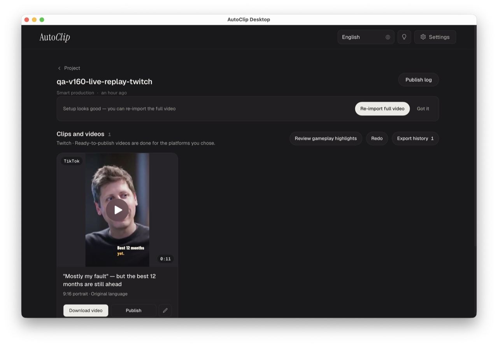

<!-- mcp-name: io.github.zhouxiaoka/autoclip-mcp -->

<div align="center">


# AutoClip

### Trasforma qualsiasi video, link o diretta streaming in clip pronte da pubblicare.

**L'alternativa open-source a OpusClip** — clipping IA local-first per **podcast, interviste e dirette gaming** con reinquadratura intelligente, sottotitoli, copertine, titoli e **MCP integrato per agenti IA**. Zero abbonamenti, nessun paywall.

<br>

<p>
  <a href="https://github.com/zhouxiaoka/autoclip/releases/latest"></a>&nbsp;
  <a href="https://github.com/zhouxiaoka/autoclip/stargazers"></a>&nbsp;
  <a href="https://github.com/zhouxiaoka/autoclip/releases"></a>&nbsp;
  &nbsp;
  <a href="../../LICENSE"></a>
</p>

<br>

<!-- hero-cta:start -->
<p>
  <a href="https://zhouxiaoka.github.io/autoclip_intro/"></a>&nbsp;&nbsp;
  <a href="https://trendshift.io/repositories/25801"></a>
</p>
<!-- hero-cta:end -->

<br>

<p>
  <a href="https://zhouxiaoka.github.io/autoclip_intro/"><strong>Sito web</strong></a>
  &nbsp;&middot;&nbsp;
  <a href="https://github.com/zhouxiaoka/autoclip/releases/latest"><strong>Scarica</strong></a>
  &nbsp;&middot;&nbsp;
  <a href="https://zhouxiaoka.github.io/autoclip_intro/features/game-streams/"><strong>Replay dirette (v1.6)</strong></a>
  &nbsp;&middot;&nbsp;
  <a href="https://zhouxiaoka.github.io/autoclip_intro/cases/?lang=en"><strong>Esempi</strong></a>
  &nbsp;&middot;&nbsp;
  <a href="#quick-start"><strong>Avvio rapido</strong></a>
  &nbsp;&middot;&nbsp;
  <a href="#documentation"><strong>Documentazione</strong></a>
  &nbsp;&middot;&nbsp;
  <a href="https://github.com/zhouxiaoka/autoclip/issues/new/choose"><strong>Segnala un problema</strong></a>
</p>

<p>
  <a href="../../README.md">English</a> · <a href="README-ZH.md">简体中文</a> · <a href="README-ZH-TW.md">繁體中文</a> · <a href="README-JA.md">日本語</a> · <a href="README-KO.md">한국어</a> · <a href="README-ES.md">Español</a> · <a href="README-PT.md">Português</a> · <a href="README-RU.md">Русский</a> · <a href="README-FR.md">Français</a> · <a href="README-ID.md">Bahasa Indonesia</a> · <a href="README-TR.md">Türkçe</a> · <a href="README-VI.md">Tiếng Việt</a> · <a href="README-DE.md">Deutsch</a> · <strong>Italiano</strong> · <a href="README-PL.md">Polski</a> · <a href="README-TH.md">ไทย</a> · <a href="README-NL.md">Nederlands</a> · <a href="README-UK.md">Українська</a> · <a href="README-HI.md">हिन्दी</a> · <a href="README-AR.md">العربية</a>
</p>

<br>

<p>
  ⭐ <em>Gratuito, licenza MIT, zero abbonamenti — taglio e rendering avvengono interamente sul tuo computer. Lascia una stella al repository se ti è utile!</em>
</p>

<!-- top-sponsors:start -->
<table width="100%">
  <tr>
    <td align="center" width="50%">
      <a href="https://go.apimart.ai/tw-autoclip"></a><br>
      <a href="https://go.apimart.ai/tw-autoclip"><strong>APIMart</strong></a><br>
      <sub>Low-cost AI image &amp; video API · GPT-Image-2 from $0.006/img</sub>
    </td>
    <td align="center" width="50%">
      <a href="mailto:christine_zhouye@163.com?subject=AutoClip%20Sponsor%20%2F%20Provider%20Partnership"><strong>Sponsor / Partner with AutoClip</strong></a><br>
      <sub>Put your AI API or creator tool in front of AutoClip users worldwide (cloud dynamic provider listing supported, zero client release needed).<br><a href="mailto:christine_zhouye@163.com">christine_zhouye@163.com</a></sub>
    </td>
  </tr>
</table>
<!-- top-sponsors:end -->

</div>

---

## Panoramica

Inserisci un link, un video locale o un **replay di una diretta** — AutoClip individua i momenti migliori, segue chi parla, imprime i sottotitoli, genera le copertine ed esporta clip pronte da pubblicare per TikTok, Shorts, Reels, YouTube, Douyin, Xiaohongshu e Bilibili.

**Local-first per progettazione:** taglio e rendering vengono eseguiti direttamente sul tuo computer, senza code di caricamento e senza costi mensili. Usa la tua API key oppure lavora al 100% offline con **Ollama / LM Studio + Whisper / SenseVoice**.


<p align="center"><em>Home → 6 fonti Replay dirette → configurazione OBS WebSocket → importazione Twitch → clip finita con sottotitoli e pubblicazione con un clic.</em></p>

---

## Novità nella v1.6

| Funzionalità | Dettagli |
| :--- | :--- |
| **6 fonti Replay dirette** | Scheda dedicata **Replay diretta** con supporto per **OBS Studio, Twitch, YouTube, Kick, Discord e registrazioni locali**. |
| **Acquisizione automatica OBS** | Collega OBS WebSocket (`4455`), taglia senza perdita (`-c copy`) e metti in coda automaticamente le clip subito dopo la fine della diretta. |
| **Momenti salienti di gioco** | Rilevamento generalizzato dei momenti salienti per azioni autonome da **8s+** con budget visivi/OCR ottimizzati. |
| **Adattamento con un clic** | Schede clip riproducibili unificate — cambia piattaforma di destinazione con un clic senza perdere le esportazioni precedenti. |
| **13 lingue** | Interfaccia desktop completa, menu nella barra e documentazione in 13 lingue (`+ zh-TW, de, id, tr, vi`) più sottotitoli RTL in arabo. |

<details>
<summary>📸 Dentro l'app (5 schermate)</summary>

<table width="100%">
<tr>
<td align="center" valign="top" width="50%">
<br>
<em>Schermata Home — Link, File e Replay diretta</em>
</td>
<td align="center" valign="top" width="50%">
<br>
<em>Replay diretta — 6 fonti di replay</em>
</td>
</tr>
<tr>
<td align="center" valign="top" width="50%">
<br>
<em>Impostazioni WebSocket OBS Studio integrate</em>
</td>
<td align="center" valign="top" width="50%">
<br>
<em>Importazione Twitch e selettore registrazioni locali</em>
</td>
</tr>
<tr>
<td align="center" valign="top" colspan="2">
<br>
<em>Clip finita — attribuzione sorgente, ritaglio 9:16, sottotitoli e Scarica / Pubblica / Rifai con un clic</em>
</td>
</tr>
</table>

</details>

---

## Esempi

Fai clic su qualsiasi miniatura o su **▶ Riproduci** per guardare le clip complete renderizzate da AutoClip. Le etichette della lingua indicano la lingua dei sottotitoli impressi nel video.

### Verticale · Intervista e Podcast

<table width="100%">
<tr>
<td align="center" valign="top" width="25%">
<a href="https://pub-3fb92949b9c2480b89feec5ec03f3540.r2.dev/cases/gates-ezra/01.mp4?v=2026-10-01g"></a><br>
<strong>Bill Gates</strong><br>
Intervista · Douyin · ZH<br>
<a href="https://pub-3fb92949b9c2480b89feec5ec03f3540.r2.dev/cases/gates-ezra/01.mp4?v=2026-10-01g">▶ Riproduci 1:01</a> · <a href="https://www.youtube.com/watch?v=A_156w0aYtU">Origine</a>
</td>
<td align="center" valign="top" width="25%">
<a href="https://pub-3fb92949b9c2480b89feec5ec03f3540.r2.dev/cases/ai-labs-debate/01.mp4?v=2026-10-01g"></a><br>
<strong>AI Experts Debate</strong><br>
Intervista · Shorts · EN<br>
<a href="https://pub-3fb92949b9c2480b89feec5ec03f3540.r2.dev/cases/ai-labs-debate/01.mp4?v=2026-10-01g">▶ Riproduci 1:25</a> · <a href="https://www.youtube.com/watch?v=OhOmLqR5nN4">Origine</a>
</td>
<td align="center" valign="top" width="25%">
<a href="https://pub-3fb92949b9c2480b89feec5ec03f3540.r2.dev/cases/robbins-36months/01.mp4?v=2026-10-01g"></a><br>
<strong>Tony Robbins</strong><br>
Podcast · Douyin · ZH<br>
<a href="https://pub-3fb92949b9c2480b89feec5ec03f3540.r2.dev/cases/robbins-36months/01.mp4?v=2026-10-01g">▶ Riproduci 1:45</a> · <a href="https://www.youtube.com/watch?v=DuRcrbP3kag">Origine</a>
</td>
<td align="center" valign="top" width="25%">
<a href="https://pub-3fb92949b9c2480b89feec5ec03f3540.r2.dev/cases/garfield-poehler/01.mp4?v=2026-10-01g"></a><br>
<strong>Garfield × Poehler</strong><br>
Podcast · Shorts · EN<br>
<a href="https://pub-3fb92949b9c2480b89feec5ec03f3540.r2.dev/cases/garfield-poehler/01.mp4?v=2026-10-01g">▶ Riproduci 1:01</a> · <a href="https://www.youtube.com/watch?v=OJV8AaWCxQQ">Origine</a>
</td>
</tr>
</table>

### Orizzontale · Proporzioni originali

<table width="100%">
<tr>
<td align="center" valign="top" width="50%">
<a href="https://pub-3fb92949b9c2480b89feec5ec03f3540.r2.dev/cases/luyu-tongliya/01.mp4?v=2026-10-01g"></a><br>
<strong>佟丽娅 × 鲁豫</strong> · 16:9 · Bilibili · ZH<br>
<a href="https://pub-3fb92949b9c2480b89feec5ec03f3540.r2.dev/cases/luyu-tongliya/01.mp4?v=2026-10-01g">▶ Riproduci 1:41</a> · <a href="https://www.bilibili.com/video/BV1qheu6kEFV/">Origine</a>
</td>
<td align="center" valign="top" width="50%">
<a href="https://pub-3fb92949b9c2480b89feec5ec03f3540.r2.dev/cases/altman-uses-ai/01.mp4?v=2026-10-01g"></a><br>
<strong>Sam Altman</strong> · 16:9 · Bilibili · ZH<br>
<a href="https://pub-3fb92949b9c2480b89feec5ec03f3540.r2.dev/cases/altman-uses-ai/01.mp4?v=2026-10-01g">▶ Riproduci 2:02</a> · <a href="https://www.youtube.com/watch?v=jZh55CQwSh8">Origine</a>
</td>
</tr>
</table>

<details>
<summary>Vedi altre 10 clip</summary>

<table width="100%">
<tr>
<td align="center" valign="top" width="25%">
<a href="https://pub-3fb92949b9c2480b89feec5ec03f3540.r2.dev/cases/neumann-doac/01.mp4?v=2026-10-01g"></a><br>
<strong>Adam Neumann</strong><br>
Podcast · TikTok · EN<br>
<a href="https://pub-3fb92949b9c2480b89feec5ec03f3540.r2.dev/cases/neumann-doac/01.mp4?v=2026-10-01g">▶ Riproduci 0:59</a> · <a href="https://www.youtube.com/watch?v=IQ4JVWdj4Q0">Origine</a>
</td>
<td align="center" valign="top" width="25%">
<a href="https://pub-3fb92949b9c2480b89feec5ec03f3540.r2.dev/cases/luyu-xiaoqi/02.mp4?v=2026-10-01g"></a><br>
<strong>小奇 × 鲁豫</strong><br>
Intervista · Douyin · ZH<br>
<a href="https://pub-3fb92949b9c2480b89feec5ec03f3540.r2.dev/cases/luyu-xiaoqi/02.mp4?v=2026-10-01g">▶ Riproduci 0:50</a> · <a href="https://www.bilibili.com/video/BV1ighy6AEPz/">Origine</a>
</td>
<td align="center" valign="top" width="25%">
<a href="https://pub-3fb92949b9c2480b89feec5ec03f3540.r2.dev/cases/luyu-guokeyu/01.mp4?v=2026-10-01g"></a><br>
<strong>郭柯宇 × 鲁豫</strong><br>
Intervista · Douyin · ZH<br>
<a href="https://pub-3fb92949b9c2480b89feec5ec03f3540.r2.dev/cases/luyu-guokeyu/01.mp4?v=2026-10-01g">▶ Riproduci 1:11</a> · <a href="https://www.bilibili.com/video/BV1LDYV6HEXR/">Origine</a>
</td>
<td align="center" valign="top" width="25%">
<a href="https://pub-3fb92949b9c2480b89feec5ec03f3540.r2.dev/cases/dafoe-hot-ones/01.mp4?v=2026-10-01g"></a><br>
<strong>Willem Dafoe</strong><br>
Podcast · TikTok · EN<br>
<a href="https://pub-3fb92949b9c2480b89feec5ec03f3540.r2.dev/cases/dafoe-hot-ones/01.mp4?v=2026-10-01g">▶ Riproduci 1:07</a> · <a href="https://www.youtube.com/watch?v=YqugY2zTIoI">Origine</a>
</td>
</tr>
<tr>
<td align="center" valign="top" width="25%">
<a href="https://pub-3fb92949b9c2480b89feec5ec03f3540.r2.dev/cases/tim-luoyonghao/01.mp4?v=2026-10-01g"></a><br>
<strong>TIM × 罗永浩</strong><br>
Intervista · Douyin · ZH<br>
<a href="https://pub-3fb92949b9c2480b89feec5ec03f3540.r2.dev/cases/tim-luoyonghao/01.mp4?v=2026-10-01g">▶ Riproduci 1:05</a> · <a href="https://www.bilibili.com/video/BV1B5xkzPEhx/">Origine</a>
</td>
<td align="center" valign="top" width="25%">
<a href="https://pub-3fb92949b9c2480b89feec5ec03f3540.r2.dev/cases/jensen-dwarkesh/01.mp4?v=2026-10-01g"></a><br>
<strong>Jensen Huang</strong><br>
Intervista · Xiaohongshu · ZH<br>
<a href="https://pub-3fb92949b9c2480b89feec5ec03f3540.r2.dev/cases/jensen-dwarkesh/01.mp4?v=2026-10-01g">▶ Riproduci 1:17</a> · <a href="https://www.youtube.com/watch?v=Hrbq66XqtCo">Origine</a>
</td>
<td align="center" valign="top" width="25%">
<a href="https://pub-3fb92949b9c2480b89feec5ec03f3540.r2.dev/cases/karpathy-dwarkesh/01.mp4?v=2026-10-01g"></a><br>
<strong>Andrej Karpathy</strong><br>
Intervista · Douyin · ZH<br>
<a href="https://pub-3fb92949b9c2480b89feec5ec03f3540.r2.dev/cases/karpathy-dwarkesh/01.mp4?v=2026-10-01g">▶ Riproduci 0:43</a> · <a href="https://www.youtube.com/watch?v=lXUZvyajciY">Origine</a>
</td>
<td align="center" valign="top" width="25%">
<a href="https://pub-3fb92949b9c2480b89feec5ec03f3540.r2.dev/cases/apple-a20/01.mp4?v=2026-10-01g"></a><br>
<strong>A20 Pro</strong><br>
Intervista · Xiaohongshu · ZH<br>
<a href="https://pub-3fb92949b9c2480b89feec5ec03f3540.r2.dev/cases/apple-a20/01.mp4?v=2026-10-01g">▶ Riproduci 2:00</a> · <a href="https://www.bilibili.com/video/BV1e4Y96FEaJ/">Origine</a>
</td>
</tr>
<tr>
<td align="center" valign="top" width="25%">
<a href="https://pub-3fb92949b9c2480b89feec5ec03f3540.r2.dev/cases/stallone-nyt/01.mp4?v=2026-10-01g"></a><br>
<strong>Sylvester Stallone</strong><br>
Intervista · Douyin · ZH<br>
<a href="https://pub-3fb92949b9c2480b89feec5ec03f3540.r2.dev/cases/stallone-nyt/01.mp4?v=2026-10-01g">▶ Riproduci 1:39</a> · <a href="https://www.youtube.com/watch?v=ccs-B_nTfZs">Origine</a>
</td>
<td align="center" valign="top" width="25%">
<a href="https://pub-3fb92949b9c2480b89feec5ec03f3540.r2.dev/cases/mrbeast-colin-samir/01.mp4?v=2026-10-01g"></a><br>
<strong>MrBeast</strong><br>
Podcast · TikTok · EN<br>
<a href="https://pub-3fb92949b9c2480b89feec5ec03f3540.r2.dev/cases/mrbeast-colin-samir/01.mp4?v=2026-10-01g">▶ Riproduci 1:42</a> · <a href="https://www.youtube.com/watch?v=9IQ_ldV9z_A">Origine</a>
</td>
<td></td>
<td></td>
</tr>
</table>

</details>

Esplora oltre 16 clip, copertine e testi dei post nella **[galleria di esempi →](https://zhouxiaoka.github.io/autoclip_intro/cases/?lang=en)** oppure [condividi le tue clip](https://github.com/zhouxiaoka/autoclip/discussions/new?category=show-and-tell). I diritti dei video originali restano dei rispettivi autori.

---

<a id="quick-start"></a>

## Avvio rapido

| Caso d'uso | Configurazione consigliata | Requisiti |
| :--- | :--- | :--- |
| **App desktop (più semplice)** | Scarica `.dmg` / `-setup.exe` da [Releases](https://github.com/zhouxiaoka/autoclip/releases/latest) | macOS Apple Silicon o Windows 10/11 x64 (Python e FFmpeg inclusi) |
| **Agenti IA / CLI / MCP** | `uvx autoclip-mcp` o `npx skills add zhouxiaoka/autoclip` | Python 3.10+ (consigliato 3.11) e FFmpeg |
| **Self-hosted / Linux / Mac Intel** | `docker compose up -d --build` | Docker e Compose v2 |

### 1. App desktop

1. Scarica l'ultimo programma di installazione da **[GitHub Releases](https://github.com/zhouxiaoka/autoclip/releases/latest)** (`aarch64.dmg` per macOS Apple Silicon, `x64-setup.exe` per Windows). Python portatile e FFmpeg sono inclusi.
2. Apri **Impostazioni**, scegli un provider cloud (o avvia Ollama / LM Studio), testa la connessione e salva — oppure fai clic su **Prova l'esempio integrato** senza alcuna API key.
3. Incolla un link video, trascina un file o passa a **Replay diretta** per collegare OBS o importare la registrazione di una diretta. Scegli le piattaforme e fai clic su **Genera**.

> I pacchetti di installazione sono compilati pubblicamente su GitHub Actions (`Desktop Build`) con verifica SHA-256 tramite `build-provenance.json`. Primo avvio su una build non firmata: su **macOS** esegui `xattr -dr com.apple.quarantine "/Applications/AutoClip Desktop.app"` (oppure *Impostazioni di Sistema → Privacy e sicurezza → Apri comunque*); su **Windows** fai clic su **Ulteriori informazioni → Esegui comunque** in SmartScreen. Vedi **[Politica di firma e verifica del codice](../../CODE_SIGNING.md)** (notarizzazione monitorata in [#119](https://github.com/zhouxiaoka/autoclip/issues/119)).

### 2. CLI &amp; MCP (Claude Code, Cursor, Codex, OpenCode e script)

Consenti agli agenti di coding IA di tagliare video direttamente dal terminale (`claude mcp add autoclip -- uvx autoclip-mcp`). Guide complete alla configurazione MCP: **[English](../MCP.en.md)** · [简体中文](../CLI_AND_MCP.md) · [日本語](../MCP.ja.md) · [한국어](../MCP.ko.md) · [Español](../MCP.es.md) · [Deutsch](../MCP.de.md).

```bash
uvx autoclip-mcp
npx skills add zhouxiaoka/autoclip

autoclip --version
autoclip produce talk.mp4 --srt talk.srt --platform tiktok --portrait-style podcast --json
autoclip outputs PROJECT_ID --export-kits
```

<details>
<summary>Wheel offline, installazione da sorgente e pacchetto MCPB</summary>

```bash
# Install from a downloaded CLI/MCP release ZIP wheel
python3 -m venv .venv && source .venv/bin/activate
python -m pip install -r requirements.txt
python -m pip install --force-reinstall --no-deps autoclip_mcp-*-py3-none-any.whl

# Or install from source
python -m pip install --no-deps .
```

Per creare un pacchetto MCPB locale senza pubblicare, esegui `python scripts/pack_mcpb.py` (non eseguire mai `smithery mcp publish` automaticamente).

</details>


### 3. Docker / Web

```bash
git clone https://github.com/zhouxiaoka/autoclip.git
cd autoclip
cp env.example .env
mkdir -p data logs uploads
docker compose up -d --build
```

Apri l'interfaccia web su `http://localhost:3000` (documentazione API su `http://localhost:8000/docs`). Consulta la [Guida Docker](../DOCKER.en.md) per permessi dei bind-mount e origini personalizzate.

---

## Benchmark

Misurato su un Mac Apple Silicon (costo LLM stimato con `qwen-plus`; esclude ASR cloud e generazione immagini IA; verifica la fattura del tuo provider per i consumi esatti):

| Input | Sorgente | Tempo e output | Costo LLM stim. |
| :--- | :--- | ---: | ---: |
| **Con sottotitoli esistenti** | Jensen Huang · 1h 43m (EN → Xiaohongshu) | **7,5 min / 10 clip** | **¥0,09** |
| **Senza sottotitoli (Whisper locale)** | TIM × Luo Yonghao · 2h 52m (ZH → Douyin) | 29,5 min / 10 clip | ¥0,20 |

---

## Sponsor ❤️

<table>
  <tr>
    <td align="center" width="140">
      <a href="https://go.apimart.ai/tw-autoclip"></a><br>
      <a href="https://go.apimart.ai/tw-autoclip"><strong>APIMart</strong></a>
    </td>
    <td>
      Grazie a <strong>APIMart</strong> per aver sponsorizzato AutoClip! <strong>APIMart</strong> è una piattaforma API economica per la generazione di immagini e video con IA — GPT-Image-2 a partire da <strong>$0.006/image</strong> (oltre <strong>160</strong> immagini per dollaro). Una sola API asincrona copre sia immagini che video: invia un'attività, ottieni un ID e recupera i risultati tramite polling o callback. Elabora in batch decine di migliaia di immagini senza timeout e cambia modello senza modificare il codice. Pagamento a consumo senza canone mensile — <a href="https://go.apimart.ai/tw-autoclip">registrati qui</a>.
    </td>
  </tr>
</table>

## Trascrizione cloud (Alibaba Cloud)

*Link di affiliazione (separato dallo sponsor sopra):* registrati su Alibaba Cloud, crea una API key nella console Bailian e attiva l'ASR cloud Bailian in **Impostazioni → Modelli predefiniti → Voce in sottotitoli**.

1. [Registrazione Alibaba Cloud](https://www.aliyun.com/benefit?userCode=qmyj6jch) (link di affiliazione)
2. [Console Bailian](https://bailian.console.aliyun.com/) — crea la tua API key

---

## Domande frequenti

<details>
<summary>AutoClip è gratuito? Serve una API key?</summary>

Sì — AutoClip è gratuito e rilasciato sotto licenza MIT. L'analisi cloud, la trascrizione e le copertine IA usano le tue API key alle tariffe del provider (il layout locale della copertina è gratuito per impostazione predefinita). Ollama e LM Studio non richiedono chiavi cloud. La pubblicazione diretta usa il tuo account Bilibili o [Upload-Post](https://www.upload-post.com).

</details>

<details>
<summary>Il mio video viene caricato sul cloud?</summary>

Taglio e rendering vengono eseguiti in locale. L'analisi cloud invia solo il testo della trascrizione; i modelli visivi ricevono solo i fotogrammi campionati; l'ASR cloud carica l'audio. Eseguendo LLM locali + Whisper / SenseVoice tutto resta offline. Analisi statistiche e segnalazioni di crash possono essere disattivate nelle Impostazioni. Vedi [Privacy](../PRIVACY.en.md).

</details>

<details>
<summary>Che tipo di video funziona meglio?</summary>

Podcast, interviste, interventi, corsi e replay di dirette gaming (OBS / Twitch / YouTube / Kick / Discord). I sorgenti con sottotitoli esistenti sono più rapidi; altrimenti usa Whisper / SenseVoice locale o ASR cloud. Per gameplay o dirette con pochi dialoghi, attiva un modello con capacità visiva.

</details>

<details>
<summary>Perché non è stata generata alcuna clip?</summary>

Controlla la fase fallita: sottotitoli/trascrizione, connessione al modello, FFmpeg, spazio su disco o limiti di durata della piattaforma (YouTube formato lungo richiede ≥180s; usa Shorts, TikTok o Bilibili per clip più brevi). Se il problema persiste, apri una issue con `autoclip --version`, sistema operativo, modello e log anonimizzati, oppure controlla [Problemi noti (#96)](https://github.com/zhouxiaoka/autoclip/issues/96).

</details>

[Risoluzione dei problemi](../FAQ.en.md) · [Problemi noti](https://github.com/zhouxiaoka/autoclip/issues/96)

---

<a id="documentation"></a>

## Documentazione

| Argomento | Guida |
| :--- | :--- |
| Installazione e prime clip | [Guida all'installazione](../USER_INSTALLATION_GUIDE.en.md) |
| Self-hosting e agenti | [Docker](../DOCKER.en.md) · [MCP e agenti IA](../MCP.en.md) ([ZH](../CLI_AND_MCP.md) · [JA](../MCP.ja.md) · [KO](../MCP.ko.md) · [ES](../MCP.es.md) · [DE](../MCP.de.md)) · [Agent Skill](../../skills/autoclip/SKILL.md) (ZH) · [OpenCode](../OPENCODE.en.md) |
| Modelli e risoluzione problemi | [Configurazione Multi-LLM](../MULTI_LLM_PROVIDER_GUIDE.md) (ZH) · [FAQ](../FAQ.en.md) |
| Rilasci e privacy | [Changelog](../../CHANGELOG.md) · [Firma del codice](../../CODE_SIGNING.md) · [Roadmap](../ROADMAP.md) (ZH) · [Community Board](../COMMUNITY_BOARD.md) (ZH) · [Privacy](../PRIVACY.en.md) |
| Ricerca | [Scegli il momento, non l'effetto](../research/2026-10-what-drives-views/article-en.md) · [中文](../research/2026-10-what-drives-views/article-zh.md) |
| Contribuire e i18n | [Contribuire](../../CONTRIBUTING.md) (ZH) · [Tradurre AutoClip](../../TRANSLATING.md) · [Guida alle traduzioni](../i18n.md) (ZH) |

## Contribuire

PR, segnalazioni di bug, clip di esempio e traduzioni sono i benvenuti. Se AutoClip ti fa risparmiare tempo, una ⭐ stella aiuta molto!

- **Community:** [GitHub Discussions](https://github.com/zhouxiaoka/autoclip/discussions) · [Q&amp;A sulla prima clip](https://github.com/zhouxiaoka/autoclip/discussions/128) · [Idee per funzionalità](https://github.com/zhouxiaoka/autoclip/discussions/129)
- **Segnalazioni di bug:** usa il [modello di issue](https://github.com/zhouxiaoka/autoclip/issues/new/choose) indicando OS, versione, modello, passaggi per riprodurre e log anonimizzati
- **Partnership:** [christine_zhouye@163.com](mailto:christine_zhouye@163.com)

AutoClip è mantenuto da una sola persona — aspettati risposte asincrone (nessun supporto dal vivo o configurazione individuale 1-a-1).


Realizzato con FastAPI, React, Tauri, FFmpeg, yt-dlp, Whisper e FunASR. [Licenza MIT](../../LICENSE).
