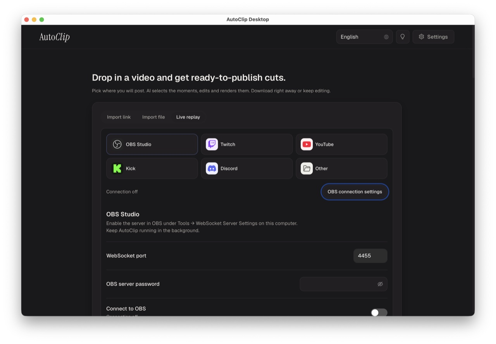

<!-- mcp-name: io.github.zhouxiaoka/autoclip-mcp -->

<div align="center">


# AutoClip

### Zet elke video, link of livestream om in direct publiceerbare clips.

**Het open-source alternatief voor OpusClip** — local-first AI-clipping voor **podcasts, interviews en gamingstreams** met slimme herkadrering, ondertitels, omslagen, titels en ingebouwde **MCP voor AI-agents**. Geen abonnementen, geen betaalmuur.

<br>

<p>
  <a href="https://github.com/zhouxiaoka/autoclip/releases/latest"></a>&nbsp;
  <a href="https://github.com/zhouxiaoka/autoclip/stargazers"></a>&nbsp;
  <a href="https://github.com/zhouxiaoka/autoclip/releases"></a>&nbsp;
  &nbsp;
  <a href="../../LICENSE"></a>
</p>

<br>

<!-- hero-cta:start -->
<p>
  <a href="https://zhouxiaoka.github.io/autoclip_intro/"></a>&nbsp;&nbsp;
  <a href="https://trendshift.io/repositories/25801"></a>
</p>
<!-- hero-cta:end -->

<br>

<p>
  <a href="https://zhouxiaoka.github.io/autoclip_intro/"><strong>Website</strong></a>
  &nbsp;&middot;&nbsp;
  <a href="https://github.com/zhouxiaoka/autoclip/releases/latest"><strong>Downloaden</strong></a>
  &nbsp;&middot;&nbsp;
  <a href="https://zhouxiaoka.github.io/autoclip_intro/features/game-streams/"><strong>Live-opnames (v1.6)</strong></a>
  &nbsp;&middot;&nbsp;
  <a href="https://zhouxiaoka.github.io/autoclip_intro/cases/?lang=en"><strong>Voorbeelden</strong></a>
  &nbsp;&middot;&nbsp;
  <a href="#snelstart"><strong>Snelstart</strong></a>
  &nbsp;&middot;&nbsp;
  <a href="#documentatie"><strong>Documentatie</strong></a>
  &nbsp;&middot;&nbsp;
  <a href="https://github.com/zhouxiaoka/autoclip/issues/new/choose"><strong>Issues</strong></a>
</p>

<p>
  <a href="../../README.md">English</a> · <a href="README-ZH.md">简体中文</a> · <a href="README-ZH-TW.md">繁體中文</a> · <a href="README-JA.md">日本語</a> · <a href="README-KO.md">한국어</a> · <a href="README-ES.md">Español</a> · <a href="README-PT.md">Português</a> · <a href="README-RU.md">Русский</a> · <a href="README-FR.md">Français</a> · <a href="README-ID.md">Bahasa Indonesia</a> · <a href="README-TR.md">Türkçe</a> · <a href="README-VI.md">Tiếng Việt</a> · <a href="README-DE.md">Deutsch</a> · <a href="README-IT.md">Italiano</a> · <a href="README-PL.md">Polski</a> · <a href="README-TH.md">ไทย</a> · <strong>Nederlands</strong> · <a href="README-UK.md">Українська</a> · <a href="README-HI.md">हिन्दी</a> · <a href="README-AR.md">العربية</a>
</p>

<br>

<p>
  ⭐ <em>Gratis, MIT-gelicentieerd, geen abonnementen — alles wordt op je eigen computer geknipt en gerenderd. Geef de repo een ster als je het nuttig vindt!</em>
</p>

<!-- top-sponsors:start -->
<table width="100%">
  <tr>
    <td align="center" width="50%">
      <a href="https://go.apimart.ai/tw-autoclip"></a><br>
      <a href="https://go.apimart.ai/tw-autoclip"><strong>APIMart</strong></a><br>
      <sub>Low-cost AI image &amp; video API · GPT-Image-2 from $0.006/img</sub>
    </td>
    <td align="center" width="50%">
      <a href="mailto:christine_zhouye@163.com?subject=AutoClip%20Sponsor%20%2F%20Provider%20Partnership"><strong>Sponsor / Partner with AutoClip</strong></a><br>
      <sub>Put your AI API or creator tool in front of AutoClip users worldwide (cloud dynamic provider listing supported, zero client release needed).<br><a href="mailto:christine_zhouye@163.com">christine_zhouye@163.com</a></sub>
    </td>
  </tr>
</table>
<!-- top-sponsors:end -->

</div>

---

## Overzicht

Voeg een link, lokale video of **livestream-herhaling** toe — AutoClip vindt de beste momenten, volgt de spreker, brandt ondertitels in, genereert omslagen en exporteert direct publiceerbare clips voor TikTok, Shorts, Reels, YouTube, Douyin, Xiaohongshu en Bilibili.

**Ontworpen als local-first:** knippen en renderen draaien rechtstreeks op je computer, zonder uploadwachtrijen en zonder maandelijkse kosten. Gebruik je eigen API-sleutel of draai 100% offline met **Ollama / LM Studio + Whisper / SenseVoice**.


<p align="center"><em>Start → 6 bronnen voor Live-opnames → OBS WebSocket-instelling → Twitch-import → Voltooide clip met ondertitels &amp; publiceren met één klik.</em></p>

---

## Nieuw in v1.6

| Functie | Details |
| :--- | :--- |
| **6 bronnen voor Live-opnames** | Speciaal tabblad **Live-opname** met ondersteuning voor **OBS Studio, Twitch, YouTube, Kick, Discord en lokale opnames**. |
| **OBS Auto-Capture** | Verbind met OBS WebSocket (`4455`), trim verliesvrij (`-c copy`) en zet clips automatisch in de wachtrij zodra je de stream beëindigt. |
| **Gamehoogtepunten** | Brede detectie van hoogtepunten met ondersteuning voor losse acties van **8s+** en strakkere budgetten voor visie/OCR. |
| **Hergebruik met één klik** | Eenvormige afspeelbare clipkaarten — wissel met één klik van doelplatform zonder eerdere exports te verliezen. |
| **13 talen** | Volledige desktop-UI, systeemvakmenu's en documentatie in 13 talen (`+ zh-TW, de, id, tr, vi`) plus Arabische RTL-ondertiteling. |

<details>
<summary>📸 Kijkje in de app (5 schermafbeeldingen)</summary>

<table width="100%">
<tr>
<td align="center" valign="top" width="50%">
<br>
<em>Startscherm — Link, Bestand en Live-opname</em>
</td>
<td align="center" valign="top" width="50%">
<br>
<em>Live-opname — 6 herhalingsbronnen</em>
</td>
</tr>
<tr>
<td align="center" valign="top" width="50%">
<br>
<em>Inline instellingen voor OBS Studio WebSocket</em>
</td>
<td align="center" valign="top" width="50%">
<br>
<em>Twitch-import &amp; kiezer voor lokale opnames</em>
</td>
</tr>
<tr>
<td align="center" valign="top" colspan="2">
<br>
<em>Voltooide clip — bronvermelding, 9:16-uitsnede, ondertitels en Downloaden / Publiceren / Opnieuw met één klik</em>
</td>
</tr>
</table>

</details>

---

## Voorbeelden

Klik op een miniatuur of **▶ Afspelen** om volledige clips te bekijken die door AutoClip zijn gerenderd. Taallabels geven de taal van de ingebrande ondertitels aan.

### Staand · Interview &amp; Podcast

<table width="100%">
<tr>
<td align="center" valign="top" width="25%">
<a href="https://pub-3fb92949b9c2480b89feec5ec03f3540.r2.dev/cases/gates-ezra/01.mp4?v=2026-10-01g"></a><br>
<strong>Bill Gates</strong><br>
Interview · Douyin · ZH<br>
<a href="https://pub-3fb92949b9c2480b89feec5ec03f3540.r2.dev/cases/gates-ezra/01.mp4?v=2026-10-01g">▶ Afspelen 1:01</a> · <a href="https://www.youtube.com/watch?v=A_156w0aYtU">Bron</a>
</td>
<td align="center" valign="top" width="25%">
<a href="https://pub-3fb92949b9c2480b89feec5ec03f3540.r2.dev/cases/ai-labs-debate/01.mp4?v=2026-10-01g"></a><br>
<strong>AI Experts Debate</strong><br>
Interview · Shorts · EN<br>
<a href="https://pub-3fb92949b9c2480b89feec5ec03f3540.r2.dev/cases/ai-labs-debate/01.mp4?v=2026-10-01g">▶ Afspelen 1:25</a> · <a href="https://www.youtube.com/watch?v=OhOmLqR5nN4">Bron</a>
</td>
<td align="center" valign="top" width="25%">
<a href="https://pub-3fb92949b9c2480b89feec5ec03f3540.r2.dev/cases/robbins-36months/01.mp4?v=2026-10-01g"></a><br>
<strong>Tony Robbins</strong><br>
Podcast · Douyin · ZH<br>
<a href="https://pub-3fb92949b9c2480b89feec5ec03f3540.r2.dev/cases/robbins-36months/01.mp4?v=2026-10-01g">▶ Afspelen 1:45</a> · <a href="https://www.youtube.com/watch?v=DuRcrbP3kag">Bron</a>
</td>
<td align="center" valign="top" width="25%">
<a href="https://pub-3fb92949b9c2480b89feec5ec03f3540.r2.dev/cases/garfield-poehler/01.mp4?v=2026-10-01g"></a><br>
<strong>Garfield × Poehler</strong><br>
Podcast · Shorts · EN<br>
<a href="https://pub-3fb92949b9c2480b89feec5ec03f3540.r2.dev/cases/garfield-poehler/01.mp4?v=2026-10-01g">▶ Afspelen 1:01</a> · <a href="https://www.youtube.com/watch?v=OJV8AaWCxQQ">Bron</a>
</td>
</tr>
</table>

### Liggend · Oorspronkelijke beeldverhouding

<table width="100%">
<tr>
<td align="center" valign="top" width="50%">
<a href="https://pub-3fb92949b9c2480b89feec5ec03f3540.r2.dev/cases/luyu-tongliya/01.mp4?v=2026-10-01g"></a><br>
<strong>佟丽娅 × 鲁豫</strong> · 16:9 · Bilibili · ZH<br>
<a href="https://pub-3fb92949b9c2480b89feec5ec03f3540.r2.dev/cases/luyu-tongliya/01.mp4?v=2026-10-01g">▶ Afspelen 1:41</a> · <a href="https://www.bilibili.com/video/BV1qheu6kEFV/">Bron</a>
</td>
<td align="center" valign="top" width="50%">
<a href="https://pub-3fb92949b9c2480b89feec5ec03f3540.r2.dev/cases/altman-uses-ai/01.mp4?v=2026-10-01g"></a><br>
<strong>Sam Altman</strong> · 16:9 · Bilibili · ZH<br>
<a href="https://pub-3fb92949b9c2480b89feec5ec03f3540.r2.dev/cases/altman-uses-ai/01.mp4?v=2026-10-01g">▶ Afspelen 2:02</a> · <a href="https://www.youtube.com/watch?v=jZh55CQwSh8">Bron</a>
</td>
</tr>
</table>

<details>
<summary>Bekijk nog 10 clips</summary>

<table width="100%">
<tr>
<td align="center" valign="top" width="25%">
<a href="https://pub-3fb92949b9c2480b89feec5ec03f3540.r2.dev/cases/neumann-doac/01.mp4?v=2026-10-01g"></a><br>
<strong>Adam Neumann</strong><br>
Podcast · TikTok · EN<br>
<a href="https://pub-3fb92949b9c2480b89feec5ec03f3540.r2.dev/cases/neumann-doac/01.mp4?v=2026-10-01g">▶ Afspelen 0:59</a> · <a href="https://www.youtube.com/watch?v=IQ4JVWdj4Q0">Bron</a>
</td>
<td align="center" valign="top" width="25%">
<a href="https://pub-3fb92949b9c2480b89feec5ec03f3540.r2.dev/cases/luyu-xiaoqi/02.mp4?v=2026-10-01g"></a><br>
<strong>小奇 × 鲁豫</strong><br>
Interview · Douyin · ZH<br>
<a href="https://pub-3fb92949b9c2480b89feec5ec03f3540.r2.dev/cases/luyu-xiaoqi/02.mp4?v=2026-10-01g">▶ Afspelen 0:50</a> · <a href="https://www.bilibili.com/video/BV1ighy6AEPz/">Bron</a>
</td>
<td align="center" valign="top" width="25%">
<a href="https://pub-3fb92949b9c2480b89feec5ec03f3540.r2.dev/cases/luyu-guokeyu/01.mp4?v=2026-10-01g"></a><br>
<strong>郭柯宇 × 鲁豫</strong><br>
Interview · Douyin · ZH<br>
<a href="https://pub-3fb92949b9c2480b89feec5ec03f3540.r2.dev/cases/luyu-guokeyu/01.mp4?v=2026-10-01g">▶ Afspelen 1:11</a> · <a href="https://www.bilibili.com/video/BV1LDYV6HEXR/">Bron</a>
</td>
<td align="center" valign="top" width="25%">
<a href="https://pub-3fb92949b9c2480b89feec5ec03f3540.r2.dev/cases/dafoe-hot-ones/01.mp4?v=2026-10-01g"></a><br>
<strong>Willem Dafoe</strong><br>
Podcast · TikTok · EN<br>
<a href="https://pub-3fb92949b9c2480b89feec5ec03f3540.r2.dev/cases/dafoe-hot-ones/01.mp4?v=2026-10-01g">▶ Afspelen 1:07</a> · <a href="https://www.youtube.com/watch?v=YqugY2zTIoI">Bron</a>
</td>
</tr>
<tr>
<td align="center" valign="top" width="25%">
<a href="https://pub-3fb92949b9c2480b89feec5ec03f3540.r2.dev/cases/tim-luoyonghao/01.mp4?v=2026-10-01g"></a><br>
<strong>TIM × 罗永浩</strong><br>
Interview · Douyin · ZH<br>
<a href="https://pub-3fb92949b9c2480b89feec5ec03f3540.r2.dev/cases/tim-luoyonghao/01.mp4?v=2026-10-01g">▶ Afspelen 1:05</a> · <a href="https://www.bilibili.com/video/BV1B5xkzPEhx/">Bron</a>
</td>
<td align="center" valign="top" width="25%">
<a href="https://pub-3fb92949b9c2480b89feec5ec03f3540.r2.dev/cases/jensen-dwarkesh/01.mp4?v=2026-10-01g"></a><br>
<strong>Jensen Huang</strong><br>
Interview · Xiaohongshu · ZH<br>
<a href="https://pub-3fb92949b9c2480b89feec5ec03f3540.r2.dev/cases/jensen-dwarkesh/01.mp4?v=2026-10-01g">▶ Afspelen 1:17</a> · <a href="https://www.youtube.com/watch?v=Hrbq66XqtCo">Bron</a>
</td>
<td align="center" valign="top" width="25%">
<a href="https://pub-3fb92949b9c2480b89feec5ec03f3540.r2.dev/cases/karpathy-dwarkesh/01.mp4?v=2026-10-01g"></a><br>
<strong>Andrej Karpathy</strong><br>
Interview · Douyin · ZH<br>
<a href="https://pub-3fb92949b9c2480b89feec5ec03f3540.r2.dev/cases/karpathy-dwarkesh/01.mp4?v=2026-10-01g">▶ Afspelen 0:43</a> · <a href="https://www.youtube.com/watch?v=lXUZvyajciY">Bron</a>
</td>
<td align="center" valign="top" width="25%">
<a href="https://pub-3fb92949b9c2480b89feec5ec03f3540.r2.dev/cases/apple-a20/01.mp4?v=2026-10-01g"></a><br>
<strong>A20 Pro</strong><br>
Interview · Xiaohongshu · ZH<br>
<a href="https://pub-3fb92949b9c2480b89feec5ec03f3540.r2.dev/cases/apple-a20/01.mp4?v=2026-10-01g">▶ Afspelen 2:00</a> · <a href="https://www.bilibili.com/video/BV1e4Y96FEaJ/">Bron</a>
</td>
</tr>
<tr>
<td align="center" valign="top" width="25%">
<a href="https://pub-3fb92949b9c2480b89feec5ec03f3540.r2.dev/cases/stallone-nyt/01.mp4?v=2026-10-01g"></a><br>
<strong>Sylvester Stallone</strong><br>
Interview · Douyin · ZH<br>
<a href="https://pub-3fb92949b9c2480b89feec5ec03f3540.r2.dev/cases/stallone-nyt/01.mp4?v=2026-10-01g">▶ Afspelen 1:39</a> · <a href="https://www.youtube.com/watch?v=ccs-B_nTfZs">Bron</a>
</td>
<td align="center" valign="top" width="25%">
<a href="https://pub-3fb92949b9c2480b89feec5ec03f3540.r2.dev/cases/mrbeast-colin-samir/01.mp4?v=2026-10-01g"></a><br>
<strong>MrBeast</strong><br>
Podcast · TikTok · EN<br>
<a href="https://pub-3fb92949b9c2480b89feec5ec03f3540.r2.dev/cases/mrbeast-colin-samir/01.mp4?v=2026-10-01g">▶ Afspelen 1:42</a> · <a href="https://www.youtube.com/watch?v=9IQ_ldV9z_A">Bron</a>
</td>
<td></td>
<td></td>
</tr>
</table>

</details>

Bekijk 16+ clips, omslagen en berichtteksten in de **[Voorbeelden →](https://zhouxiaoka.github.io/autoclip_intro/cases/?lang=en)**, of [deel je eigen clips](https://github.com/zhouxiaoka/autoclip/discussions/new?category=show-and-tell). Bronauteursrechten blijven bij de oorspronkelijke makers.

---

<a id="snelstart"></a>

## Snelstart

| Gebruik | Aanbevolen installatie | Vereisten |
| :--- | :--- | :--- |
| **Desktop-app (eenvoudigst)** | Download `.dmg` / `-setup.exe` via [Releases](https://github.com/zhouxiaoka/autoclip/releases/latest) | Apple Silicon macOS of Windows 10/11 x64 (Python &amp; FFmpeg meegeleverd) |
| **AI-agents / CLI / MCP** | `uvx autoclip-mcp` of `npx skills add zhouxiaoka/autoclip` | Python 3.10+ (3.11 aanbevolen) &amp; FFmpeg |
| **Self-hosted / Linux / Intel Mac** | `docker compose up -d --build` | Docker &amp; Compose v2 |

### 1. Desktop-app

1. Download het nieuwste installatiebestand via **[GitHub Releases](https://github.com/zhouxiaoka/autoclip/releases/latest)** (`aarch64.dmg` voor Apple Silicon macOS, `x64-setup.exe` voor Windows). Portable Python en FFmpeg zijn meegeleverd.
2. Open **Instellingen**, kies een cloudaanbieder (of start Ollama / LM Studio), test de verbinding en sla op — of klik op **Voorbeeldproject openen** zonder API-sleutel.
3. Plak een videolink, zet een bestand neer of schakel over naar **Live-opname** om OBS te koppelen of een streamopname te importeren. Kies je platforms en klik op **Genereren**.

> Installatiebestanden worden openbaar gebouwd op GitHub Actions (`Desktop Build`) met SHA-256-verificatie via `build-provenance.json`. Eerste keer starten op een niet-ondertekende build: voer op **macOS** `xattr -dr com.apple.quarantine "/Applications/AutoClip Desktop.app"` uit (of *Systeeminstellingen → Privacy en beveiliging → Open toch*); klik op **Windows** op **Meer informatie → Toch uitvoeren** bij SmartScreen. Zie **[Beleid voor codeondertekening en verificatie](../../CODE_SIGNING.md)** (notarisatie wordt gevolgd in [#119](https://github.com/zhouxiaoka/autoclip/issues/119)).

### 2. CLI &amp; MCP (Claude Code, Cursor, Codex, OpenCode &amp; scripts)

Laat AI-codeeragents video's rechtstreeks vanuit je terminal knippen (`claude mcp add autoclip -- uvx autoclip-mcp`). Volledige MCP-installatiehandleidingen: **[English](../MCP.en.md)** · [简体中文](../CLI_AND_MCP.md) · [日本語](../MCP.ja.md) · [한국어](../MCP.ko.md) · [Español](../MCP.es.md) · [Deutsch](../MCP.de.md).

```bash
uvx autoclip-mcp
npx skills add zhouxiaoka/autoclip

autoclip --version
autoclip produce talk.mp4 --srt talk.srt --platform tiktok --portrait-style podcast --json
autoclip outputs PROJECT_ID --export-kits
```

<details>
<summary>Offline wheel, broncode-installatie &amp; MCPB-verpakking</summary>

```bash
# Install from a downloaded CLI/MCP release ZIP wheel
python3 -m venv .venv && source .venv/bin/activate
python -m pip install -r requirements.txt
python -m pip install --force-reinstall --no-deps autoclip_mcp-*-py3-none-any.whl

# Or install from source
python -m pip install --no-deps .
```

Voer `python scripts/pack_mcpb.py` uit om lokaal een MCPB-bundel te bouwen zonder te publiceren (voer `smithery mcp publish` nooit automatisch uit).

</details>


### 3. Docker / Web

```bash
git clone https://github.com/zhouxiaoka/autoclip.git
cd autoclip
cp env.example .env
mkdir -p data logs uploads
docker compose up -d --build
```

Open de web-UI op `http://localhost:3000` (API-documentatie op `http://localhost:8000/docs`). Zie de [Docker-handleiding](../DOCKER.en.md) voor bind-mount-rechten en aangepaste origins.

---

## Benchmarks

Gemeten op een Apple Silicon Mac (LLM-kosten geschat met `qwen-plus`; exclusief cloud-ASR en AI-beeldgeneratie; raadpleeg de factuur van je aanbieder voor het exacte verbruik):

| Invoer | Bron | Tijd &amp; uitvoer | Gesch. LLM-kosten |
| :--- | :--- | ---: | ---: |
| **Met bestaande ondertitels** | Jensen Huang · 1u 43m (EN → Xiaohongshu) | **7,5 min / 10 clips** | **¥0,09** |
| **Zonder ondertitels (lokaal Whisper)** | TIM × Luo Yonghao · 2u 52m (ZH → Douyin) | 29,5 min / 10 clips | ¥0,20 |

---

## Sponsor ❤️

<table>
  <tr>
    <td align="center" width="140">
      <a href="https://go.apimart.ai/tw-autoclip"></a><br>
      <a href="https://go.apimart.ai/tw-autoclip"><strong>APIMart</strong></a>
    </td>
    <td>
      Dank aan <strong>APIMart</strong> voor het sponsoren van AutoClip! <strong>APIMart</strong> is een voordelig API-platform voor AI-beeld- en videogeneratie — GPT-Image-2 vanaf <strong>$0.006/afbeelding</strong> (<strong>160+</strong> afbeeldingen per dollar). Eén asynchrone API dekt zowel beeld als video: dien een taak in, ontvang een ID en haal resultaten op via polling of callback. Verwerk tienduizenden afbeeldingen in batch zonder time-outs en wissel van model zonder code te wijzigen. Pay-as-you-go zonder maandelijkse kosten — <a href="https://go.apimart.ai/tw-autoclip">meld je hier aan</a>.
    </td>
  </tr>
</table>

## Cloudtranscriptie (Alibaba Cloud)

*Affiliatielink (los van de sponsor hierboven):* meld je aan bij Alibaba Cloud, maak een API-sleutel aan in de Bailian-console en schakel Bailian cloud-ASR in onder **Instellingen → Standaardmodellen → Spraak naar ondertiteling**.

1. [Aanmelden bij Alibaba Cloud](https://www.aliyun.com/benefit?userCode=qmyj6jch) (affiliatielink)
2. [Bailian-console](https://bailian.console.aliyun.com/) — maak je API-sleutel aan

---

## Veelgestelde vragen (FAQ)

<details>
<summary>Is AutoClip gratis? Heb ik een API-sleutel nodig?</summary>

Ja — AutoClip is gratis en MIT-gelicentieerd. Cloudanalyse, transcriptie en AI-omslagen gebruiken je eigen API-sleutels tegen de tarieven van de aanbieder (lokale omslagopmaak is standaard gratis). Ollama en LM Studio vereisen geen cloudsleutel. Direct publiceren gebruikt je eigen Bilibili- of [Upload-Post](https://www.upload-post.com)-account.

</details>

<details>
<summary>Wordt mijn video naar de cloud geüpload?</summary>

Knippen en renderen draaien lokaal. Cloudanalyse verzendt alleen transcriptietekst; visuele modellen ontvangen alleen bemonsterde frames; cloud-ASR uploadt audio. Met lokale LLM's + Whisper / SenseVoice blijft alles offline. Gebruiksstatistieken en crashrapporten kunnen in Instellingen worden uitgezet. Zie [Privacy](../PRIVACY.en.md).

</details>

<details>
<summary>Welk soort video's werkt het best?</summary>

Podcasts, interviews, lezingen, cursussen en gaming-livestreamopnames (OBS / Twitch / YouTube / Kick / Discord). Bronnen met bestaande ondertitels zijn het snelst; gebruik anders lokaal Whisper / SenseVoice of cloud-ASR. Schakel voor gameplay of streams met weinig dialoog een model met beeldherkenning in.

</details>

<details>
<summary>Waarom zijn er geen clips gegenereerd?</summary>

Controleer de mislukte stap: ondertitels/transcriptie, modelverbinding, FFmpeg, schijfruimte of platformlengtelimieten (YouTube lange video vereist ≥180s; gebruik Shorts, TikTok of Bilibili voor kortere clips). Als het nog steeds mislukt, open dan een issue met `autoclip --version`, besturingssysteem, model en geanonimiseerde logs, of bekijk [Bekende problemen (#96)](https://github.com/zhouxiaoka/autoclip/issues/96).

</details>

[Probleemoplossing](../FAQ.en.md) · [Bekende problemen](https://github.com/zhouxiaoka/autoclip/issues/96)

---

<a id="documentatie"></a>

## Documentatie

| Onderwerp | Gids |
| :--- | :--- |
| Installatie &amp; eerste clips | [Installatiehandleiding](../USER_INSTALLATION_GUIDE.en.md) |
| Self-hosting &amp; agents | [Docker](../DOCKER.en.md) · [MCP &amp; AI Agents](../MCP.en.md) ([ZH](../CLI_AND_MCP.md) · [JA](../MCP.ja.md) · [KO](../MCP.ko.md) · [ES](../MCP.es.md) · [DE](../MCP.de.md)) · [Agent Skill](../../skills/autoclip/SKILL.md) (ZH) · [OpenCode](../OPENCODE.en.md) |
| Modellen &amp; probleemoplossing | [Multi-LLM-configuratie](../MULTI_LLM_PROVIDER_GUIDE.md) (ZH) · [FAQ](../FAQ.en.md) |
| Releases &amp; privacy | [Changelog](../../CHANGELOG.md) · [Codeondertekening](../../CODE_SIGNING.md) · [Roadmap](../ROADMAP.md) (ZH) · [Community Board](../COMMUNITY_BOARD.md) (ZH) · [Privacy](../PRIVACY.en.md) |
| Onderzoek | [Pick the Moment, Not the Effect](../research/2026-10-what-drives-views/article-en.md) · [中文](../research/2026-10-what-drives-views/article-zh.md) |
| Bijdragen &amp; vertalen | [Bijdragen](../../CONTRIBUTING.md) (ZH) · [AutoClip vertalen](../../TRANSLATING.md) · [Vertaalgids](../i18n.md) (ZH) |

## Bijdragen

PR's, bugrapporten, voorbeeldclips en vertalingen zijn van harte welkom. Als AutoClip je tijd bespaart, helpt een ⭐ ster enorm!

- **Community:** [GitHub Discussions](https://github.com/zhouxiaoka/autoclip/discussions) · [Eerste-clip Q&amp;A](https://github.com/zhouxiaoka/autoclip/discussions/128) · [Functie-ideeën](https://github.com/zhouxiaoka/autoclip/discussions/129)
- **Bugrapporten:** gebruik het [issue-sjabloon](https://github.com/zhouxiaoka/autoclip/issues/new/choose) met besturingssysteem, versie, model, reproductiestappen en geanonimiseerde logs
- **Partnerschappen:** [christine_zhouye@163.com](mailto:christine_zhouye@163.com)

AutoClip wordt door één persoon onderhouden — houd rekening met asynchrone reacties (geen live- of 1-op-1-installatieondersteuning).


Gebouwd met FastAPI, React, Tauri, FFmpeg, yt-dlp, Whisper en FunASR. [MIT-licentie](../../LICENSE).
