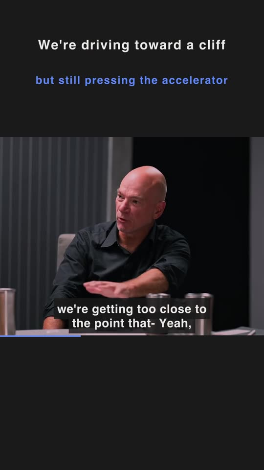

<div align="center">


# AutoClip

### Одна ссылка — один клик.

Открытый код, нарезка и рендер на вашем компьютере. Вставьте ссылку, выберите площадку и получите <b>видео, обложку и текст</b>,<br>
для Douyin, Xiaohongshu, TikTok, Reels, YouTube Shorts, Bilibili или YouTube.<br>
Приложение бесплатно; облачные модели оплачиваются по использованию. Результат можно поправить в редакторе.

<p>
  <a href="https://github.com/zhouxiaoka/autoclip/releases/latest"></a>
  <a href="https://github.com/zhouxiaoka/autoclip/stargazers"></a>
  <a href="https://github.com/zhouxiaoka/autoclip/releases"></a>
  <a href="../../LICENSE"></a>
</p>

<a href="https://trendshift.io/repositories/25801"></a>

**[Сайт](https://zhouxiaoka.github.io/autoclip_intro/)** · **[Скачать десктоп](https://github.com/zhouxiaoka/autoclip/releases/latest)** · [Кейсы](https://zhouxiaoka.github.io/autoclip_intro/cases/) · [Исследование](../research/2026-10-what-drives-views/article-en.md) · [Быстрый старт](#быстрый-старт) · [Документация](#документация) · [Ошибка](https://github.com/zhouxiaoka/autoclip/issues/new/choose)

[English](../../README.md) · [简体中文](README-ZH.md) · [繁體中文](README-ZH-TW.md) · [日本語](README-JA.md) · [한국어](README-KO.md) · [Español](README-ES.md) · [Português](README-PT.md) · **Русский** · [Français](README-FR.md) · [Bahasa Indonesia](README-ID.md) · [Türkçe](README-TR.md) · [Tiếng Việt](README-VI.md) · [Deutsch](README-DE.md)

</div>


**[Актуальный релиз](https://github.com/zhouxiaoka/autoclip/releases/latest)** — это то, что показывает `autoclip --version`, вместе с desktop, CLI и MCP. Автовыпуск, разбивка субтитров, кадрирование и очередь длинных видео описаны в [истории изменений](../../CHANGELOG.md). Обновите старые версии.

## Настоящие клипы

Нажмите на изображение или «Смотреть», чтобы открыть полный клип. Указан язык субтитров готового видео. Ниже шесть примеров; раскройте раздел, чтобы посмотреть ещё десять.

### Вертикальные · интервью и подкаст на весь экран

<table width="100%">
<tr>
<td align="center" valign="top" width="25%">
<a href="https://pub-3fb92949b9c2480b89feec5ec03f3540.r2.dev/cases/gates-ezra/01.mp4?v=2026-10-01g"></a><br>
<strong>Bill Gates</strong><br>
Интервью · Douyin · Китайский<br>
<a href="https://pub-3fb92949b9c2480b89feec5ec03f3540.r2.dev/cases/gates-ezra/01.mp4?v=2026-10-01g">▶ Смотреть 1:01</a> · <a href="https://www.youtube.com/watch?v=A_156w0aYtU">Оригинал</a>
</td>
<td align="center" valign="top" width="25%">
<a href="https://pub-3fb92949b9c2480b89feec5ec03f3540.r2.dev/cases/ai-labs-debate/01.mp4?v=2026-10-01g"></a><br>
<strong>AI Experts Debate</strong><br>
Интервью · Shorts · Английский<br>
<a href="https://pub-3fb92949b9c2480b89feec5ec03f3540.r2.dev/cases/ai-labs-debate/01.mp4?v=2026-10-01g">▶ Смотреть 1:25</a> · <a href="https://www.youtube.com/watch?v=OhOmLqR5nN4">Оригинал</a>
</td>
<td align="center" valign="top" width="25%">
<a href="https://pub-3fb92949b9c2480b89feec5ec03f3540.r2.dev/cases/robbins-36months/01.mp4?v=2026-10-01g"></a><br>
<strong>Tony Robbins</strong><br>
Подкаст на весь экран · Douyin · Китайский<br>
<a href="https://pub-3fb92949b9c2480b89feec5ec03f3540.r2.dev/cases/robbins-36months/01.mp4?v=2026-10-01g">▶ Смотреть 1:45</a> · <a href="https://www.youtube.com/watch?v=DuRcrbP3kag">Оригинал</a>
</td>
<td align="center" valign="top" width="25%">
<a href="https://pub-3fb92949b9c2480b89feec5ec03f3540.r2.dev/cases/garfield-poehler/01.mp4?v=2026-10-01g"></a><br>
<strong>Andrew Garfield × Amy Poehler</strong><br>
Подкаст на весь экран · Shorts · Английский<br>
<a href="https://pub-3fb92949b9c2480b89feec5ec03f3540.r2.dev/cases/garfield-poehler/01.mp4?v=2026-10-01g">▶ Смотреть 1:01</a> · <a href="https://www.youtube.com/watch?v=OJV8AaWCxQQ">Оригинал</a>
</td>
</tr>
</table>

### Горизонтальные · исходное кадрирование

<table width="100%">
<tr>
<td align="center" valign="top" width="50%">
<a href="https://pub-3fb92949b9c2480b89feec5ec03f3540.r2.dev/cases/luyu-tongliya/01.mp4?v=2026-10-01g"></a><br>
<strong>佟丽娅 × 鲁豫</strong><br>
Исходное кадрирование · Bilibili · Китайский<br>
<a href="https://pub-3fb92949b9c2480b89feec5ec03f3540.r2.dev/cases/luyu-tongliya/01.mp4?v=2026-10-01g">▶ Смотреть 1:41</a> · <a href="https://www.bilibili.com/video/BV1qheu6kEFV/">Оригинал</a>
</td>
<td align="center" valign="top" width="50%">
<a href="https://pub-3fb92949b9c2480b89feec5ec03f3540.r2.dev/cases/altman-uses-ai/01.mp4?v=2026-10-01g"></a><br>
<strong>Sam Altman</strong><br>
Исходное кадрирование · Bilibili · Китайский<br>
<a href="https://pub-3fb92949b9c2480b89feec5ec03f3540.r2.dev/cases/altman-uses-ai/01.mp4?v=2026-10-01g">▶ Смотреть 2:02</a> · <a href="https://www.youtube.com/watch?v=jZh55CQwSh8">Оригинал</a>
</td>
</tr>
</table>

<details>
<summary>Ещё 10 готовых клипов</summary>

<table width="100%">
<tr>
<td align="center" valign="top" width="25%">
<a href="https://pub-3fb92949b9c2480b89feec5ec03f3540.r2.dev/cases/neumann-doac/01.mp4?v=2026-10-01g"></a><br>
<strong>Adam Neumann</strong><br>
Подкаст на весь экран · TikTok · Английский<br>
<a href="https://pub-3fb92949b9c2480b89feec5ec03f3540.r2.dev/cases/neumann-doac/01.mp4?v=2026-10-01g">▶ Смотреть 0:59</a> · <a href="https://www.youtube.com/watch?v=IQ4JVWdj4Q0">Оригинал</a>
</td>
<td align="center" valign="top" width="25%">
<a href="https://pub-3fb92949b9c2480b89feec5ec03f3540.r2.dev/cases/luyu-xiaoqi/02.mp4?v=2026-10-01g"></a><br>
<strong>小奇 × 鲁豫</strong><br>
Интервью · Douyin · Китайский<br>
<a href="https://pub-3fb92949b9c2480b89feec5ec03f3540.r2.dev/cases/luyu-xiaoqi/02.mp4?v=2026-10-01g">▶ Смотреть 0:50</a> · <a href="https://www.bilibili.com/video/BV1ighy6AEPz/">Оригинал</a>
</td>
<td align="center" valign="top" width="25%">
<a href="https://pub-3fb92949b9c2480b89feec5ec03f3540.r2.dev/cases/luyu-guokeyu/01.mp4?v=2026-10-01g"></a><br>
<strong>郭柯宇 × 鲁豫</strong><br>
Интервью · Douyin · Китайский<br>
<a href="https://pub-3fb92949b9c2480b89feec5ec03f3540.r2.dev/cases/luyu-guokeyu/01.mp4?v=2026-10-01g">▶ Смотреть 1:11</a> · <a href="https://www.bilibili.com/video/BV1LDYV6HEXR/">Оригинал</a>
</td>
<td align="center" valign="top" width="25%">
<a href="https://pub-3fb92949b9c2480b89feec5ec03f3540.r2.dev/cases/dafoe-hot-ones/01.mp4?v=2026-10-01g"></a><br>
<strong>Willem Dafoe</strong><br>
Подкаст на весь экран · TikTok · Английский<br>
<a href="https://pub-3fb92949b9c2480b89feec5ec03f3540.r2.dev/cases/dafoe-hot-ones/01.mp4?v=2026-10-01g">▶ Смотреть 1:07</a> · <a href="https://www.youtube.com/watch?v=YqugY2zTIoI">Оригинал</a>
</td>
</tr>
<tr>
<td align="center" valign="top" width="25%">
<a href="https://pub-3fb92949b9c2480b89feec5ec03f3540.r2.dev/cases/tim-luoyonghao/01.mp4?v=2026-10-01g"></a><br>
<strong>TIM × 罗永浩</strong><br>
Интервью · Douyin · Китайский<br>
<a href="https://pub-3fb92949b9c2480b89feec5ec03f3540.r2.dev/cases/tim-luoyonghao/01.mp4?v=2026-10-01g">▶ Смотреть 1:05</a> · <a href="https://www.bilibili.com/video/BV1B5xkzPEhx/">Оригинал</a>
</td>
<td align="center" valign="top" width="25%">
<a href="https://pub-3fb92949b9c2480b89feec5ec03f3540.r2.dev/cases/jensen-dwarkesh/01.mp4?v=2026-10-01g"></a><br>
<strong>Jensen Huang</strong><br>
Интервью · Xiaohongshu · Китайский<br>
<a href="https://pub-3fb92949b9c2480b89feec5ec03f3540.r2.dev/cases/jensen-dwarkesh/01.mp4?v=2026-10-01g">▶ Смотреть 1:17</a> · <a href="https://www.youtube.com/watch?v=Hrbq66XqtCo">Оригинал</a>
</td>
<td align="center" valign="top" width="25%">
<a href="https://pub-3fb92949b9c2480b89feec5ec03f3540.r2.dev/cases/karpathy-dwarkesh/01.mp4?v=2026-10-01g"></a><br>
<strong>Andrej Karpathy</strong><br>
Интервью · Douyin · Китайский<br>
<a href="https://pub-3fb92949b9c2480b89feec5ec03f3540.r2.dev/cases/karpathy-dwarkesh/01.mp4?v=2026-10-01g">▶ Смотреть 0:43</a> · <a href="https://www.youtube.com/watch?v=lXUZvyajciY">Оригинал</a>
</td>
<td align="center" valign="top" width="25%">
<a href="https://pub-3fb92949b9c2480b89feec5ec03f3540.r2.dev/cases/apple-a20/01.mp4?v=2026-10-01g"></a><br>
<strong>A20 Pro</strong><br>
Интервью · Xiaohongshu · Китайский<br>
<a href="https://pub-3fb92949b9c2480b89feec5ec03f3540.r2.dev/cases/apple-a20/01.mp4?v=2026-10-01g">▶ Смотреть 2:00</a> · <a href="https://www.bilibili.com/video/BV1e4Y96FEaJ/">Оригинал</a>
</td>
</tr>
<tr>
<td align="center" valign="top" width="25%">
<a href="https://pub-3fb92949b9c2480b89feec5ec03f3540.r2.dev/cases/stallone-nyt/01.mp4?v=2026-10-01g"></a><br>
<strong>Sylvester Stallone</strong><br>
Интервью · Douyin · Китайский<br>
<a href="https://pub-3fb92949b9c2480b89feec5ec03f3540.r2.dev/cases/stallone-nyt/01.mp4?v=2026-10-01g">▶ Смотреть 1:39</a> · <a href="https://www.youtube.com/watch?v=ccs-B_nTfZs">Оригинал</a>
</td>
<td align="center" valign="top" width="25%">
<a href="https://pub-3fb92949b9c2480b89feec5ec03f3540.r2.dev/cases/mrbeast-colin-samir/01.mp4?v=2026-10-01g"></a><br>
<strong>MrBeast</strong><br>
Подкаст на весь экран · TikTok · Английский<br>
<a href="https://pub-3fb92949b9c2480b89feec5ec03f3540.r2.dev/cases/mrbeast-colin-samir/01.mp4?v=2026-10-01g">▶ Смотреть 1:42</a> · <a href="https://www.youtube.com/watch?v=9IQ_ldV9z_A">Оригинал</a>
</td>
<td></td>
<td></td>
</tr>
</table>

</details>

Видео, обложки и тексты публикаций доступны в **[библиотеке примеров →](https://zhouxiaoka.github.io/autoclip_intro/cases/?lang=ru)**. [Поделитесь своими клипами](https://github.com/zhouxiaoka/autoclip/discussions/new?category=show-and-tell). Права на исходные видео принадлежат их авторам; клипы показаны только для демонстрации.

## Что умеет

### Вставил ссылку — получил клипы

Генерация по формату и длительности площадки. Для каждой площадки автоматически создаётся до 10 лучших подходящих клипов; остальные — по запросу. В комплекте обложка, заголовок, описание, хештеги и ZIP.

### Упаковка встроена

Douyin / Xiaohongshu — интервью по умолчанию; TikTok / Reels / Shorts — полноэкранный подкаст. Вертикальный макет можно выбрать, язык субтитров и текста задаёт площадка. Bilibili / YouTube — горизонтальные. Кадр следует за говорящим, сцены без людей сохраняются целиком. Брендовый финал включён по умолчанию, отключается в настройках; в копируемом тексте нет подписи AutoClip.

### Остаётся на компьютере

Нарезка, кадрирование и рендер локальные. Выбирайте модель, авторские субтитры, локальный Whisper / SenseVoice или настроенную облачную транскрипцию. CLI / MCP используют тот же поток, что desktop.

## Время и стоимость на реальных видео

Три разных источника измерены во время разработки, не контролируемое сравнение одного входа. Стоимость оценена по тогдашнему использованию текстового qwen-plus, без облачного ASR, AI-изображений и публикации. Фактический счёт задаёт провайдер.

| Версия | Исходник | Выход | Оценка стоимости текстовой модели (CNY) |
| --- | --- | ---: | ---: |
| **Новая · есть субтитры** | Jensen · 1ч43м (EN → Xiaohongshu) | **7,5 мин / 10 клипов** | **¥0,09** |
| Новая · без субтитров | TIM × Ло Юнхао · 2ч52м (ZH → Douyin) | 29,5 мин / 10 клипов | ¥0,20 |
| Старая | MrBeast · 2ч06м (EN → TikTok) | 65 мин | ¥0,64 |

<details>
<summary>Условия и записи</summary>

1 октября 2026, тот же Apple Silicon Mac. Два новых запуска сделали 10 клипов; старый — 33. Различаются и исходники, и число результатов. Jensen использовал авторские субтитры; TIM — локальный Whisper base.

Авторские субтитры позволяют пропустить транскрипцию; иначе выбирайте локальный или облачный ASR. Дополнительные площадки и клипы увеличивают время и расход. [Измерения и расчёт](../COST_PER_VIDEO.md) (кит.).

</details>

## Выбирайте модели и поток данных

Нарезка и рендер на вашем компьютере. Облачный анализ отправляет нужные субтитры и текст; анализ изображения или генерация с референсом — необходимые кадры; облачная транскрипция — аудио. Локальные анализ и транскрипция не требуют соответствующего облачного API. Готовые клипы загружаются на подключённые площадки при выборе публикации. Аналитику и отчёты об ошибках можно выключить. [Конфиденциальность](../PRIVACY.en.md).

## Быстрый старт

| Задача | Способ | Нужно |
| --- | --- | --- |
| Делать клипы на этом ПК | **Десктоп** | macOS Apple Silicon или Windows x64 |
| Свой веб / Linux | **Docker** | Docker и Compose v2 |
| Пакеты / агенты | **CLI / MCP** | Python 3.10+ (лучше 3.11) и FFmpeg |

### Десктоп

1. **Установка.** Из [Releases](https://github.com/zhouxiaoka/autoclip/releases/latest). macOS Apple Silicon: `.dmg`. Windows 10 / 11 x64: `-setup.exe`. Python и FFmpeg уже внутри.
2. **Настройте модель.** Выберите провайдера и API Key, доступную модель анализа, проверьте соединение и сохраните. Для локальных моделей сначала загрузите модель и запустите Ollama / LM Studio.
3. **Ссылка и площадка.** Начните с интервью/подкаста с субтитрами и выберите вертикальный макет. Без субтитров подготовьте Whisper / SenseVoice или облачную транскрипцию в настройках.
4. **Проверьте и сохраните.** Проверьте субтитры, кадр и полноту содержания, затем скачайте комплект или подключите аккаунт для публикации. При необходимости создавайте резервные клипы.

Intel Mac / Linux могут использовать Docker или CLI. Десктопные установщики пока без цифровой подписи ([#119](https://github.com/zhouxiaoka/autoclip/issues/119)), поэтому Windows SmartScreen и антивирусы могут показывать предупреждение; все сборки выполняются публично в GitHub Actions (`Desktop Build`), а точные SHA-256 указаны в файле `build-provenance.json` релиза (также доступны Docker, CLI и сборка из исходников). Требования, первый запуск и объём проверки — в [руководстве](../USER_INSTALLATION_GUIDE.en.md) и [актуальный Release](https://github.com/zhouxiaoka/autoclip/releases/latest).

[Установка](../USER_INSTALLATION_GUIDE.en.md) · [Неполадки](../FAQ.en.md)

**CLI / MCP (Claude Code, Codex, OpenCode и скрипты)**

```bash
uvx autoclip-mcp
npx skills add zhouxiaoka/autoclip

autoclip --version
autoclip produce talk.mp4 --srt talk.srt --platform tiktok --portrait-style podcast --json
autoclip outputs PROJECT_ID --export-kits
```

<details>
<summary>Offline wheel, source install &amp; MCPB packaging</summary>

```bash
# Install from a downloaded CLI/MCP release ZIP wheel
python3 -m venv .venv && source .venv/bin/activate
python -m pip install -r requirements.txt
python -m pip install --force-reinstall --no-deps autoclip_mcp-*-py3-none-any.whl

# Or install from source
python -m pip install --no-deps .
```

To build a local MCPB bundle without publishing, run `python scripts/pack_mcpb.py` (never run `smithery mcp publish` automatically).

</details>


**Docker / Web**

```bash
git clone https://github.com/zhouxiaoka/autoclip.git
cd autoclip
cp env.example .env
mkdir -p data logs uploads
docker compose up -d --build
```

Откройте веб-интерфейс по адресу `http://localhost:3000` (документация API: `http://localhost:8000/docs`). Подробнее о правах томов и доменах — в [руководстве по Docker](../DOCKER.en.md).
## Модели

| Способ | Настройка |
| --- | --- |
| Облачный API | Провайдер и API Key в настройках. Совместимые с OpenAI принимают Base URL. |
| Ollama | Адрес по умолчанию `http://localhost:11434/v1`. Скачайте и запустите локальную модель, затем выберите модель, которую предоставляет сервер. API Key не нужен. |
| LM Studio | Загрузите модель и запустите Local Server, по умолчанию `http://localhost:1234/v1`. |

В Docker `localhost` — сам контейнер. Для модели на хосте укажите адрес, доступный из контейнера.

[Модели](../MULTI_LLM_PROVIDER_GUIDE.md) (кит.) · [Локально и контейнеры](../CLI_AND_MCP.md) (кит.)

## Благодарим спонсоров ❤️

<table>
  <tr>
    <td align="center" width="140">
      <a href="https://go.apimart.ai/tw-autoclip"></a><br>
      <a href="https://go.apimart.ai/tw-autoclip"><strong>APIMart</strong></a>
    </td>
    <td>
      Благодарим <strong>APIMart</strong> за поддержку этого проекта! <strong>APIMart</strong> — недорогая API-платформа для генерации изображений и видео с помощью ИИ: GPT-Image-2 от <strong>$0.006/image</strong>, более <strong>160</strong> изображений за один доллар. Один асинхронный API охватывает и изображения, и видео: отправьте задачу, получите ID и заберите результат опросом или через callback. Пакетная обработка десятков тысяч изображений без таймаутов, смена модели без изменения кода. Оплата по факту использования, без ежемесячной платы — <a href="https://go.apimart.ai/tw-autoclip">зарегистрируйтесь здесь</a>, чтобы начать.
    </td>
  </tr>
  </table>

## Частые вопросы

<details>
<summary>Это бесплатно? Нужен API Key?</summary>

Приложение бесплатно под MIT. Облачный анализ, транскрипция и AI-изображения используют ваши ключи и тарифы провайдера. Автообложка по умолчанию не вызывает платную генерацию. Ollama / LM Studio требуют железо, но не облачный ключ. Публикация — со своим Bilibili или [Upload-Post](https://www.upload-post.com).

</details>

<details>
<summary>Видео куда-то отправляется?</summary>

Нарезка и рендер на вашем компьютере. Облачный анализ отправляет нужные субтитры и текст; анализ изображения или генерация с референсом — необходимые кадры; облачная транскрипция — аудио. Локальные анализ и транскрипция не требуют соответствующего облачного API. Готовые клипы загружаются на подключённые площадки при выборе публикации. Аналитику и отчёты об ошибках можно выключить. [Конфиденциальность](../PRIVACY.en.md).

</details>

<details>
<summary>Какие видео подходят лучше?</summary>

Основные проверенные случаи — интервью, подкасты, курсы и речь. Авторские субтитры быстрее всего; иначе используйте локальную/облачную транскрипцию. Для игр или малого диалога включите анализ кадров с подходящей моделью и проверьте выбранные моменты.

</details>

<details>
<summary>Почему нет клипов?</summary>

Проверьте транскрипцию, соединение с моделью, FFmpeg, диск и условия площадки. Длинный YouTube требует цельных клипов от 180 секунд; для короткого источника выберите Shorts/Bilibili. Если ошибка остаётся, приложите версию из `autoclip --version`, OS, длительность, модель и очищенные логи в [известные проблемы](https://github.com/zhouxiaoka/autoclip/issues/96).

</details>

[Неполадки](../FAQ.en.md) · [Известные проблемы](https://github.com/zhouxiaoka/autoclip/issues/96)

## Документация

| Нужно | Документы |
| --- | --- |
| Установка и первые клипы | [Установка](../USER_INSTALLATION_GUIDE.en.md) |
| Свой хостинг и автоматизация | [Docker](../DOCKER.en.md) · [CLI / MCP](../CLI_AND_MCP.md) (кит.) · [Agent skill](../../skills/autoclip/SKILL.md) (кит.) · [OpenCode](../OPENCODE.en.md) |
| Модели и сбои | [Модели](../MULTI_LLM_PROVIDER_GUIDE.md) (кит.) · [FAQ](../FAQ.en.md) |
| Версии, план, приватность | [Changelog](../../CHANGELOG.md) · [План](../ROADMAP.md) (кит.) · [Доска](../COMMUNITY_BOARD.md) (кит.) · [Приватность](../PRIVACY.en.md) |
| Исследование | [Заметка №1](../research/2026-10-what-drives-views/article-en.md) · [中文](../research/2026-10-what-drives-views/article-zh.md) |
| Участие и перевод | [Вклад](../../CONTRIBUTING.md) (кит.) · [Переводы](../i18n.md) (кит.) |

## Участие

Правки, примеры, отзывы и переводы приветствуются. Если AutoClip помог — звезда кстати.

- **Общение:** [Discussions](https://github.com/zhouxiaoka/autoclip/discussions) · [Первый клип](https://github.com/zhouxiaoka/autoclip/discussions/128) · [Идеи](https://github.com/zhouxiaoka/autoclip/discussions/129)
- **Баги:** [форма](https://github.com/zhouxiaoka/autoclip/issues/new/choose) с ОС, версией, моделью, шагами и журналами без секретов
- **Партнёрство:** [christine_zhouye@163.com](mailto:christine_zhouye@163.com)

Ведёт один человек. Живой поддержки и личного деплоя нет.


Спасибо FastAPI, React, Tauri, FFmpeg, yt-dlp, Whisper, FunASR и всем, кто вкладывается. [MIT License](../../LICENSE).
