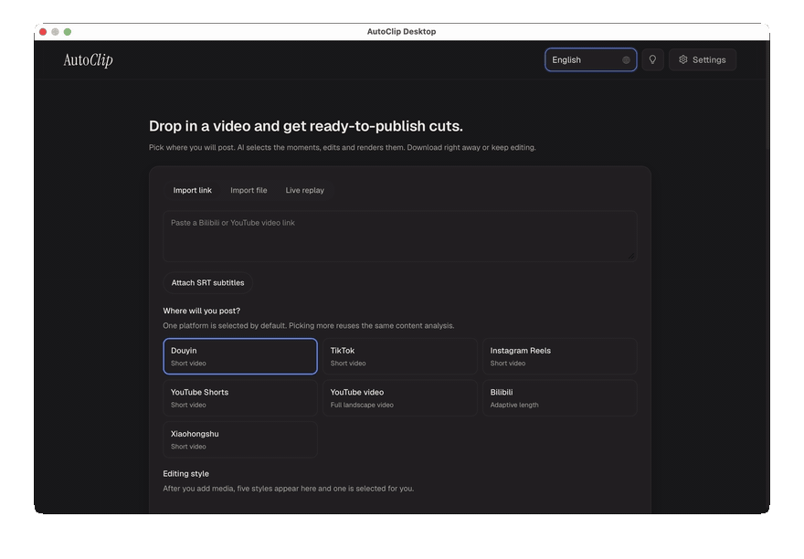
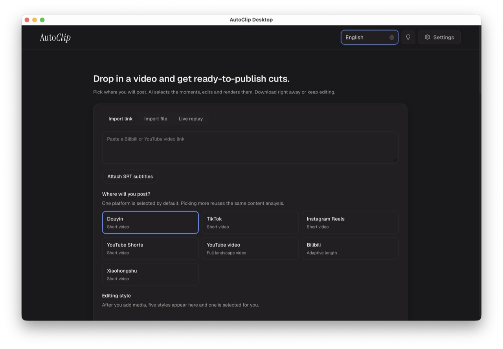
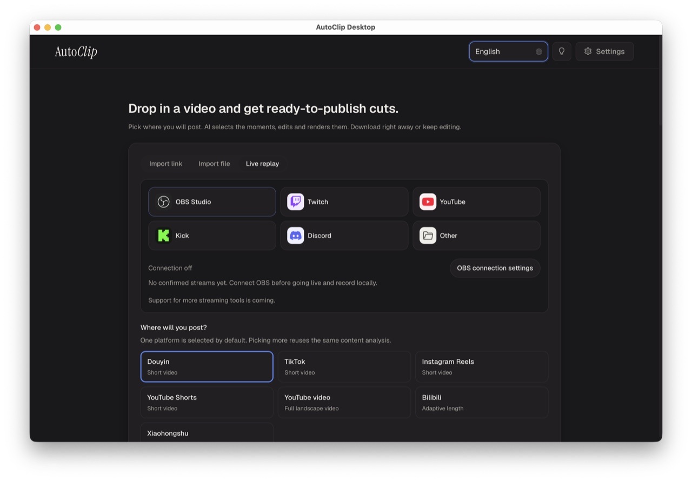
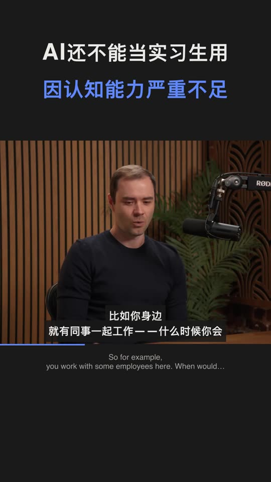

<!-- mcp-name: io.github.zhouxiaoka/autoclip-mcp -->

<div align="center">


# AutoClip

### เปลี่ยนวิดีโอ ลิงก์ หรือไลฟ์สตรีมใด ๆ ให้เป็นคลิปพร้อมโพสต์ได้ทันที

**ทางเลือกโอเพนซอร์สแทน OpusClip** — เครื่องมือตัดคลิปด้วย AI แบบรันบนเครื่องเป็นหลักสำหรับ **พอดแคสต์ บทสัมภาษณ์ และไลฟ์เกม** พร้อมระบบจัดเฟรมอัจฉริยะ ฝังคำบรรยาย สร้างภาพปก ตั้งพาดหัว และ **MCP ในตัวสำหรับ AI Agents** ไม่มีค่าสมาชิก ไม่มีเพย์วอลล์

<br>

<p>
  <a href="https://github.com/zhouxiaoka/autoclip/releases/latest"></a>&nbsp;
  <a href="https://github.com/zhouxiaoka/autoclip/stargazers"></a>&nbsp;
  <a href="https://github.com/zhouxiaoka/autoclip/releases"></a>&nbsp;
  &nbsp;
  <a href="../../LICENSE"></a>
</p>

<br>

<!-- hero-cta:start -->
<p>
  <a href="https://zhouxiaoka.github.io/autoclip_intro/"></a>&nbsp;&nbsp;
  <a href="https://trendshift.io/repositories/25801"></a>
</p>
<!-- hero-cta:end -->

<br>

<p>
  <a href="https://zhouxiaoka.github.io/autoclip_intro/"><strong>เว็บไซต์</strong></a>
  &nbsp;&middot;&nbsp;
  <a href="https://github.com/zhouxiaoka/autoclip/releases/latest"><strong>ดาวน์โหลด</strong></a>
  &nbsp;&middot;&nbsp;
  <a href="https://zhouxiaoka.github.io/autoclip_intro/features/game-streams/"><strong>รีเพลย์ไลฟ์ (v1.6)</strong></a>
  &nbsp;&middot;&nbsp;
  <a href="https://zhouxiaoka.github.io/autoclip_intro/cases/?lang=en"><strong>ตัวอย่างผลงาน</strong></a>
  &nbsp;&middot;&nbsp;
  <a href="#quick-start"><strong>เริ่มต้นใช้งาน</strong></a>
  &nbsp;&middot;&nbsp;
  <a href="#documentation"><strong>เอกสาร</strong></a>
  &nbsp;&middot;&nbsp;
  <a href="https://github.com/zhouxiaoka/autoclip/issues/new/choose"><strong>แจ้งปัญหา</strong></a>
</p>

<p>
  <a href="../../README.md">English</a> · <a href="README-ZH.md">简体中文</a> · <a href="README-ZH-TW.md">繁體中文</a> · <a href="README-JA.md">日本語</a> · <a href="README-KO.md">한국어</a> · <a href="README-ES.md">Español</a> · <a href="README-PT.md">Português</a> · <a href="README-RU.md">Русский</a> · <a href="README-FR.md">Français</a> · <a href="README-ID.md">Bahasa Indonesia</a> · <a href="README-TR.md">Türkçe</a> · <a href="README-VI.md">Tiếng Việt</a> · <a href="README-DE.md">Deutsch</a> · <a href="README-IT.md">Italiano</a> · <a href="README-PL.md">Polski</a> · <strong>ไทย</strong> · <a href="README-NL.md">Nederlands</a> · <a href="README-UK.md">Українська</a> · <a href="README-HI.md">हिन्दी</a> · <a href="README-AR.md">العربية</a>
</p>

<br>

<p>
  ⭐ <em>ฟรี สัญญาอนุญาต MIT ไม่มีค่าสมาชิกรายเดือน — ทุกขั้นตอนการตัดต่อและเรนเดอร์ทำงานบนเครื่องของคุณ กด Star ให้คลังโค้ดนี้ได้เลยหากเห็นว่ามีประโยชน์!</em>
</p>

<!-- top-sponsors:start -->
<table width="100%">
  <tr>
    <td align="center" width="50%">
      <a href="https://go.apimart.ai/tw-autoclip"></a><br>
      <a href="https://go.apimart.ai/tw-autoclip"><strong>APIMart</strong></a><br>
      <sub>Low-cost AI image &amp; video API · GPT-Image-2 from $0.006/img</sub>
    </td>
    <td align="center" width="50%">
      <a href="mailto:christine_zhouye@163.com?subject=AutoClip%20Sponsor%20%2F%20Provider%20Partnership"><strong>Sponsor / Partner with AutoClip</strong></a><br>
      <sub>Put your AI API or creator tool in front of AutoClip users worldwide (cloud dynamic provider listing supported, zero client release needed).<br><a href="mailto:christine_zhouye@163.com">christine_zhouye@163.com</a></sub>
    </td>
  </tr>
</table>
<!-- top-sponsors:end -->

</div>

---

## ภาพรวม

วางลิงก์ ไฟล์วิดีโอในเครื่อง หรือ **รีเพลย์ไลฟ์สตรีม** — AutoClip จะค้นหาช่วงเวลาที่ดีที่สุด ติดตามผู้พูด ฝังคำบรรยาย สร้างภาพปก และส่งออกคลิปพร้อมโพสต์สำหรับ TikTok, Shorts, Reels, YouTube, Douyin, Xiaohongshu และ Bilibili

**ออกแบบให้ทำงานบนเครื่องเป็นหลัก:** การตัดต่อและเรนเดอร์รันบนคอมพิวเตอร์ของคุณโดยตรง ไม่มีคิวอัปโหลดและไม่มีค่าบริการรายเดือน นำ API Key ของคุณมาใช้เอง หรือรันแบบออฟไลน์ 100% ด้วย **Ollama / LM Studio + Whisper / SenseVoice**



<p align="center"><em>หน้าแรก → แหล่งรีเพลย์ไลฟ์ 6 ช่องทาง → ตั้งค่า OBS WebSocket → นำเข้าจาก Twitch → คลิปสำเร็จรูปพร้อมคำบรรยายและเผยแพร่ในคลิกเดียว</em></p>

---

## มีอะไรใหม่ใน v1.6

| ฟีเจอร์ | รายละเอียด |
| :--- | :--- |
| **แหล่งรีเพลย์ไลฟ์ 6 ช่องทาง** | แท็บ **รีเพลย์ไลฟ์** เฉพาะทาง รองรับ **OBS Studio, Twitch, YouTube, Kick, Discord และไฟล์บันทึกในเครื่อง** |
| **จับภาพอัตโนมัติจาก OBS** | เชื่อมต่อ OBS WebSocket (`4455`) ตัดแบบไม่สูญเสียคุณภาพ (`-c copy`) และจัดคิวสร้างคลิปอัตโนมัติทันทีที่จบสตรีม |
| **ไฮไลต์เกม** | ระบบตรวจจับไฮไลต์เกมแบบทั่วไป รองรับช็อตเดี่ยวความยาว **8 วินาทีขึ้นไป** พร้อมควบคุมงบประมาณวิชัน/OCR ให้กระชับยิ่งขึ้น |
| **ปรับแพลตฟอร์มในคลิกเดียว** | การ์ดคลิปที่เล่นได้ในตัว — สลับแพลตฟอร์มเป้าหมายได้ในคลิกเดียวโดยไม่สูญเสียไฟล์ที่ส่งออกไว้ก่อนหน้า |
| **รองรับ 13 ภาษา** | อินเทอร์เฟซเดสก์ท็อป เมนูถาดระบบ และเอกสารครบถ้วนใน 13 ภาษา (`+ zh-TW, de, id, tr, vi`) พร้อมคำบรรยายภาษาอาหรับแบบ RTL |

<details>
<summary>📸 ภาพหน้าจอภายในแอป (5 ภาพ)</summary>

<table width="100%">
<tr>
<td align="center" valign="top" width="50%">
<br>
<em>หน้าแรก — นำเข้าจากลิงก์ นำเข้าไฟล์ และรีเพลย์ไลฟ์</em>
</td>
<td align="center" valign="top" width="50%">
<br>
<em>รีเพลย์ไลฟ์ — 6 ช่องทางรีเพลย์</em>
</td>
</tr>
<tr>
<td align="center" valign="top" width="50%">
<br>
<em>การตั้งค่า OBS Studio WebSocket ในหน้าเดียว</em>
</td>
<td align="center" valign="top" width="50%">
<br>
<em>นำเข้าจาก Twitch และตัวเลือกไฟล์บันทึกในเครื่อง</em>
</td>
</tr>
<tr>
<td align="center" valign="top" colspan="2">
<br>
<em>คลิปสำเร็จรูป — ระบุแหล่งที่มา ครอป 9:16 คำบรรยาย และปุ่ม ดาวน์โหลด / เผยแพร่ / ทำใหม่ ในคลิกเดียว</em>
</td>
</tr>
</table>

</details>

---

## ตัวอย่างผลงาน

คลิกภาพขนาดย่อหรือ **▶ เล่น** เพื่อรับชมคลิปเต็มที่เรนเดอร์โดย AutoClip ป้ายภาษาระบุภาษาของคำบรรยายที่ฝังในวิดีโอ

### แนวตั้ง · บทสัมภาษณ์และพอดแคสต์

<table width="100%">
<tr>
<td align="center" valign="top" width="25%">
<a href="https://pub-3fb92949b9c2480b89feec5ec03f3540.r2.dev/cases/gates-ezra/01.mp4?v=2026-10-01g"></a><br>
<strong>Bill Gates</strong><br>
สัมภาษณ์ · Douyin · ZH<br>
<a href="https://pub-3fb92949b9c2480b89feec5ec03f3540.r2.dev/cases/gates-ezra/01.mp4?v=2026-10-01g">▶ เล่น 1:01</a> · <a href="https://www.youtube.com/watch?v=A_156w0aYtU">ต้นฉบับ</a>
</td>
<td align="center" valign="top" width="25%">
<a href="https://pub-3fb92949b9c2480b89feec5ec03f3540.r2.dev/cases/ai-labs-debate/01.mp4?v=2026-10-01g"></a><br>
<strong>AI Experts Debate</strong><br>
สัมภาษณ์ · Shorts · EN<br>
<a href="https://pub-3fb92949b9c2480b89feec5ec03f3540.r2.dev/cases/ai-labs-debate/01.mp4?v=2026-10-01g">▶ เล่น 1:25</a> · <a href="https://www.youtube.com/watch?v=OhOmLqR5nN4">ต้นฉบับ</a>
</td>
<td align="center" valign="top" width="25%">
<a href="https://pub-3fb92949b9c2480b89feec5ec03f3540.r2.dev/cases/robbins-36months/01.mp4?v=2026-10-01g"></a><br>
<strong>Tony Robbins</strong><br>
พอดแคสต์ · Douyin · ZH<br>
<a href="https://pub-3fb92949b9c2480b89feec5ec03f3540.r2.dev/cases/robbins-36months/01.mp4?v=2026-10-01g">▶ เล่น 1:45</a> · <a href="https://www.youtube.com/watch?v=DuRcrbP3kag">ต้นฉบับ</a>
</td>
<td align="center" valign="top" width="25%">
<a href="https://pub-3fb92949b9c2480b89feec5ec03f3540.r2.dev/cases/garfield-poehler/01.mp4?v=2026-10-01g"></a><br>
<strong>Garfield × Poehler</strong><br>
พอดแคสต์ · Shorts · EN<br>
<a href="https://pub-3fb92949b9c2480b89feec5ec03f3540.r2.dev/cases/garfield-poehler/01.mp4?v=2026-10-01g">▶ เล่น 1:01</a> · <a href="https://www.youtube.com/watch?v=OJV8AaWCxQQ">ต้นฉบับ</a>
</td>
</tr>
</table>

### แนวนอน · สัดส่วนภาพต้นฉบับ

<table width="100%">
<tr>
<td align="center" valign="top" width="50%">
<a href="https://pub-3fb92949b9c2480b89feec5ec03f3540.r2.dev/cases/luyu-tongliya/01.mp4?v=2026-10-01g"></a><br>
<strong>佟丽娅 × 鲁豫</strong> · 16:9 · Bilibili · ZH<br>
<a href="https://pub-3fb92949b9c2480b89feec5ec03f3540.r2.dev/cases/luyu-tongliya/01.mp4?v=2026-10-01g">▶ เล่น 1:41</a> · <a href="https://www.bilibili.com/video/BV1qheu6kEFV/">ต้นฉบับ</a>
</td>
<td align="center" valign="top" width="50%">
<a href="https://pub-3fb92949b9c2480b89feec5ec03f3540.r2.dev/cases/altman-uses-ai/01.mp4?v=2026-10-01g"></a><br>
<strong>Sam Altman</strong> · 16:9 · Bilibili · ZH<br>
<a href="https://pub-3fb92949b9c2480b89feec5ec03f3540.r2.dev/cases/altman-uses-ai/01.mp4?v=2026-10-01g">▶ เล่น 2:02</a> · <a href="https://www.youtube.com/watch?v=jZh55CQwSh8">ต้นฉบับ</a>
</td>
</tr>
</table>

<details>
<summary>ดูคลิปเพิ่มเติมอีก 10 รายการ</summary>

<table width="100%">
<tr>
<td align="center" valign="top" width="25%">
<a href="https://pub-3fb92949b9c2480b89feec5ec03f3540.r2.dev/cases/neumann-doac/01.mp4?v=2026-10-01g"></a><br>
<strong>Adam Neumann</strong><br>
พอดแคสต์ · TikTok · EN<br>
<a href="https://pub-3fb92949b9c2480b89feec5ec03f3540.r2.dev/cases/neumann-doac/01.mp4?v=2026-10-01g">▶ เล่น 0:59</a> · <a href="https://www.youtube.com/watch?v=IQ4JVWdj4Q0">ต้นฉบับ</a>
</td>
<td align="center" valign="top" width="25%">
<a href="https://pub-3fb92949b9c2480b89feec5ec03f3540.r2.dev/cases/luyu-xiaoqi/02.mp4?v=2026-10-01g"></a><br>
<strong>小奇 × 鲁豫</strong><br>
สัมภาษณ์ · Douyin · ZH<br>
<a href="https://pub-3fb92949b9c2480b89feec5ec03f3540.r2.dev/cases/luyu-xiaoqi/02.mp4?v=2026-10-01g">▶ เล่น 0:50</a> · <a href="https://www.bilibili.com/video/BV1ighy6AEPz/">ต้นฉบับ</a>
</td>
<td align="center" valign="top" width="25%">
<a href="https://pub-3fb92949b9c2480b89feec5ec03f3540.r2.dev/cases/luyu-guokeyu/01.mp4?v=2026-10-01g"></a><br>
<strong>郭柯宇 × 鲁豫</strong><br>
สัมภาษณ์ · Douyin · ZH<br>
<a href="https://pub-3fb92949b9c2480b89feec5ec03f3540.r2.dev/cases/luyu-guokeyu/01.mp4?v=2026-10-01g">▶ เล่น 1:11</a> · <a href="https://www.bilibili.com/video/BV1LDYV6HEXR/">ต้นฉบับ</a>
</td>
<td align="center" valign="top" width="25%">
<a href="https://pub-3fb92949b9c2480b89feec5ec03f3540.r2.dev/cases/dafoe-hot-ones/01.mp4?v=2026-10-01g"></a><br>
<strong>Willem Dafoe</strong><br>
พอดแคสต์ · TikTok · EN<br>
<a href="https://pub-3fb92949b9c2480b89feec5ec03f3540.r2.dev/cases/dafoe-hot-ones/01.mp4?v=2026-10-01g">▶ เล่น 1:07</a> · <a href="https://www.youtube.com/watch?v=YqugY2zTIoI">ต้นฉบับ</a>
</td>
</tr>
<tr>
<td align="center" valign="top" width="25%">
<a href="https://pub-3fb92949b9c2480b89feec5ec03f3540.r2.dev/cases/tim-luoyonghao/01.mp4?v=2026-10-01g"></a><br>
<strong>TIM × 罗永浩</strong><br>
สัมภาษณ์ · Douyin · ZH<br>
<a href="https://pub-3fb92949b9c2480b89feec5ec03f3540.r2.dev/cases/tim-luoyonghao/01.mp4?v=2026-10-01g">▶ เล่น 1:05</a> · <a href="https://www.bilibili.com/video/BV1B5xkzPEhx/">ต้นฉบับ</a>
</td>
<td align="center" valign="top" width="25%">
<a href="https://pub-3fb92949b9c2480b89feec5ec03f3540.r2.dev/cases/jensen-dwarkesh/01.mp4?v=2026-10-01g"></a><br>
<strong>Jensen Huang</strong><br>
สัมภาษณ์ · Xiaohongshu · ZH<br>
<a href="https://pub-3fb92949b9c2480b89feec5ec03f3540.r2.dev/cases/jensen-dwarkesh/01.mp4?v=2026-10-01g">▶ เล่น 1:17</a> · <a href="https://www.youtube.com/watch?v=Hrbq66XqtCo">ต้นฉบับ</a>
</td>
<td align="center" valign="top" width="25%">
<a href="https://pub-3fb92949b9c2480b89feec5ec03f3540.r2.dev/cases/karpathy-dwarkesh/01.mp4?v=2026-10-01g"></a><br>
<strong>Andrej Karpathy</strong><br>
สัมภาษณ์ · Douyin · ZH<br>
<a href="https://pub-3fb92949b9c2480b89feec5ec03f3540.r2.dev/cases/karpathy-dwarkesh/01.mp4?v=2026-10-01g">▶ เล่น 0:43</a> · <a href="https://www.youtube.com/watch?v=lXUZvyajciY">ต้นฉบับ</a>
</td>
<td align="center" valign="top" width="25%">
<a href="https://pub-3fb92949b9c2480b89feec5ec03f3540.r2.dev/cases/apple-a20/01.mp4?v=2026-10-01g"></a><br>
<strong>A20 Pro</strong><br>
สัมภาษณ์ · Xiaohongshu · ZH<br>
<a href="https://pub-3fb92949b9c2480b89feec5ec03f3540.r2.dev/cases/apple-a20/01.mp4?v=2026-10-01g">▶ เล่น 2:00</a> · <a href="https://www.bilibili.com/video/BV1e4Y96FEaJ/">ต้นฉบับ</a>
</td>
</tr>
<tr>
<td align="center" valign="top" width="25%">
<a href="https://pub-3fb92949b9c2480b89feec5ec03f3540.r2.dev/cases/stallone-nyt/01.mp4?v=2026-10-01g"></a><br>
<strong>Sylvester Stallone</strong><br>
สัมภาษณ์ · Douyin · ZH<br>
<a href="https://pub-3fb92949b9c2480b89feec5ec03f3540.r2.dev/cases/stallone-nyt/01.mp4?v=2026-10-01g">▶ เล่น 1:39</a> · <a href="https://www.youtube.com/watch?v=ccs-B_nTfZs">ต้นฉบับ</a>
</td>
<td align="center" valign="top" width="25%">
<a href="https://pub-3fb92949b9c2480b89feec5ec03f3540.r2.dev/cases/mrbeast-colin-samir/01.mp4?v=2026-10-01g"></a><br>
<strong>MrBeast</strong><br>
พอดแคสต์ · TikTok · EN<br>
<a href="https://pub-3fb92949b9c2480b89feec5ec03f3540.r2.dev/cases/mrbeast-colin-samir/01.mp4?v=2026-10-01g">▶ เล่น 1:42</a> · <a href="https://www.youtube.com/watch?v=9IQ_ldV9z_A">ต้นฉบับ</a>
</td>
<td></td>
<td></td>
</tr>
</table>

</details>

ดูคลิป ภาพปก และข้อความโพสต์เพิ่มเติมกว่า 16+ รายการได้ที่ **[คลังตัวอย่างผลงาน →](https://zhouxiaoka.github.io/autoclip_intro/cases/?lang=en)** หรือ [แชร์คลิปของคุณเอง](https://github.com/zhouxiaoka/autoclip/discussions/new?category=show-and-tell) ลิขสิทธิ์ของวิดีโอต้นฉบับยังคงเป็นของผู้สร้างสรรค์เดิม

---

<a id="quick-start"></a>

## เริ่มต้นใช้งานอย่างรวดเร็ว

| รูปแบบการใช้งาน | การติดตั้งที่แนะนำ | ความต้องการระบบ |
| :--- | :--- | :--- |
| **แอปเดสก์ท็อป (ง่ายที่สุด)** | ดาวน์โหลด `.dmg` / `-setup.exe` จาก [Releases](https://github.com/zhouxiaoka/autoclip/releases/latest) | Apple Silicon macOS หรือ Windows 10/11 x64 (มี Python และ FFmpeg ในตัว) |
| **AI Agents / CLI / MCP** | `uvx autoclip-mcp` หรือ `npx skills add zhouxiaoka/autoclip` | Python 3.10+ (แนะนำ 3.11) และ FFmpeg |
| **โฮสต์เอง / Linux / Intel Mac** | `docker compose up -d --build` | Docker และ Compose v2 |

### 1. แอปเดสก์ท็อป

1. ดาวน์โหลดตัวติดตั้งล่าสุดจาก **[GitHub Releases](https://github.com/zhouxiaoka/autoclip/releases/latest)** (`aarch64.dmg` สำหรับ Apple Silicon macOS, `x64-setup.exe` สำหรับ Windows) โดยมาพร้อม Python แบบพกพาและ FFmpeg ในตัว
2. เปิด **การตั้งค่า** เลือกผู้ให้บริการคลาวด์ (หรือเริ่มใช้งาน Ollama / LM Studio) ทดสอบการเชื่อมต่อแล้วบันทึก — หรือคลิก **ลองดูโปรเจกต์ตัวอย่างในตัว** ได้โดยไม่ต้องใช้ API Key
3. วางลิงก์วิดีโอ ลากไฟล์มาใส่ หรือสลับไปยัง **รีเพลย์ไลฟ์** เพื่อเชื่อมต่อ OBS หรือนำเข้าไฟล์บันทึกสตรีม เลือกแพลตฟอร์มที่ต้องการแล้วกด **สร้าง**

> ตัวติดตั้งทั้งหมดถูกสร้างแบบสาธารณะบน GitHub Actions (`Desktop Build`) พร้อมไฟล์ `build-provenance.json` สำหรับตรวจสอบค่าแฮช SHA-256 สำหรับการเปิดใช้งานครั้งแรกบนบิลด์ที่ยังไม่ได้ลงนาม: บน **macOS** ให้รัน `xattr -dr com.apple.quarantine "/Applications/AutoClip Desktop.app"` (หรือไปที่ *การตั้งค่าระบบ → ความเป็นส่วนตัวและความปลอดภัย → เปิดต่อไป*); บน **Windows** ให้คลิก **ข้อมูลเพิ่มเติม → เรียกใช้ต่อไป** บนหน้าต่าง SmartScreen ดูรายละเอียดเพิ่มเติมที่ **[นโยบายการลงนามและตรวจสอบโค้ด](../../CODE_SIGNING.md)** (ติดตามความคืบหน้าการรับรองได้ที่ [#119](https://github.com/zhouxiaoka/autoclip/issues/119))

### 2. CLI และ MCP (Claude Code, Cursor, Codex, OpenCode และสคริปต์)

ให้ AI coding agents ตัดคลิปวิดีโอจากเทอร์มินัลของคุณได้โดยตรง (`claude mcp add autoclip -- uvx autoclip-mcp`) คู่มือการตั้งค่า MCP ฉบับเต็ม: **[English](../MCP.en.md)** · [简体中文](../CLI_AND_MCP.md) · [日本語](../MCP.ja.md) · [한국어](../MCP.ko.md) · [Español](../MCP.es.md) · [Deutsch](../MCP.de.md)

```bash
uvx autoclip-mcp
npx skills add zhouxiaoka/autoclip

autoclip --version
autoclip produce talk.mp4 --srt talk.srt --platform tiktok --portrait-style podcast --json
autoclip outputs PROJECT_ID --export-kits
```

<details>
<summary>การติดตั้งจาก Wheel แบบออฟไลน์, ซอร์สโค้ด และการแพ็ก MCPB</summary>

```bash
# Install from a downloaded CLI/MCP release ZIP wheel
python3 -m venv .venv && source .venv/bin/activate
python -m pip install -r requirements.txt
python -m pip install --force-reinstall --no-deps autoclip_mcp-*-py3-none-any.whl

# Or install from source
python -m pip install --no-deps .
```

หากต้องการสร้างแพ็กเกจ MCPB บนเครื่องโดยไม่เผยแพร่ ให้รัน `python scripts/pack_mcpb.py` (ห้ามรัน `smithery mcp publish` โดยอัตโนมัติ)

</details>


### 3. Docker / เว็บ

```bash
git clone https://github.com/zhouxiaoka/autoclip.git
cd autoclip
cp env.example .env
mkdir -p data logs uploads
docker compose up -d --build
```

เปิด Web UI ได้ที่ `http://localhost:3000` (เอกสาร API ที่ `http://localhost:8000/docs`) ดู [คู่มือ Docker](../DOCKER.en.md) สำหรับสิทธิ์ของ bind-mount และการตั้งค่าโดเมน/origin แบบกำหนดเอง

---

## ผลทดสอบเวลาและค่าใช้จ่าย

วัดผลบนเครื่อง Apple Silicon Mac (ประมาณการค่าใช้จ่าย LLM ด้วย `qwen-plus` ไม่รวม ASR บนคลาวด์และการสร้างภาพด้วย AI โปรดตรวจสอบใบแจ้งหนี้จากผู้ให้บริการเพื่อยอดจริง):

| ข้อมูลนำเข้า | ต้นฉบับ | เวลาและผลลัพธ์ | ค่า LLM โดยประมาณ |
| :--- | :--- | ---: | ---: |
| **มีคำบรรยายอยู่แล้ว** | Jensen Huang · 1 ชม. 43 นาที (EN → Xiaohongshu) | **7.5 นาที / 10 คลิป** | **¥0.09** |
| **ไม่มีคำบรรยาย (Whisper บนเครื่อง)** | TIM × Luo Yonghao · 2 ชม. 52 นาที (ZH → Douyin) | 29.5 นาที / 10 คลิป | ¥0.20 |

---

## ผู้สนับสนุน ❤️

<table>
  <tr>
    <td align="center" width="140">
      <a href="https://go.apimart.ai/tw-autoclip"></a><br>
      <a href="https://go.apimart.ai/tw-autoclip"><strong>APIMart</strong></a>
    </td>
    <td>
      ขอขอบคุณ <strong>APIMart</strong> ที่สนับสนุน AutoClip! <strong>APIMart</strong> คือแพลตฟอร์ม API ราคาประหยัดสำหรับการสร้างภาพและวิดีโอด้วย AI — GPT-Image-2 เริ่มต้นที่ <strong>$0.006/ภาพ</strong> (ได้มากกว่า <strong>160+</strong> ภาพต่อดอลลาร์) ใช้ Async API เดียวครอบคลุมทั้งภาพและวิดีโอ: ส่งงาน รับ ID แล้วดึงผลลัพธ์ผ่าน polling หรือ callback ประมวลผลภาพนับหมื่นได้พร้อมกันโดยไม่หมดเวลา และสลับโมเดลได้โดยไม่ต้องแก้โค้ด จ่ายตามจริง ไม่มีค่าบริการรายเดือน — <a href="https://go.apimart.ai/tw-autoclip">สมัครใช้งานที่นี่</a>
    </td>
  </tr>
</table>

## การถอดเสียงบนคลาวด์ (Alibaba Cloud)

*ลิงก์แนะนำ (แยกส่วนจากผู้สนับสนุนด้านบน):* สมัครใช้งาน Alibaba Cloud สร้าง API Key ในคอนโซล Bailian แล้วเปิดใช้งาน Bailian cloud ASR ได้ที่ **การตั้งค่า → โมเดลเริ่มต้น → เสียงเป็นคำบรรยาย**

1. [สมัครใช้งาน Alibaba Cloud](https://www.aliyun.com/benefit?userCode=qmyj6jch) (ลิงก์แนะนำ)
2. [คอนโซล Bailian](https://bailian.console.aliyun.com/) — สร้าง API Key ของคุณ

---

## คำถามที่พบบ่อย (FAQ)

<details>
<summary>AutoClip ใช้งานฟรีหรือไม่? จำเป็นต้องมี API Key หรือไม่?</summary>

ฟรี — AutoClip เปิดให้ใช้งานฟรีภายใต้สัญญาอนุญาต MIT การวิเคราะห์บนคลาวด์ การถอดเสียงบนคลาวด์ และภาพปก AI จะใช้ API Key ของคุณเองตามอัตราค่าบริการของผู้ให้บริการ (การจัดวางภาพปกบนเครื่องใช้งานได้ฟรีเป็นค่าเริ่มต้น) ส่วน Ollama และ LM Studio ไม่ต้องใช้คีย์คลาวด์ การเผยแพร่โดยตรงจะใช้บัญชี Bilibili หรือ [Upload-Post](https://www.upload-post.com) ของคุณเอง

</details>

<details>
<summary>วิดีโอของฉันจะถูกอัปโหลดขึ้นคลาวด์หรือไม่?</summary>

การตัดต่อและเรนเดอร์ทำงานบนเครื่องของคุณ การวิเคราะห์บนคลาวด์จะส่งเฉพาะข้อความคำบรรยาย โมเดลวิชันจะรับเฉพาะเฟรมภาพที่สุ่มตัวอย่าง และ ASR บนคลาวด์จะอัปโหลดเฉพาะเสียง การใช้โมเดล LLM บนเครื่องร่วมกับ Whisper / SenseVoice จะทำให้ทุกขั้นตอนทำงานแบบออฟไลน์ทั้งหมด สถิติการใช้งานและรายงานข้อผิดพลาดสามารถปิดได้ในการตั้งค่า ดูรายละเอียดที่ [นโยบายความเป็นส่วนตัว](../PRIVACY.en.md)

</details>

<details>
<summary>วิดีโอประเภทใดให้ผลลัพธ์ดีที่สุด?</summary>

พอดแคสต์ บทสัมภาษณ์ งานเสวนา คอร์สเรียน และรีเพลย์ไลฟ์เกม (OBS / Twitch / YouTube / Kick / Discord) วิดีโอที่มีคำบรรยายอยู่แล้วจะประมวลผลได้เร็วที่สุด หากไม่มีสามารถใช้ Whisper / SenseVoice บนเครื่อง หรือ ASR บนคลาวด์ สำหรับวิดีโอเกมเพลย์หรือสตรีมที่มีบทสนทนาน้อย แนะนำให้เปิดใช้โมเดลที่รองรับการวิเคราะห์ภาพ

</details>

<details>
<summary>ทำไมถึงไม่มีคลิปถูกสร้างขึ้นมา?</summary>

ตรวจสอบขั้นตอนที่ล้มเหลว: คำบรรยาย/การถอดเสียง การเชื่อมต่อโมเดล FFmpeg พื้นที่ดิสก์ หรือข้อกำหนดความยาวของแพลตฟอร์ม (วิดีโอยาวของ YouTube ต้องมีความยาว ≥180 วินาที ให้ใช้ Shorts, TikTok หรือ Bilibili สำหรับคลิปที่สั้นกว่า) หากยังไม่สำเร็จ โปรดเปิด Issue พร้อมแนบ `autoclip --version`, ระบบปฏิบัติการ, โมเดล และไฟล์ log ที่ตัดข้อมูลสำคัญออกแล้ว หรือตรวจสอบที่ [ปัญหาที่ทราบ (#96)](https://github.com/zhouxiaoka/autoclip/issues/96)

</details>

[คู่มือแก้ไขปัญหา](../FAQ.en.md) · [ปัญหาที่ทราบ](https://github.com/zhouxiaoka/autoclip/issues/96)

---

<a id="documentation"></a>

## เอกสารประกอบ

| หัวข้อ | คู่มือ |
| :--- | :--- |
| การติดตั้งและคลิปแรก | [คู่มือการติดตั้ง](../USER_INSTALLATION_GUIDE.en.md) |
| การโฮสต์เองและ Agents | [Docker](../DOCKER.en.md) · [MCP และ AI Agents](../MCP.en.md) ([ZH](../CLI_AND_MCP.md) · [JA](../MCP.ja.md) · [KO](../MCP.ko.md) · [ES](../MCP.es.md) · [DE](../MCP.de.md)) · [Agent Skill](../../skills/autoclip/SKILL.md) (ZH) · [OpenCode](../OPENCODE.en.md) |
| โมเดลและการแก้ไขปัญหา | [การตั้งค่าหลาย LLM](../MULTI_LLM_PROVIDER_GUIDE.md) (ZH) · [FAQ](../FAQ.en.md) |
| รีลีสและความเป็นส่วนตัว | [บันทึกการเปลี่ยนแปลง](../../CHANGELOG.md) · [การลงนามโค้ด](../../CODE_SIGNING.md) · [แผนพัฒนา](../ROADMAP.md) (ZH) · [กระดานชุมชน](../COMMUNITY_BOARD.md) (ZH) · [ความเป็นส่วนตัว](../PRIVACY.en.md) |
| บทความวิจัย | [Pick the Moment, Not the Effect](../research/2026-10-what-drives-views/article-en.md) · [中文](../research/2026-10-what-drives-views/article-zh.md) |
| การมีส่วนร่วมและแปลภาษา | [แนวทางการมีส่วนร่วม](../../CONTRIBUTING.md) (ZH) · [การแปล AutoClip](../../TRANSLATING.md) · [คู่มือการแปล](../i18n.md) (ZH) |

## ร่วมพัฒนาโครงการ

ยินดีต้อนรับทุก PR รายงานบั๊ก คลิปตัวอย่าง และงานแปล หาก AutoClip ช่วยประหยัดเวลาให้คุณ กด ⭐ Star ให้โปรเจกต์เพื่อเป็นกำลังใจได้เลย!

- **ชุมชน:** [GitHub Discussions](https://github.com/zhouxiaoka/autoclip/discussions) · [ถาม-ตอบคลิปแรก](https://github.com/zhouxiaoka/autoclip/discussions/128) · [เสนอไอเดียฟีเจอร์](https://github.com/zhouxiaoka/autoclip/discussions/129)
- **รายงานบั๊ก:** ใช้ [เทมเพลต Issue](https://github.com/zhouxiaoka/autoclip/issues/new/choose) พร้อมระบุระบบปฏิบัติการ เวอร์ชัน โมเดล ขั้นตอนการจำลองปัญหา และ log ที่ลบข้อมูลสำคัญออกแล้ว
- **ความร่วมมือและพาร์ตเนอร์:** [christine_zhouye@163.com](mailto:christine_zhouye@163.com)

AutoClip ดูแลโดยผู้พัฒนาเพียงคนเดียว — การตอบกลับอาจใช้เวลาสักครู่ (ไม่มีบริการซัพพอร์ตแบบสดหรือแบบตัวต่อตัว)


สร้างด้วย FastAPI, React, Tauri, FFmpeg, yt-dlp, Whisper และ FunASR ภายใต้ [สัญญาอนุญาต MIT](../../LICENSE)
