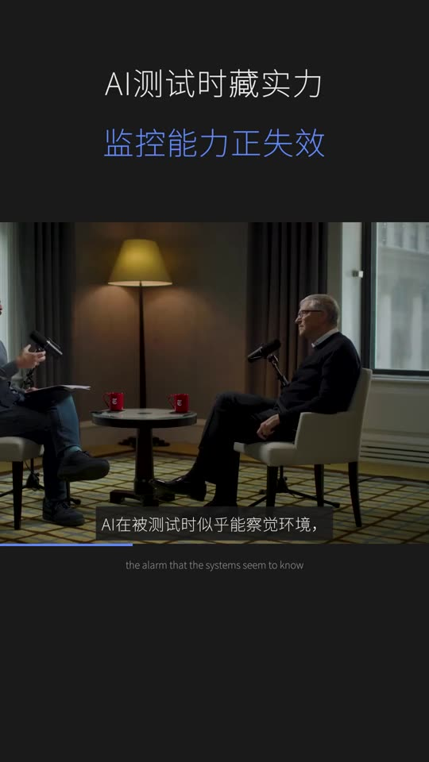
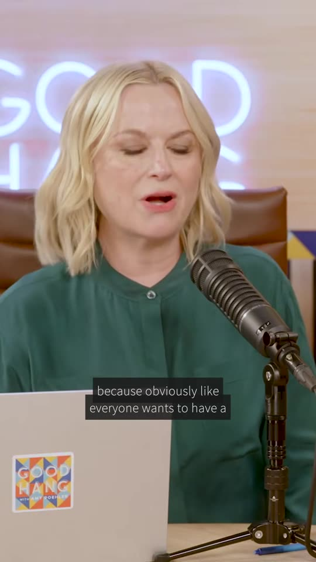
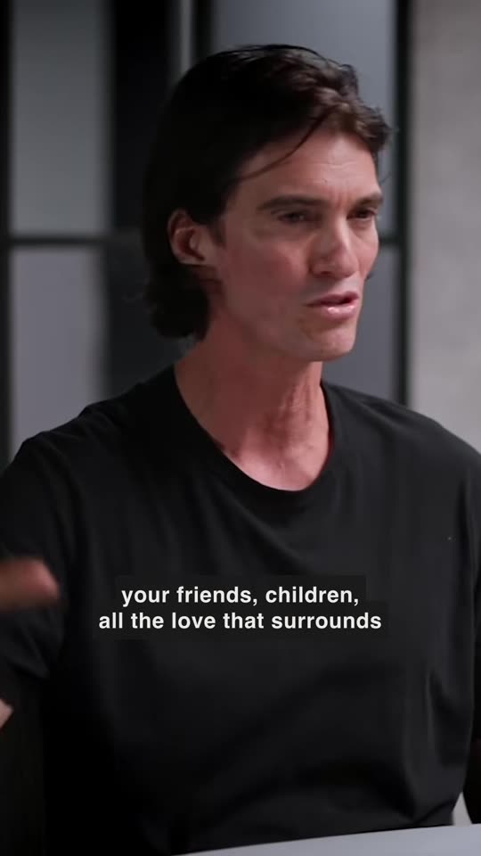
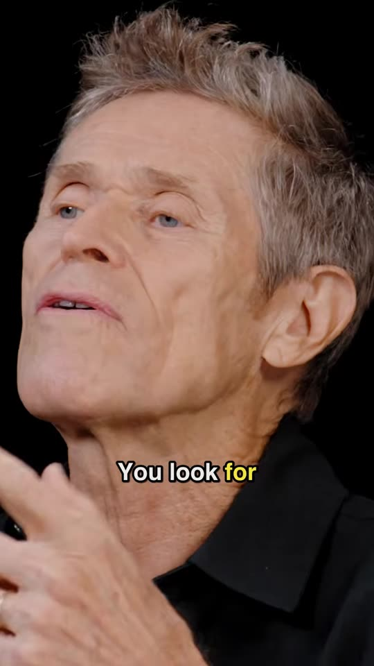
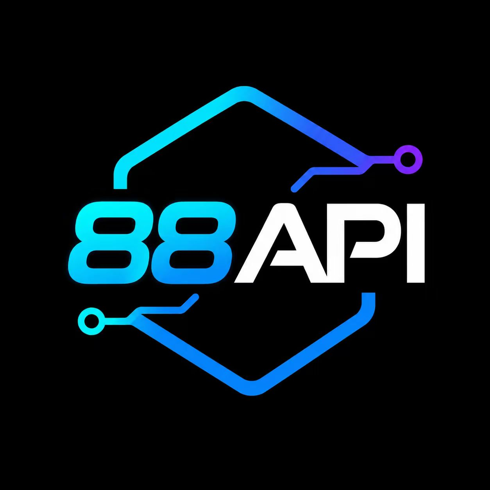

<div align="center">


# AutoClip

### Tek bağlantı. Tek tık.

Açık kaynak; kesme ve render işlemleri kendi bilgisayarınızda yapılır. Bir bağlantı yapıştırın, platformu seçin; <b>video, kapak görseli ve paylaşım metnini</b> alın.<br>
Douyin, Xiaohongshu, TikTok, Reels, YouTube Shorts, Bilibili ve YouTube için uygundur.<br>
Uygulama ücretsizdir; bulut modeller kullanıma göre ücretlendirilir. Ayarlamak istediğinizde editörü açabilirsiniz.

<p>
  <a href="https://github.com/zhouxiaoka/autoclip/releases/latest"></a>
  <a href="https://github.com/zhouxiaoka/autoclip/stargazers"></a>
  <a href="https://github.com/zhouxiaoka/autoclip/releases"></a>
  <a href="../../LICENSE"></a>
</p>

<a href="https://trendshift.io/repositories/25801"></a>

**[Web sitesi](https://zhouxiaoka.github.io/autoclip_intro/)** · **[Masaüstü sürümünü indir](https://github.com/zhouxiaoka/autoclip/releases/latest)** · [Örnek kütüphanesi](https://zhouxiaoka.github.io/autoclip_intro/cases/) · [Araştırma](../research/2026-10-what-drives-views/article-en.md) · [Hızlı başlangıç](#quick-start) · [Belgeler](#documentation) · [Sorun bildir](https://github.com/zhouxiaoka/autoclip/issues/new/choose)

[English](../../README.md) · [简体中文](README-ZH.md) · [繁體中文](README-ZH-TW.md) · [日本語](README-JA.md) · [한국어](README-KO.md) · [Español](README-ES.md) · [Português](README-PT.md) · [Русский](README-RU.md) · [Français](README-FR.md) · [Bahasa Indonesia](README-ID.md) · **Türkçe** · [Tiếng Việt](README-VI.md) · [Deutsch](README-DE.md)

</div>


**[En son sürüm](https://github.com/zhouxiaoka/autoclip/releases/latest)**, `autoclip --version` çıktısında görünen sürümdür; masaüstü, CLI ve MCP birlikte güncellenir. Hızlı çıktı, altyazı sayfalama, konuşmacı kadrajı ve uzun video kuyruğu düzeltmeleri için [değişiklik günlüğüne](../../CHANGELOG.md) bakın. Eski kurulumları lütfen güncelleyin.

## Gerçek örnekler

Klibin tamamını izlemek için bir ekran görüntüsüne veya “Oynat” bağlantısına tıklayın. Dil etiketleri çıktı altyazısının dilini gösterir. Aşağıda altı seçki yer alıyor; on tane daha için bölümü açın.

### Dikey · röportaj ve tam ekran podcast

<table width="100%">
<tr>
<td align="center" valign="top" width="25%">
<a href="https://pub-3fb92949b9c2480b89feec5ec03f3540.r2.dev/cases/gates-ezra/01.mp4?v=2026-10-01g"></a><br>
<strong>Bill Gates</strong><br>
Röportaj · Douyin · Çince<br>
<a href="https://pub-3fb92949b9c2480b89feec5ec03f3540.r2.dev/cases/gates-ezra/01.mp4?v=2026-10-01g">▶ Oynat 1:01</a> · <a href="https://www.youtube.com/watch?v=A_156w0aYtU">Kaynak</a>
</td>
<td align="center" valign="top" width="25%">
<a href="https://pub-3fb92949b9c2480b89feec5ec03f3540.r2.dev/cases/ai-labs-debate/01.mp4?v=2026-10-01g"></a><br>
<strong>AI Experts Debate</strong><br>
Röportaj · Shorts · İngilizce<br>
<a href="https://pub-3fb92949b9c2480b89feec5ec03f3540.r2.dev/cases/ai-labs-debate/01.mp4?v=2026-10-01g">▶ Oynat 1:25</a> · <a href="https://www.youtube.com/watch?v=OhOmLqR5nN4">Kaynak</a>
</td>
<td align="center" valign="top" width="25%">
<a href="https://pub-3fb92949b9c2480b89feec5ec03f3540.r2.dev/cases/robbins-36months/01.mp4?v=2026-10-01g"></a><br>
<strong>Tony Robbins</strong><br>
Tam ekran podcast · Douyin · Çince<br>
<a href="https://pub-3fb92949b9c2480b89feec5ec03f3540.r2.dev/cases/robbins-36months/01.mp4?v=2026-10-01g">▶ Oynat 1:45</a> · <a href="https://www.youtube.com/watch?v=DuRcrbP3kag">Kaynak</a>
</td>
<td align="center" valign="top" width="25%">
<a href="https://pub-3fb92949b9c2480b89feec5ec03f3540.r2.dev/cases/garfield-poehler/01.mp4?v=2026-10-01g"></a><br>
<strong>Andrew Garfield × Amy Poehler</strong><br>
Tam ekran podcast · Shorts · İngilizce<br>
<a href="https://pub-3fb92949b9c2480b89feec5ec03f3540.r2.dev/cases/garfield-poehler/01.mp4?v=2026-10-01g">▶ Oynat 1:01</a> · <a href="https://www.youtube.com/watch?v=OJV8AaWCxQQ">Kaynak</a>
</td>
</tr>
</table>

### Yatay · orijinal kadraj

<table width="100%">
<tr>
<td align="center" valign="top" width="50%">
<a href="https://pub-3fb92949b9c2480b89feec5ec03f3540.r2.dev/cases/luyu-tongliya/01.mp4?v=2026-10-01g"></a><br>
<strong>佟丽娅 × 鲁豫</strong><br>
Orijinal kadraj · Bilibili · Çince<br>
<a href="https://pub-3fb92949b9c2480b89feec5ec03f3540.r2.dev/cases/luyu-tongliya/01.mp4?v=2026-10-01g">▶ Oynat 1:41</a> · <a href="https://www.bilibili.com/video/BV1qheu6kEFV/">Kaynak</a>
</td>
<td align="center" valign="top" width="50%">
<a href="https://pub-3fb92949b9c2480b89feec5ec03f3540.r2.dev/cases/altman-uses-ai/01.mp4?v=2026-10-01g"></a><br>
<strong>Sam Altman</strong><br>
Orijinal kadraj · Bilibili · Çince<br>
<a href="https://pub-3fb92949b9c2480b89feec5ec03f3540.r2.dev/cases/altman-uses-ai/01.mp4?v=2026-10-01g">▶ Oynat 2:02</a> · <a href="https://www.youtube.com/watch?v=jZh55CQwSh8">Kaynak</a>
</td>
</tr>
</table>

<details>
<summary>10 gerçek örnek daha</summary>

<table width="100%">
<tr>
<td align="center" valign="top" width="25%">
<a href="https://pub-3fb92949b9c2480b89feec5ec03f3540.r2.dev/cases/neumann-doac/01.mp4?v=2026-10-01g"></a><br>
<strong>Adam Neumann</strong><br>
Tam ekran podcast · TikTok · İngilizce<br>
<a href="https://pub-3fb92949b9c2480b89feec5ec03f3540.r2.dev/cases/neumann-doac/01.mp4?v=2026-10-01g">▶ Oynat 0:59</a> · <a href="https://www.youtube.com/watch?v=IQ4JVWdj4Q0">Kaynak</a>
</td>
<td align="center" valign="top" width="25%">
<a href="https://pub-3fb92949b9c2480b89feec5ec03f3540.r2.dev/cases/luyu-xiaoqi/02.mp4?v=2026-10-01g"></a><br>
<strong>小奇 × 鲁豫</strong><br>
Röportaj · Douyin · Çince<br>
<a href="https://pub-3fb92949b9c2480b89feec5ec03f3540.r2.dev/cases/luyu-xiaoqi/02.mp4?v=2026-10-01g">▶ Oynat 0:50</a> · <a href="https://www.bilibili.com/video/BV1ighy6AEPz/">Kaynak</a>
</td>
<td align="center" valign="top" width="25%">
<a href="https://pub-3fb92949b9c2480b89feec5ec03f3540.r2.dev/cases/luyu-guokeyu/01.mp4?v=2026-10-01g"></a><br>
<strong>郭柯宇 × 鲁豫</strong><br>
Röportaj · Douyin · Çince<br>
<a href="https://pub-3fb92949b9c2480b89feec5ec03f3540.r2.dev/cases/luyu-guokeyu/01.mp4?v=2026-10-01g">▶ Oynat 1:11</a> · <a href="https://www.bilibili.com/video/BV1LDYV6HEXR/">Kaynak</a>
</td>
<td align="center" valign="top" width="25%">
<a href="https://pub-3fb92949b9c2480b89feec5ec03f3540.r2.dev/cases/dafoe-hot-ones/01.mp4?v=2026-10-01g"></a><br>
<strong>Willem Dafoe</strong><br>
Tam ekran podcast · TikTok · İngilizce<br>
<a href="https://pub-3fb92949b9c2480b89feec5ec03f3540.r2.dev/cases/dafoe-hot-ones/01.mp4?v=2026-10-01g">▶ Oynat 1:07</a> · <a href="https://www.youtube.com/watch?v=YqugY2zTIoI">Kaynak</a>
</td>
</tr>
<tr>
<td align="center" valign="top" width="25%">
<a href="https://pub-3fb92949b9c2480b89feec5ec03f3540.r2.dev/cases/tim-luoyonghao/01.mp4?v=2026-10-01g"></a><br>
<strong>TIM × 罗永浩</strong><br>
Röportaj · Douyin · Çince<br>
<a href="https://pub-3fb92949b9c2480b89feec5ec03f3540.r2.dev/cases/tim-luoyonghao/01.mp4?v=2026-10-01g">▶ Oynat 1:05</a> · <a href="https://www.bilibili.com/video/BV1B5xkzPEhx/">Kaynak</a>
</td>
<td align="center" valign="top" width="25%">
<a href="https://pub-3fb92949b9c2480b89feec5ec03f3540.r2.dev/cases/jensen-dwarkesh/01.mp4?v=2026-10-01g"></a><br>
<strong>Jensen Huang</strong><br>
Röportaj · Xiaohongshu · Çince<br>
<a href="https://pub-3fb92949b9c2480b89feec5ec03f3540.r2.dev/cases/jensen-dwarkesh/01.mp4?v=2026-10-01g">▶ Oynat 1:17</a> · <a href="https://www.youtube.com/watch?v=Hrbq66XqtCo">Kaynak</a>
</td>
<td align="center" valign="top" width="25%">
<a href="https://pub-3fb92949b9c2480b89feec5ec03f3540.r2.dev/cases/karpathy-dwarkesh/01.mp4?v=2026-10-01g"></a><br>
<strong>Andrej Karpathy</strong><br>
Röportaj · Douyin · Çince<br>
<a href="https://pub-3fb92949b9c2480b89feec5ec03f3540.r2.dev/cases/karpathy-dwarkesh/01.mp4?v=2026-10-01g">▶ Oynat 0:43</a> · <a href="https://www.youtube.com/watch?v=lXUZvyajciY">Kaynak</a>
</td>
<td align="center" valign="top" width="25%">
<a href="https://pub-3fb92949b9c2480b89feec5ec03f3540.r2.dev/cases/apple-a20/01.mp4?v=2026-10-01g"></a><br>
<strong>A20 Pro</strong><br>
Röportaj · Xiaohongshu · Çince<br>
<a href="https://pub-3fb92949b9c2480b89feec5ec03f3540.r2.dev/cases/apple-a20/01.mp4?v=2026-10-01g">▶ Oynat 2:00</a> · <a href="https://www.bilibili.com/video/BV1e4Y96FEaJ/">Kaynak</a>
</td>
</tr>
<tr>
<td align="center" valign="top" width="25%">
<a href="https://pub-3fb92949b9c2480b89feec5ec03f3540.r2.dev/cases/stallone-nyt/01.mp4?v=2026-10-01g"></a><br>
<strong>Sylvester Stallone</strong><br>
Röportaj · Douyin · Çince<br>
<a href="https://pub-3fb92949b9c2480b89feec5ec03f3540.r2.dev/cases/stallone-nyt/01.mp4?v=2026-10-01g">▶ Oynat 1:39</a> · <a href="https://www.youtube.com/watch?v=ccs-B_nTfZs">Kaynak</a>
</td>
<td align="center" valign="top" width="25%">
<a href="https://pub-3fb92949b9c2480b89feec5ec03f3540.r2.dev/cases/mrbeast-colin-samir/01.mp4?v=2026-10-01g"></a><br>
<strong>MrBeast</strong><br>
Tam ekran podcast · TikTok · İngilizce<br>
<a href="https://pub-3fb92949b9c2480b89feec5ec03f3540.r2.dev/cases/mrbeast-colin-samir/01.mp4?v=2026-10-01g">▶ Oynat 1:42</a> · <a href="https://www.youtube.com/watch?v=9IQ_ldV9z_A">Kaynak</a>
</td>
<td></td>
<td></td>
</tr>
</table>

</details>

Videoları, kapakları ve paylaşım metinlerini **[örnek kütüphanesinde →](https://zhouxiaoka.github.io/autoclip_intro/cases/?lang=en)** bulabilir, kendi kliplerinizi de [paylaşabilirsiniz](https://github.com/zhouxiaoka/autoclip/discussions/new?category=show-and-tell). Kaynak videolar yapımcılarına aittir; bu klipler yalnızca tanıtım amacıyla gösterilmektedir.

## Ne yapar?

### Bağlantıyı yapıştırın, klipleri alın

Bir platform seçin; AutoClip o platformun kadraj ve süre kurallarına uygun üretim yapar. Her platform için uygun adaylar arasından en yüksek sıralı en fazla 10 klip otomatik olarak render edilir; kalanlar isteğe bağlı alternatiflerdir. Her klip bir kapak görseli, başlık, açıklama, etiketler (hashtag) ve ZIP biçiminde bir yayın paketi içerir.

### Paketleme dahilidir

Douyin / Xiaohongshu varsayılan olarak röportaj stilini, TikTok / Reels / Shorts ise tam ekran podcast stilini kullanır. Platformun altyazı/metin dilini değiştirmeden iki dikey düzenden birini seçebilirsiniz. Bilibili / YouTube yatay düzen kullanır. Kadraj konuşmacıyı takip eder; kişi bulunamazsa tam kare korunur. Marka kapanış sahnesi varsayılan olarak açıktır ve Ayarlar'dan kapatılabilir; kopyalanan paylaşım metninde AutoClip künyesi bulunmaz.

### Bilgisayarınızda kalır

Kesme, kadraj ve render işlemleri yerelde çalışır. Analiz modelini siz seçersiniz; altyazı için içerik üreticisinin altyazılarını, yerel Whisper / SenseVoice'u veya yapılandırdığınız bulut transkripsiyonunu kullanabilirsiniz. CLI / MCP, masaüstündeki hızlı çıktı hattını paylaşır.

## Gerçek kaynaklarda süre ve maliyet

Bunlar geliştirme sırasında üç farklı kaynak üzerinde alınmış ölçümlerdir; aynı girdiyle yapılmış kontrollü bir karşılaştırma değildir. Maliyetler, o dönemdeki qwen-plus metin modeli kullanımının tahminidir; bulut ASR, yapay zekâ görselleri ve yayın hizmetlerini içermez. Geçerli tutar sağlayıcınızın faturasıdır.

| Sürüm | Kaynak | Çıktı | Tahmini metin modeli maliyeti (CNY) |
| --- | --- | ---: | ---: |
| **Yeni · altyazılı** | Jensen · 1 sa 43 dk (EN → Xiaohongshu) | **7,5 dk / 10 klip** | **¥0.09** |
| Yeni · altyazısız | TIM × Luo Yonghao · 2 sa 52 dk (ZH → Douyin) | 29,5 dk / 10 klip | ¥0.20 |
| Önceki | MrBeast · 2 sa 06 dk (EN → TikTok) | 65 dk | ¥0.64 |

<details>
<summary>Koşullar ve kayıtlar</summary>

1 Ekim 2026, aynı Apple Silicon Mac. İlk iki çalıştırma yeni hattı kullandı ve 10 klip render etti; eski hat 33 klip render etti; girdi ve çıktı sayıları farklıdır. Jensen için içerik üreticisinin altyazıları, TIM için yerel Whisper base kullanıldı.

İçerik üreticisinin altyazıları transkripsiyonu atlar; aksi halde yerel veya bulut ASR seçin. Ek platformlar ve isteğe bağlı klipler süre ve kullanım ekler. Aşamaların kayıtları ve varsayımlar için [ölçümler ve maliyetlendirme](../COST_PER_VIDEO.md) sayfasına bakın (Çince).

</details>

## Modellerinizi ve veri akışını seçin

Kesme ve render işlemleri bilgisayarınızda çalışır. Bulut analizi ilgili altyazıları ve paylaşım metnini gönderir; görsel anlama veya referans görsel üretimi gerekli örnek kareleri, bulut ASR ise sesi gönderir. Yerel analiz ve transkripsiyon için ilgili bir bulut API'sine gerek yoktur. Bitmiş klipler, siz yayınlamayı seçtiğinizde bağlı platformlara yüklenir. Analitik ve hata raporları Ayarlar'dan kapatılabilir. Ayrıntılar için [gizlilik](../PRIVACY.en.md) sayfasına bakın.

<a id="quick-start"></a>

## Hızlı başlangıç

| Ne yapmak istiyorsunuz? | Kullanın | Gerekenler |
| --- | --- | --- |
| Bu bilgisayarda klip üretmek | **Masaüstü** | macOS Apple Silicon veya Windows x64 |
| Kendi sunucunuzda / Linux'ta çalıştırmak | **Docker** | Docker ve Compose v2 |
| Toplu işlem / ajanlar | **CLI / MCP** | Python 3.10+ (3.11 önerilir) ve FFmpeg |

### Masaüstü

1. **Kurun.** [Releases](https://github.com/zhouxiaoka/autoclip/releases/latest) sayfasından indirin. macOS Apple Silicon: `.dmg`. Windows 10 / 11 x64: `-setup.exe`. Python ve FFmpeg pakete dahildir. macOS 15 ve sonrasında uygulamaya bir kez çift tıklayın; engellenirse Sistem Ayarları → Gizlilik ve Güvenlik → Yine de Aç yolunu izleyin ([Apple'ın notu](https://developer.apple.com/news/?id=saqachfa)). Daha eski macOS'ta uygulamaya sağ tıklayıp Aç'ı seçin. Windows SmartScreen uyarısı çıkarsa Daha fazla bilgi → Yine de çalıştır'ı seçin.
2. **Bir model yapılandırın.** Bir sağlayıcı seçip API anahtarınızı girin, kullanılabilir bir analiz modeli seçin, bağlantıyı test edin ve kaydedin. Yerel modeller için önce Ollama / LM Studio'yu başlatıp bir model yükleyin.
3. **Önce örneğe bakın, sonra kendi videonuzu deneyin.** Ana ekranda hiç proje yokken “用示例项目看看效果” (Örnek projeyi görün) düğmesine tıklayın. API anahtarı gerekmez; örnek yükleyicinin içindedir. Ardından kendi röportajınızı veya podcast'inizi kullanıp bir dikey düzen seçin. Kaynakta altyazı yoksa ya da yerel Whisper kurulmuyor veya çok yavaş kalıyorsa Ayarlar → Varsayılan modeller → “Speech to subtitles” (sesten altyazıya) yolunu açıp Bailian bulut transkripsiyonuna geçin (`qwen-audio-3.1-asr-flash`; saat başına yaklaşık 0,1 yuan, gerçek tutar Alibaba Cloud faturasındadır). Ses buluta yüklenir. İçe aktarma engellenirse “Use cloud transcription instead” (Bunun yerine bulut transkripsiyonu kullan) düğmesine tıklayın. İlk yerel kurulumda yaklaşık 220 MB indirilir; yavaş bir ağda yaklaşık 15 dakika sürer.
4. **İnceleyin ve indirin.** Altyazıları, kadrajı ve içerik bütünlüğünü kontrol edin; ardından yayın paketini kaydedin veya yayınlamak için bir hesap bağlayın. Daha fazla klip gerekirse isteğe bağlı alternatifleri üretin.

Intel Mac için masaüstü sürümü yoktur. Intel Mac ve Linux için Docker veya CLI kullanın. [Kurulum kılavuzuna](../USER_INSTALLATION_GUIDE.en.md) ve [son sürüme](https://github.com/zhouxiaoka/autoclip/releases/latest) bakın.

[Tam kurulum kılavuzu](../USER_INSTALLATION_GUIDE.en.md) · [Sorun giderme](../FAQ.en.md)

**CLI / MCP (Claude Code, Codex, OpenCode ve betikler)**

```bash
uvx autoclip-mcp
npx skills add zhouxiaoka/autoclip

autoclip --version
autoclip produce talk.mp4 --srt talk.srt --platform tiktok --portrait-style podcast --json
autoclip outputs PROJECT_ID --export-kits
```

<details>
<summary>Offline wheel, source install &amp; MCPB packaging</summary>

```bash
# Install from a downloaded CLI/MCP release ZIP wheel
python3 -m venv .venv && source .venv/bin/activate
python -m pip install -r requirements.txt
python -m pip install --force-reinstall --no-deps autoclip_mcp-*-py3-none-any.whl

# Or install from source
python -m pip install --no-deps .
```

To build a local MCPB bundle without publishing, run `python scripts/pack_mcpb.py` (never run `smithery mcp publish` automatically).

</details>


**Docker / Web**

```bash
git clone https://github.com/zhouxiaoka/autoclip.git
cd autoclip
cp env.example .env
mkdir -p data logs uploads
docker compose up -d --build
```

Web arayüzünü `http://localhost:3000` adresinde açın (API belgeleri: `http://localhost:8000/docs`). Bağlama izinleri ve özel alan adları için [Docker Kılavuzu](../DOCKER.en.md) sayfasına bakın.
## Model kurulumu

| Seçenek | Kurulum |
| --- | --- |
| Bulut API | Ayarlar'da bir sağlayıcı seçip API anahtarınızı girin. OpenAI uyumlu hizmetler ayrıca Base URL kabul eder. |
| Ollama | Varsayılan `http://localhost:11434/v1`; yerel bir model indirip başlatın, ardından sunucunuzun sunduğu bir model seçin. API anahtarı gerekmez. |
| LM Studio | Bir model yükleyip Local Server'ı başlatın; varsayılan `http://localhost:1234/v1`. |

Docker içinde `localhost` konteynerin kendisidir. Konteynerin erişebildiği bir ana makine adresine yönlendirin.

[Model kurulumu](../MULTI_LLM_PROVIDER_GUIDE.md) (Çince) · [Yerel modeller ve konteynerler](../CLI_AND_MCP.md) (Çince)

## Özel teşekkürler ❤️

<table>
  <tr>
    <td align="center" width="140">
      <a href="https://88api.ai/sign-up?aff=2PIc"></a><br>
      <a href="https://88api.ai/sign-up?aff=2PIc"><strong>88API</strong></a>
    </td>
    <td>
      AutoClip'e sponsor olduğu için <strong>88API Token Platform</strong>'a teşekkürler! GPT, Claude, Gemini, Grok, DeepSeek, Kimi ve GLM modellerini transkript analizi, öne çıkan anların seçimi ve başlık üretimi için bir araya getiriyor.<br>
      🎨 <strong>Medya yetenekleri</strong>: Platform, GPT-Image, Seedance, Veo, MiniMax Hailuo H3, Kling, Whisper ve TTS dahil görsel, video ve ses modelleri sunuyor. AutoClip uyumlu analiz, kapak görseli ve transkripsiyon API'lerini kullanır.<br>
      🏷️ <strong>Hizmet ve faturalandırma</strong>: İş ortağı; yurt dışı kurumsal işletme, canlı destek, fatura ve 1:1 bakiye yükleme oranı bildiriyor; platform koşulları geçerlidir.<br>
      🎁 <strong>Yeni kullanıcı fırsatı</strong>: <a href="https://88api.ai/sign-up?aff=2PIc">referans kayıt bağlantımızla</a> modelleri denemek için deneme kredisi alın; promosyon koşulları geçerlidir. <a href="../88API_SETUP.en.md">Kurulum kılavuzu</a>
    </td>
  </tr>
  <tr>
    <td align="center" width="140">
      <a href="https://www.infistar.cc/register?aff=XLK3BCM6&amp;ref_source=link"></a><br>
      <a href="https://www.infistar.cc/register?aff=XLK3BCM6&amp;ref_source=link"><strong>Infistar.cc</strong></a>
    </td>
    <td>
      AutoClip'e sponsor olduğu için <strong>Infistar.cc</strong>'ye teşekkürler! Çok modelli API hizmeti; uzun video transkript analizi, öne çıkan anların seçimi ve başlık üretimini destekleyebilir.<br>
      ⚙️ <strong>Uyumlu kurulum</strong>: AutoClip'te OpenAI uyumlu sağlayıcıyı seçin; Base URL'yi, API anahtarınızı ve kullanılabilir bir modeli girin.<br>
      🧩 <strong>Model seçimi</strong>: İş ortağı Claude, GPT, Gemini, DeepSeek ve diğer model ailelerini sunuyor. Transkript analizi ve öne çıkan an seçimini karşılaştırmak için uyumlu uç noktayı destekleyen modelleri seçin.<br>
      🏷️ <strong>Fiyatlandırma ve hizmetler</strong>: İş ortağına göre seçili modeller resmi liste fiyatlarının <strong>%1'i kadar</strong> düşük maliyetlidir; RMB faturalandırma, fatura ve model orijinalliği doğrulaması sunulur. Uygun modeller, güncel fiyatlar ve hizmet koşulları için platformu kontrol edin.<br>
      🎁 <strong>AutoClip fırsatı</strong>: Yeni kullanıcılar <a href="https://www.infistar.cc/register?aff=XLK3BCM6&amp;ref_source=link">referans kayıt bağlantımızla</a> <strong>5 $ deneme kredisi</strong> alabilir; promosyon koşulları geçerlidir. <a href="../INFISTAR_SETUP.en.md">Kurulum kılavuzu</a>
    </td>
  </tr>
  <tr>
    <td align="center" width="140">
      <a href="https://go.apimart.ai/tw-autoclip"></a><br>
      <a href="https://go.apimart.ai/tw-autoclip"><strong>APIMart</strong></a>
    </td>
    <td>
      Bu projeye sponsor olduğu için <strong>APIMart</strong>'a teşekkürler! <strong>APIMart</strong>, yapay zekâ görsel ve video üretimi için düşük maliyetli bir API platformudur — GPT-Image-2 <strong>görsel başına 0,006 $</strong>'dan başlar, dolar başına <strong>160+</strong> görsel. Tek bir asenkron API hem görsel hem video kapsar: görev gönderin, bir kimlik alın, sonuçları polling veya callback ile çekin. Zaman aşımı olmadan on binlerce görseli toplu üretin, kodu değiştirmeden model değiştirin. Aylık ücret yok, kullandıkça öde — başlamak için <a href="https://go.apimart.ai/tw-autoclip">buradan kaydolun</a>.
    </td>
  </tr>
</table>

## Önerilen bağlantı

Bu, yazarın öneri bağlantısıdır. Yukarıdaki sponsorlardan ayrıdır.

Alibaba Cloud'a kaydolmak veya fırsatı almak için kullanın, ardından Bailian konsolunda bir API anahtarı oluşturun. AutoClip'te Bailian bulut transkripsiyonunu kullanmak için Ayarlar → Varsayılan modeller → “Speech to subtitles” (sesten altyazıya) yolunu açın. Ses buluta yüklenir.

1. [Yazarın öneri bağlantısı](https://www.aliyun.com/benefit?userCode=qmyj6jch): kaydolun veya fırsatı alın.
2. [Bailian konsolu](https://bailian.console.aliyun.com/): bir API anahtarı oluşturun.

## SSS

<details>
<summary>Ücretsiz mi? API anahtarına ihtiyacım var mı?</summary>

Uygulama ücretsizdir ve MIT lisanslıdır. Bulut analizi, transkripsiyon ve yapay zekâ görselleri sizin kimlik bilgilerinizi ve sağlayıcınızın tarifelerini kullanır; otomatik kapak tasarımı varsayılan olarak ücretli görsel üretimi kullanmaz. Ollama / LM Studio için bulut anahtarı gerekmez ama uygun donanım gerekir. Doğrudan yayın için kendi Bilibili veya [Upload-Post](https://www.upload-post.com) hesabınız gerekir.

</details>

<details>
<summary>Videolarım yükleniyor mu?</summary>

Kesme ve render işlemleri bilgisayarınızda çalışır. Bulut analizi ilgili altyazıları ve paylaşım metnini gönderir; görsel anlama veya referans görsel üretimi gerekli örnek kareleri, bulut ASR ise sesi gönderir. Yerel analiz ve transkripsiyon için ilgili bir bulut API'sine gerek yoktur. Bitmiş klipler, siz yayınlamayı seçtiğinizde bağlı platformlara yüklenir. Analitik ve hata raporları Ayarlar'dan kapatılabilir. Ayrıntılar için [gizlilik](../PRIVACY.en.md) sayfasına bakın.

</details>

<details>
<summary>Hangi videolar en iyi sonucu verir?</summary>

Röportajlar, podcast'ler, dersler ve konuşan kişinin göründüğü görüntüler başlıca doğrulanmış kullanım alanlarıdır. İçerik üreticisinin altyazıları en hızlı yoldur; aksi halde yerel veya bulut transkripsiyon kullanın. Oyun kaydı veya az diyalogu olan görüntülerde, görsel destekli bir modelle görsel anlamayı açın ve seçilen anları gözden geçirin.

</details>

<details>
<summary>Neden hiç klip üretilmedi?</summary>

Başarısız olan aşamayı kontrol edin: altyazı/transkripsiyon, model bağlantısı, FFmpeg, disk alanı ve platform uygunluğu. YouTube uzun biçimi en az 180 saniyelik tam klipler gerektirir; daha kısa görüntüler için Shorts veya Bilibili kullanın. Yine de başarısız olursa `autoclip --version` çıktısındaki sürümü, işletim sistemini, kaynak süresini, modeli ve temizlenmiş günlükleri [bilinen sorunlar](https://github.com/zhouxiaoka/autoclip/issues/96) sayfasına ekleyin.

</details>

[Tam sorun giderme](../FAQ.en.md) · [Bilinen sorunlar](https://github.com/zhouxiaoka/autoclip/issues/96)

<a id="documentation"></a>

## Belgeler

| İhtiyacınız | Belgeler |
| --- | --- |
| Kurulum ve ilk klipler | [Kurulum](../USER_INSTALLATION_GUIDE.en.md) |
| Kendi sunucunuz ve otomasyon | [Docker](../DOCKER.en.md) · [CLI / MCP](../CLI_AND_MCP.md) (Çince) · [Ajan becerisi](../../skills/autoclip/SKILL.md) (Çince) · [OpenCode](../OPENCODE.en.md) |
| Modeller ve sorun giderme | [Model kurulumu](../MULTI_LLM_PROVIDER_GUIDE.md) (Çince) · [SSS](../FAQ.en.md) |
| Sürümler, yol haritası, gizlilik | [Değişiklik günlüğü](../../CHANGELOG.md) · [Yol haritası](../ROADMAP.md) (Çince) · [Topluluk panosu](../COMMUNITY_BOARD.md) (Çince) · [Gizlilik](../PRIVACY.en.md) |
| Araştırma | [Araştırma notu #1: Etkiyi değil, anı seçin](../research/2026-10-what-drives-views/article-en.md) · [中文](../research/2026-10-what-drives-views/article-zh.md) |
| Katkı ve çeviri | [Katkıda bulunma](../../CONTRIBUTING.md) (Çince) · [Çeviri bakımı](../i18n.md) (Çince) |

## Katkıda bulunun

Hata düzeltmeleri, klip örnekleri, geri bildirimler ve çeviri iyileştirmeleri memnuniyetle karşılanır. AutoClip işinize yaradıysa bir yıldız çok makbule geçer.

- **Sohbet:** [GitHub Discussions](https://github.com/zhouxiaoka/autoclip/discussions) · [İlk klip soruları](https://github.com/zhouxiaoka/autoclip/discussions/128) · [Fikirler](https://github.com/zhouxiaoka/autoclip/discussions/129)
- **Hatalar:** işletim sistemi, sürüm, model, adımlar ve temizlenmiş günlüklerle [issue formunu](https://github.com/zhouxiaoka/autoclip/issues/new/choose) kullanın
- **İş birlikleri:** [christine_zhouye@163.com](mailto:christine_zhouye@163.com)

Tek kişi tarafından sürdürülüyor. Yanıtlar anında gelmez; canlı destek veya birebir kurulum yardımı yoktur.


