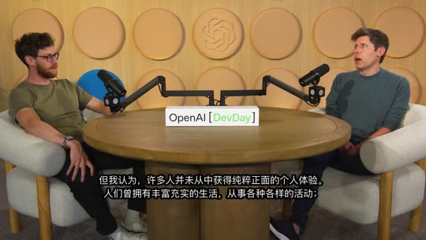

<!-- mcp-name: io.github.zhouxiaoka/autoclip-mcp -->

<div align="center">


# AutoClip

### Перетворюйте будь-яке відео, посилання чи пряму трансляцію на готові до публікації кліпи.

**Альтернатива OpusClip із відкритим вихідним кодом** — локальна нарізка за допомогою ШІ для **подкастів, інтерв'ю та ігрових стримів** із розумним перекадруванням, субтитрами, обкладинками, заголовками та вбудованим **MCP для ШІ-агентів**. Без підписок і пейволів.

<br>

<p>
  <a href="https://github.com/zhouxiaoka/autoclip/releases/latest"></a>&nbsp;
  <a href="https://github.com/zhouxiaoka/autoclip/stargazers"></a>&nbsp;
  <a href="https://github.com/zhouxiaoka/autoclip/releases"></a>&nbsp;
  &nbsp;
  <a href="../../LICENSE"></a>
</p>

<br>

<!-- hero-cta:start -->
<p>
  <a href="https://zhouxiaoka.github.io/autoclip_intro/"></a>&nbsp;&nbsp;
  <a href="https://trendshift.io/repositories/25801"></a>
</p>
<!-- hero-cta:end -->

<br>

<p>
  <a href="https://zhouxiaoka.github.io/autoclip_intro/"><strong>Вебсайт</strong></a>
  &nbsp;&middot;&nbsp;
  <a href="https://github.com/zhouxiaoka/autoclip/releases/latest"><strong>Завантажити</strong></a>
  &nbsp;&middot;&nbsp;
  <a href="https://zhouxiaoka.github.io/autoclip_intro/features/game-streams/"><strong>Повтори стримів (v1.6)</strong></a>
  &nbsp;&middot;&nbsp;
  <a href="https://zhouxiaoka.github.io/autoclip_intro/cases/?lang=en"><strong>Приклади</strong></a>
  &nbsp;&middot;&nbsp;
  <a href="#quick-start"><strong>Швидкий старт</strong></a>
  &nbsp;&middot;&nbsp;
  <a href="#documentation"><strong>Документація</strong></a>
  &nbsp;&middot;&nbsp;
  <a href="https://github.com/zhouxiaoka/autoclip/issues/new/choose"><strong>Повідомити про проблему</strong></a>
</p>

<p>
  <a href="../../README.md">English</a> · <a href="README-ZH.md">简体中文</a> · <a href="README-ZH-TW.md">繁體中文</a> · <a href="README-JA.md">日本語</a> · <a href="README-KO.md">한국어</a> · <a href="README-ES.md">Español</a> · <a href="README-PT.md">Português</a> · <a href="README-RU.md">Русский</a> · <a href="README-FR.md">Français</a> · <a href="README-ID.md">Bahasa Indonesia</a> · <a href="README-TR.md">Türkçe</a> · <a href="README-VI.md">Tiếng Việt</a> · <a href="README-DE.md">Deutsch</a> · <a href="README-IT.md">Italiano</a> · <a href="README-PL.md">Polski</a> · <a href="README-TH.md">ไทย</a> · <a href="README-NL.md">Nederlands</a> · <strong>Українська</strong> · <a href="README-HI.md">हिन्दी</a> · <a href="README-AR.md">العربية</a>
</p>

<br>

<p>
  ⭐ <em>Безкоштовно, під ліцензією MIT, без підписок — уся нарізка й рендеринг виконуються на вашому комп'ютері. Поставте зірочку репозиторію, якщо він став вам у пригоді!</em>
</p>

<!-- top-sponsors:start -->
<table width="100%">
  <tr>
    <td align="center" width="50%">
      <a href="https://go.apimart.ai/tw-autoclip"></a><br>
      <a href="https://go.apimart.ai/tw-autoclip"><strong>APIMart</strong></a><br>
      <sub>Low-cost AI image &amp; video API · GPT-Image-2 from $0.006/img</sub>
    </td>
    <td align="center" width="50%">
      <a href="mailto:christine_zhouye@163.com?subject=AutoClip%20Sponsor%20%2F%20Provider%20Partnership"><strong>Sponsor / Partner with AutoClip</strong></a><br>
      <sub>Put your AI API or creator tool in front of AutoClip users worldwide (cloud dynamic provider listing supported, zero client release needed).<br><a href="mailto:christine_zhouye@163.com">christine_zhouye@163.com</a></sub>
    </td>
  </tr>
</table>
<!-- top-sponsors:end -->

</div>

---

## Огляд

Вставте посилання, локальне відео або **повтор прямої трансляції** — AutoClip знаходить найкращі моменти, стежить за мовцем, вшиває субтитри, генерує обкладинки та експортує готові до публікації кліпи для TikTok, Shorts, Reels, YouTube, Douyin, Xiaohongshu й Bilibili.

**Локальний підхід за задумом:** нарізка та рендеринг виконуються безпосередньо на вашому комп'ютері без черг завантаження та щомісячних платежів. Використовуйте власний API-ключ або працюйте на 100% офлайн з **Ollama / LM Studio + Whisper / SenseVoice**.


<p align="center"><em>Головна → 6 джерел повторів трансляцій → налаштування OBS WebSocket → імпорт із Twitch → готовий кліп із субтитрами та публікацією в один клік.</em></p>

---

## Що нового у v1.6

| Функція | Деталі |
| :--- | :--- |
| **6 джерел повторів трансляцій** | Окрема вкладка **Live Replay** із підтримкою **OBS Studio, Twitch, YouTube, Kick, Discord і локальних записів**. |
| **Автозахоплення OBS** | Підключайте OBS WebSocket (`4455`), обрізайте без втрати якості (`-c copy`) та автоматично ставте кліпи в чергу одразу після завершення стриму. |
| **Ігрові хайлайти** | Універсальне виявлення яскравих моментів із підтримкою окремих ігрових епізодів від **8 с+** та ощадливішим бюджетом на візуальний аналіз і OCR. |
| **Переформатування в один клік** | Уніфіковані картки кліпів із відтворенням — перемикайте цільові платформи в один клік, не втрачаючи попередніх експортів. |
| **13 мов** | Повний настільний інтерфейс, меню трею та документація 13 мовами (`+ zh-TW, de, id, tr, vi`) і підтримка арабських субтитрів RTL. |

<details>
<summary>📸 Усередині застосунку (5 знімків екрана)</summary>

<table width="100%">
<tr>
<td align="center" valign="top" width="50%">
<br>
<em>Головний екран — Link, File та Live Replay</em>
</td>
<td align="center" valign="top" width="50%">
<br>
<em>Live Replay — 6 джерел повторів</em>
</td>
</tr>
<tr>
<td align="center" valign="top" width="50%">
<br>
<em>Вбудовані налаштування OBS Studio WebSocket</em>
</td>
<td align="center" valign="top" width="50%">
<br>
<em>Імпорт із Twitch і вибір локального запису</em>
</td>
</tr>
<tr>
<td align="center" valign="top" colspan="2">
<br>
<em>Готовий кліп — зазначення джерела, кадрування 9:16, субтитри та Download / Publish / Redo в один клік</em>
</td>
</tr>
</table>

</details>

---

## Приклади

Натисніть на будь-яку мініатюру або **▶ Відтворити**, щоб переглянути повні кліпи, відрендерені AutoClip. Позначки мов вказують на мову вшитих субтитрів.

### Вертикальні · Інтерв'ю та подкасти

<table width="100%">
<tr>
<td align="center" valign="top" width="25%">
<a href="https://pub-3fb92949b9c2480b89feec5ec03f3540.r2.dev/cases/gates-ezra/01.mp4?v=2026-10-01g"></a><br>
<strong>Bill Gates</strong><br>
Інтерв'ю · Douyin · ZH<br>
<a href="https://pub-3fb92949b9c2480b89feec5ec03f3540.r2.dev/cases/gates-ezra/01.mp4?v=2026-10-01g">▶ Відтворити 1:01</a> · <a href="https://www.youtube.com/watch?v=A_156w0aYtU">Джерело</a>
</td>
<td align="center" valign="top" width="25%">
<a href="https://pub-3fb92949b9c2480b89feec5ec03f3540.r2.dev/cases/ai-labs-debate/01.mp4?v=2026-10-01g"></a><br>
<strong>AI Experts Debate</strong><br>
Інтерв'ю · Shorts · EN<br>
<a href="https://pub-3fb92949b9c2480b89feec5ec03f3540.r2.dev/cases/ai-labs-debate/01.mp4?v=2026-10-01g">▶ Відтворити 1:25</a> · <a href="https://www.youtube.com/watch?v=OhOmLqR5nN4">Джерело</a>
</td>
<td align="center" valign="top" width="25%">
<a href="https://pub-3fb92949b9c2480b89feec5ec03f3540.r2.dev/cases/robbins-36months/01.mp4?v=2026-10-01g"></a><br>
<strong>Tony Robbins</strong><br>
Подкаст · Douyin · ZH<br>
<a href="https://pub-3fb92949b9c2480b89feec5ec03f3540.r2.dev/cases/robbins-36months/01.mp4?v=2026-10-01g">▶ Відтворити 1:45</a> · <a href="https://www.youtube.com/watch?v=DuRcrbP3kag">Джерело</a>
</td>
<td align="center" valign="top" width="25%">
<a href="https://pub-3fb92949b9c2480b89feec5ec03f3540.r2.dev/cases/garfield-poehler/01.mp4?v=2026-10-01g"></a><br>
<strong>Garfield × Poehler</strong><br>
Подкаст · Shorts · EN<br>
<a href="https://pub-3fb92949b9c2480b89feec5ec03f3540.r2.dev/cases/garfield-poehler/01.mp4?v=2026-10-01g">▶ Відтворити 1:01</a> · <a href="https://www.youtube.com/watch?v=OJV8AaWCxQQ">Джерело</a>
</td>
</tr>
</table>

### Горизонтальні · Початкове співвідношення сторін

<table width="100%">
<tr>
<td align="center" valign="top" width="50%">
<a href="https://pub-3fb92949b9c2480b89feec5ec03f3540.r2.dev/cases/luyu-tongliya/01.mp4?v=2026-10-01g"></a><br>
<strong>佟丽娅 × 鲁豫</strong> · 16:9 · Bilibili · ZH<br>
<a href="https://pub-3fb92949b9c2480b89feec5ec03f3540.r2.dev/cases/luyu-tongliya/01.mp4?v=2026-10-01g">▶ Відтворити 1:41</a> · <a href="https://www.bilibili.com/video/BV1qheu6kEFV/">Джерело</a>
</td>
<td align="center" valign="top" width="50%">
<a href="https://pub-3fb92949b9c2480b89feec5ec03f3540.r2.dev/cases/altman-uses-ai/01.mp4?v=2026-10-01g"></a><br>
<strong>Sam Altman</strong> · 16:9 · Bilibili · ZH<br>
<a href="https://pub-3fb92949b9c2480b89feec5ec03f3540.r2.dev/cases/altman-uses-ai/01.mp4?v=2026-10-01g">▶ Відтворити 2:02</a> · <a href="https://www.youtube.com/watch?v=jZh55CQwSh8">Джерело</a>
</td>
</tr>
</table>

<details>
<summary>Переглянути ще 10 кліпів</summary>

<table width="100%">
<tr>
<td align="center" valign="top" width="25%">
<a href="https://pub-3fb92949b9c2480b89feec5ec03f3540.r2.dev/cases/neumann-doac/01.mp4?v=2026-10-01g"></a><br>
<strong>Adam Neumann</strong><br>
Подкаст · TikTok · EN<br>
<a href="https://pub-3fb92949b9c2480b89feec5ec03f3540.r2.dev/cases/neumann-doac/01.mp4?v=2026-10-01g">▶ Відтворити 0:59</a> · <a href="https://www.youtube.com/watch?v=IQ4JVWdj4Q0">Джерело</a>
</td>
<td align="center" valign="top" width="25%">
<a href="https://pub-3fb92949b9c2480b89feec5ec03f3540.r2.dev/cases/luyu-xiaoqi/02.mp4?v=2026-10-01g"></a><br>
<strong>小奇 × 鲁豫</strong><br>
Інтерв'ю · Douyin · ZH<br>
<a href="https://pub-3fb92949b9c2480b89feec5ec03f3540.r2.dev/cases/luyu-xiaoqi/02.mp4?v=2026-10-01g">▶ Відтворити 0:50</a> · <a href="https://www.bilibili.com/video/BV1ighy6AEPz/">Джерело</a>
</td>
<td align="center" valign="top" width="25%">
<a href="https://pub-3fb92949b9c2480b89feec5ec03f3540.r2.dev/cases/luyu-guokeyu/01.mp4?v=2026-10-01g"></a><br>
<strong>郭柯宇 × 鲁豫</strong><br>
Інтерв'ю · Douyin · ZH<br>
<a href="https://pub-3fb92949b9c2480b89feec5ec03f3540.r2.dev/cases/luyu-guokeyu/01.mp4?v=2026-10-01g">▶ Відтворити 1:11</a> · <a href="https://www.bilibili.com/video/BV1LDYV6HEXR/">Джерело</a>
</td>
<td align="center" valign="top" width="25%">
<a href="https://pub-3fb92949b9c2480b89feec5ec03f3540.r2.dev/cases/dafoe-hot-ones/01.mp4?v=2026-10-01g"></a><br>
<strong>Willem Dafoe</strong><br>
Подкаст · TikTok · EN<br>
<a href="https://pub-3fb92949b9c2480b89feec5ec03f3540.r2.dev/cases/dafoe-hot-ones/01.mp4?v=2026-10-01g">▶ Відтворити 1:07</a> · <a href="https://www.youtube.com/watch?v=YqugY2zTIoI">Джерело</a>
</td>
</tr>
<tr>
<td align="center" valign="top" width="25%">
<a href="https://pub-3fb92949b9c2480b89feec5ec03f3540.r2.dev/cases/tim-luoyonghao/01.mp4?v=2026-10-01g"></a><br>
<strong>TIM × 罗永浩</strong><br>
Інтерв'ю · Douyin · ZH<br>
<a href="https://pub-3fb92949b9c2480b89feec5ec03f3540.r2.dev/cases/tim-luoyonghao/01.mp4?v=2026-10-01g">▶ Відтворити 1:05</a> · <a href="https://www.bilibili.com/video/BV1B5xkzPEhx/">Джерело</a>
</td>
<td align="center" valign="top" width="25%">
<a href="https://pub-3fb92949b9c2480b89feec5ec03f3540.r2.dev/cases/jensen-dwarkesh/01.mp4?v=2026-10-01g"></a><br>
<strong>Jensen Huang</strong><br>
Інтерв'ю · Xiaohongshu · ZH<br>
<a href="https://pub-3fb92949b9c2480b89feec5ec03f3540.r2.dev/cases/jensen-dwarkesh/01.mp4?v=2026-10-01g">▶ Відтворити 1:17</a> · <a href="https://www.youtube.com/watch?v=Hrbq66XqtCo">Джерело</a>
</td>
<td align="center" valign="top" width="25%">
<a href="https://pub-3fb92949b9c2480b89feec5ec03f3540.r2.dev/cases/karpathy-dwarkesh/01.mp4?v=2026-10-01g"></a><br>
<strong>Andrej Karpathy</strong><br>
Інтерв'ю · Douyin · ZH<br>
<a href="https://pub-3fb92949b9c2480b89feec5ec03f3540.r2.dev/cases/karpathy-dwarkesh/01.mp4?v=2026-10-01g">▶ Відтворити 0:43</a> · <a href="https://www.youtube.com/watch?v=lXUZvyajciY">Джерело</a>
</td>
<td align="center" valign="top" width="25%">
<a href="https://pub-3fb92949b9c2480b89feec5ec03f3540.r2.dev/cases/apple-a20/01.mp4?v=2026-10-01g"></a><br>
<strong>A20 Pro</strong><br>
Інтерв'ю · Xiaohongshu · ZH<br>
<a href="https://pub-3fb92949b9c2480b89feec5ec03f3540.r2.dev/cases/apple-a20/01.mp4?v=2026-10-01g">▶ Відтворити 2:00</a> · <a href="https://www.bilibili.com/video/BV1e4Y96FEaJ/">Джерело</a>
</td>
</tr>
<tr>
<td align="center" valign="top" width="25%">
<a href="https://pub-3fb92949b9c2480b89feec5ec03f3540.r2.dev/cases/stallone-nyt/01.mp4?v=2026-10-01g"></a><br>
<strong>Sylvester Stallone</strong><br>
Інтерв'ю · Douyin · ZH<br>
<a href="https://pub-3fb92949b9c2480b89feec5ec03f3540.r2.dev/cases/stallone-nyt/01.mp4?v=2026-10-01g">▶ Відтворити 1:39</a> · <a href="https://www.youtube.com/watch?v=ccs-B_nTfZs">Джерело</a>
</td>
<td align="center" valign="top" width="25%">
<a href="https://pub-3fb92949b9c2480b89feec5ec03f3540.r2.dev/cases/mrbeast-colin-samir/01.mp4?v=2026-10-01g"></a><br>
<strong>MrBeast</strong><br>
Подкаст · TikTok · EN<br>
<a href="https://pub-3fb92949b9c2480b89feec5ec03f3540.r2.dev/cases/mrbeast-colin-samir/01.mp4?v=2026-10-01g">▶ Відтворити 1:42</a> · <a href="https://www.youtube.com/watch?v=9IQ_ldV9z_A">Джерело</a>
</td>
<td></td>
<td></td>
</tr>
</table>

</details>

Перегляньте понад 16 кліпів, обкладинок і текстів дописів у **[галереї прикладів →](https://zhouxiaoka.github.io/autoclip_intro/cases/?lang=en)** або [поділіться власними кліпами](https://github.com/zhouxiaoka/autoclip/discussions/new?category=show-and-tell). Авторські права на вихідні відео належать їхнім творцям.

---

<a id="quick-start"></a>

## Швидкий старт

| Сценарій | Рекомендований спосіб | Вимоги |
| :--- | :--- | :--- |
| **Настільний застосунок (найпростіше)** | Завантажте `.dmg` / `-setup.exe` з [Releases](https://github.com/zhouxiaoka/autoclip/releases/latest) | Apple Silicon macOS або Windows 10/11 x64 (Python і FFmpeg у комплекті) |
| **ШІ-агенти / CLI / MCP** | `uvx autoclip-mcp` або `npx skills add zhouxiaoka/autoclip` | Python 3.10+ (рекомендовано 3.11) і FFmpeg |
| **Самостійний хостинг / Linux / Intel Mac** | `docker compose up -d --build` | Docker і Compose v2 |

### 1. Настільний застосунок

1. Завантажте останній інсталятор із **[GitHub Releases](https://github.com/zhouxiaoka/autoclip/releases/latest)** (`aarch64.dmg` для Apple Silicon macOS, `x64-setup.exe` для Windows). Портативні Python і FFmpeg уже вбудовані.
2. Відкрийте **Налаштування**, оберіть хмарного провайдера (або запустіть Ollama / LM Studio), перевірте з'єднання та збережіть — або натисніть **Спробувати вбудований приклад** без API-ключа.
3. Вставте посилання на відео, перетягніть файл або перейдіть на вкладку **Live Replay**, щоб підключити OBS чи імпортувати запис стриму. Оберіть платформи та натисніть **Згенерувати**.

> Інсталятори публічно збираються на GitHub Actions (`Desktop Build`) із перевіркою SHA-256 через `build-provenance.json`. Перший запуск непідписаної збірки: у **macOS** виконайте `xattr -dr com.apple.quarantine "/Applications/AutoClip Desktop.app"` (або *Системні параметри → Приватність і безпека → Відкрити все одно*); у **Windows** у вікні SmartScreen натисніть **Докладніше → Виконати в будь-якому разі**. Дивіться **[Політику підпису коду та перевірки](../../CODE_SIGNING.md)** (нотаризація відстежується в [#119](https://github.com/zhouxiaoka/autoclip/issues/119)).

### 2. CLI та MCP (Claude Code, Cursor, Codex, OpenCode і скрипти)

Дозвольте ШІ-агентам кодування нарізати відео прямо з термінала (`claude mcp add autoclip -- uvx autoclip-mcp`). Повні посібники з налаштування MCP: **[English](../MCP.en.md)** · [简体中文](../CLI_AND_MCP.md) · [日本語](../MCP.ja.md) · [한국어](../MCP.ko.md) · [Español](../MCP.es.md) · [Deutsch](../MCP.de.md).

```bash
uvx autoclip-mcp
npx skills add zhouxiaoka/autoclip

autoclip --version
autoclip produce talk.mp4 --srt talk.srt --platform tiktok --portrait-style podcast --json
autoclip outputs PROJECT_ID --export-kits
```

<details>
<summary>Офлайн wheel-пакет, встановлення з вихідного коду та пакування MCPB</summary>

```bash
# Install from a downloaded CLI/MCP release ZIP wheel
python3 -m venv .venv && source .venv/bin/activate
python -m pip install -r requirements.txt
python -m pip install --force-reinstall --no-deps autoclip_mcp-*-py3-none-any.whl

# Or install from source
python -m pip install --no-deps .
```

Щоб зібрати локальний пакет MCPB без публікації, виконайте `python scripts/pack_mcpb.py` (ніколи не запускайте `smithery mcp publish` автоматично).

</details>


### 3. Docker / Веб

```bash
git clone https://github.com/zhouxiaoka/autoclip.git
cd autoclip
cp env.example .env
mkdir -p data logs uploads
docker compose up -d --build
```

Відкрийте вебінтерфейс за адресою `http://localhost:3000` (документація API за адресою `http://localhost:8000/docs`). Докладніше про права доступу для bind-mount і власні домени дивіться в [посібнику з Docker](../DOCKER.en.md).

---

## Бенчмарки

Виміряно на Apple Silicon Mac (вартість LLM оцінено за `qwen-plus`; не включає хмарний ASR і генерацію ШІ-зображень; точне використання дивіться у рахунку вашого провайдера):

| Вхідні дані | Джерело | Час і результат | Оцінка вартості LLM |
| :--- | :--- | ---: | ---: |
| **З наявними субтитрами** | Jensen Huang · 1 год 43 хв (EN → Xiaohongshu) | **7,5 хв / 10 кліпів** | **¥0.09** |
| **Без субтитрів (локальний Whisper)** | TIM × Luo Yonghao · 2 год 52 хв (ZH → Douyin) | 29,5 хв / 10 кліпів | ¥0.20 |

---

## Спонсор ❤️

<table>
  <tr>
    <td align="center" width="140">
      <a href="https://go.apimart.ai/tw-autoclip"></a><br>
      <a href="https://go.apimart.ai/tw-autoclip"><strong>APIMart</strong></a>
    </td>
    <td>
      Дякуємо <strong>APIMart</strong> за спонсорську підтримку AutoClip! <strong>APIMart</strong> — це доступна API-платформа для генерації зображень і відео за допомогою ШІ: GPT-Image-2 від <strong>$0.006/зображення</strong> (<strong>160+</strong> зображень за долар). Один асинхронний API охоплює й зображення, і відео: надішліть завдання, отримайте ID та забирайте результати через опитування або callback. Обробляйте десятки тисяч зображень пакетами без тайм-аутів і перемикайте моделі без зміни коду. Оплата за фактом використання без щомісячної підписки — <a href="https://go.apimart.ai/tw-autoclip">зареєструйтеся тут</a>.
    </td>
  </tr>
</table>

## Хмарна транскрипція (Alibaba Cloud)

*Партнерське посилання (окремо від спонсора вище):* зареєструйтеся в Alibaba Cloud, створіть API-ключ у консолі Bailian і увімкніть хмарний ASR Bailian у **Налаштування → Моделі за замовчуванням → Мовлення в субтитри**.

1. [Реєстрація в Alibaba Cloud](https://www.aliyun.com/benefit?userCode=qmyj6jch) (партнерське посилання)
2. [Консоль Bailian](https://bailian.console.aliyun.com/) — створіть свій API-ключ

---

## Часті запитання

<details>
<summary>AutoClip безкоштовний? Чи потрібен API-ключ?</summary>

Так — AutoClip безкоштовний і поширюється за ліцензією MIT. Хмарний аналіз, транскрипція та ШІ-обкладинки використовують ваші власні API-ключі за тарифами провайдера (локальний макет обкладинки безкоштовний за замовчуванням). Ollama та LM Studio не потребують хмарного ключа. Пряма публікація використовує ваш власний акаунт Bilibili або [Upload-Post](https://www.upload-post.com).

</details>

<details>
<summary>Чи завантажується моє відео в хмару?</summary>

Нарізка та рендеринг виконуються локально. Хмарний аналіз надсилає лише текст субтитрів; візуальні моделі отримують лише вибіркові кадри; хмарний ASR завантажує аудіо. Локальні LLM + Whisper / SenseVoice залишають усе повністю офлайн. Аналітику та звіти про збої можна вимкнути в Налаштуваннях. Дивіться [Приватність](../PRIVACY.en.md).

</details>

<details>
<summary>Які відео підходять найкраще?</summary>

Подкасти, інтерв'ю, виступи, курси та записи ігрових прямих трансляцій (OBS / Twitch / YouTube / Kick / Discord). Джерела з наявними субтитрами обробляються найшвидше; інакше використовуйте локальний Whisper / SenseVoice або хмарний ASR. Для ігроладу або стримів із малим обсягом діалогів увімкніть візуальну модель.

</details>

<details>
<summary>Чому не згенерувалися кліпи?</summary>

Перевірте етап, на якому стався збій: субтитри/транскрипція, підключення до моделі, FFmpeg, вільне місце на диску або обмеження тривалості платформи (довгий формат YouTube вимагає ≥180 с; для коротших кліпів використовуйте Shorts, TikTok або Bilibili). Якщо проблема не зникає, створіть Issue із `autoclip --version`, ОС, моделлю та очищеними логами або перевірте [Відомі проблеми (#96)](https://github.com/zhouxiaoka/autoclip/issues/96).

</details>

[Усунення несправностей](../FAQ.en.md) · [Відомі проблеми](https://github.com/zhouxiaoka/autoclip/issues/96)

---

<a id="documentation"></a>

## Документація

| Тема | Посібник |
| :--- | :--- |
| Встановлення та перші кліпи | [Посібник зі встановлення](../USER_INSTALLATION_GUIDE.en.md) |
| Самостійний хостинг та агенти | [Docker](../DOCKER.en.md) · [MCP та ШІ-агенти](../MCP.en.md) ([ZH](../CLI_AND_MCP.md) · [JA](../MCP.ja.md) · [KO](../MCP.ko.md) · [ES](../MCP.es.md) · [DE](../MCP.de.md)) · [Agent Skill](../../skills/autoclip/SKILL.md) (ZH) · [OpenCode](../OPENCODE.en.md) |
| Моделі та діагностика | [Налаштування Multi-LLM](../MULTI_LLM_PROVIDER_GUIDE.md) (ZH) · [FAQ](../FAQ.en.md) |
| Релізи та приватність | [Changelog](../../CHANGELOG.md) · [Підпис коду](../../CODE_SIGNING.md) · [Дорожня карта](../ROADMAP.md) (ZH) · [Дошка спільноти](../COMMUNITY_BOARD.md) (ZH) · [Приватність](../PRIVACY.en.md) |
| Дослідження | [Pick the Moment, Not the Effect](../research/2026-10-what-drives-views/article-en.md) · [中文](../research/2026-10-what-drives-views/article-zh.md) |
| Участь та i18n | [Участь у розробці](../../CONTRIBUTING.md) (ZH) · [Переклад AutoClip](../../TRANSLATING.md) · [Посібник із перекладу](../i18n.md) (ZH) |

## Долучайтеся

PR, звіти про помилки, приклади кліпів і переклади завжди вітаються. Якщо AutoClip економить ваш час, ⭐ зірочка дуже допоможе!

- **Спільнота:** [GitHub Discussions](https://github.com/zhouxiaoka/autoclip/discussions) · [Питання про перший кліп](https://github.com/zhouxiaoka/autoclip/discussions/128) · [Ідеї функцій](https://github.com/zhouxiaoka/autoclip/discussions/129)
- **Звіти про помилки:** скористайтеся [шаблоном Issue](https://github.com/zhouxiaoka/autoclip/issues/new/choose), додавши ОС, версію, модель, кроки відтворення та очищені логи
- **Партнерство:** [christine_zhouye@163.com](mailto:christine_zhouye@163.com)

AutoClip підтримується одним розробником — очікуйте асинхронних відповідей (підтримки в реальному часі чи індивідуального налаштування немає).


Створено на базі FastAPI, React, Tauri, FFmpeg, yt-dlp, Whisper та FunASR. [Ліцензія MIT](../../LICENSE).
