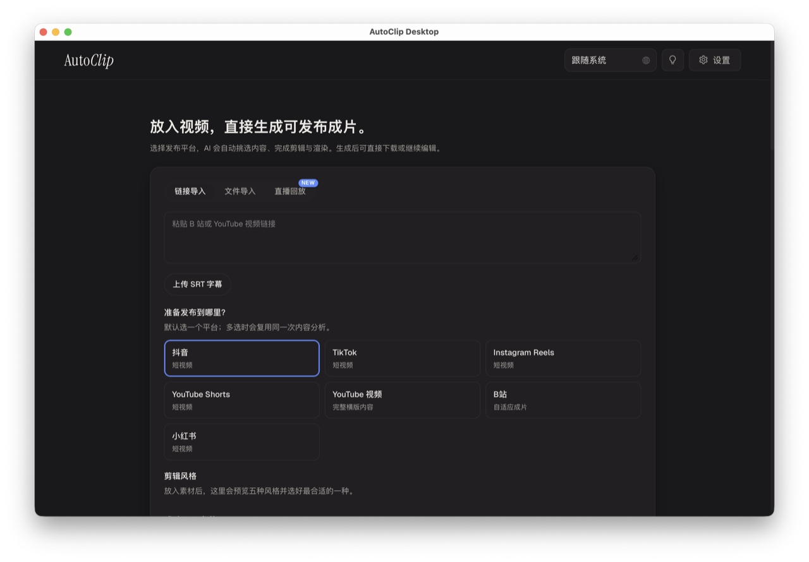
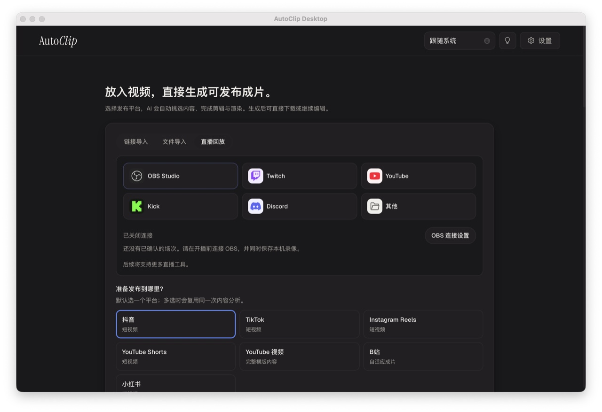
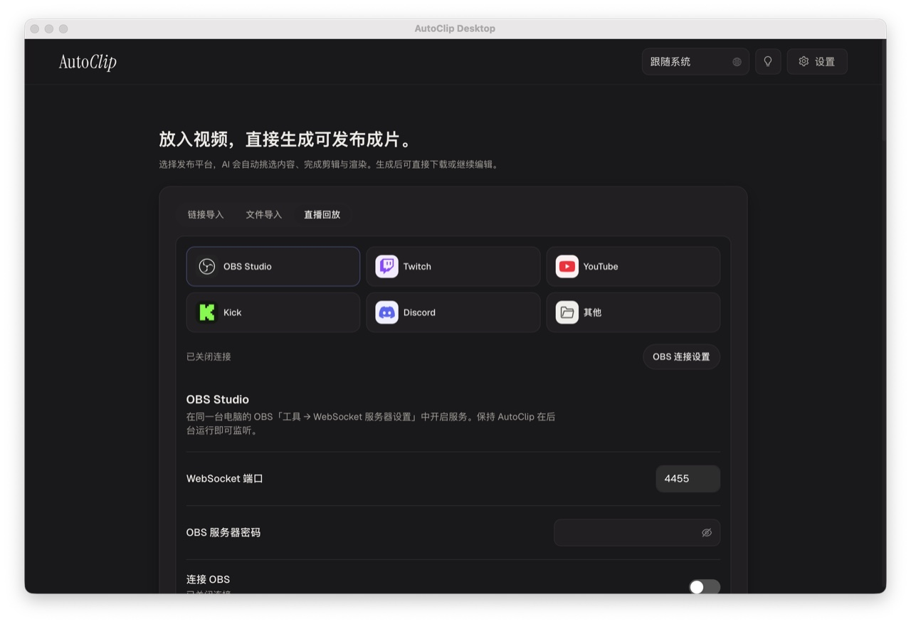
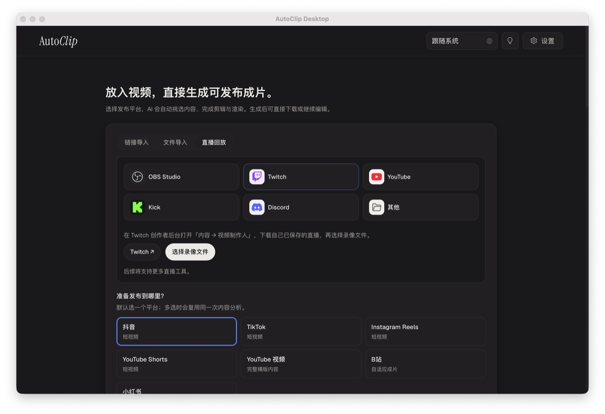
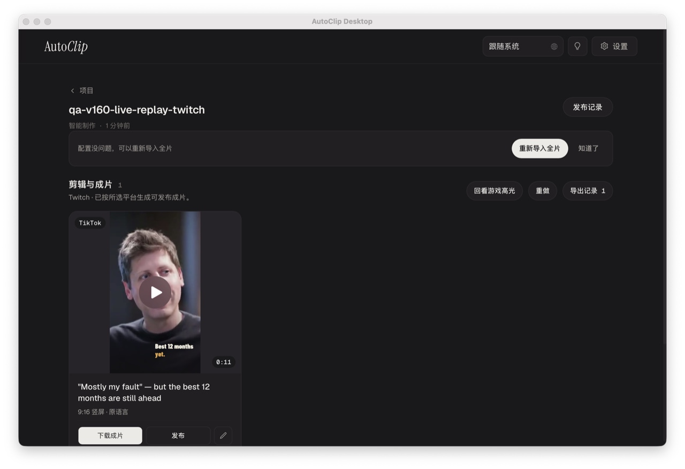

<!-- mcp-name: io.github.zhouxiaoka/autoclip-mcp -->

<div align="center">


# AutoClip

### 放入链接、视频或直播回放，直接生成可发布成片。

开源、本机剪辑与渲染的 AI 切片工具，覆盖 **播客、访谈与游戏直播回放** —— 自动取景、烧录字幕、生成封面与标题文案。

<br>

<p>
  <a href="https://github.com/zhouxiaoka/autoclip/releases/latest"></a>&nbsp;
  <a href="https://github.com/zhouxiaoka/autoclip/stargazers"></a>&nbsp;
  <a href="https://github.com/zhouxiaoka/autoclip/releases"></a>&nbsp;
  &nbsp;
  <a href="../../LICENSE"></a>
</p>

<br>

<p>
  <a href="https://trendshift.io/repositories/25801"></a>
</p>

<br>

<p>
  <a href="https://zhouxiaoka.github.io/autoclip_intro/"><strong>官网</strong></a>
  &nbsp;&middot;&nbsp;
  <a href="https://github.com/zhouxiaoka/autoclip/releases/latest"><strong>下载桌面版</strong></a>
  &nbsp;&middot;&nbsp;
  <a href="https://zhouxiaoka.github.io/autoclip_intro/features/game-streams/"><strong>直播回放 (v1.6)</strong></a>
  &nbsp;&middot;&nbsp;
  <a href="https://zhouxiaoka.github.io/autoclip_intro/cases/"><strong>案例库</strong></a>
  &nbsp;&middot;&nbsp;
  <a href="#quick-start"><strong>快速开始</strong></a>
  &nbsp;&middot;&nbsp;
  <a href="#documentation"><strong>文档</strong></a>
  &nbsp;&middot;&nbsp;
  <a href="https://github.com/zhouxiaoka/autoclip/issues/new/choose"><strong>问题反馈</strong></a>
</p>

<p>
  <a href="../../README.md">English</a> · <strong>简体中文</strong> · <a href="README-ZH-TW.md">繁體中文</a> · <a href="README-JA.md">日本語</a> · <a href="README-KO.md">한국어</a> · <a href="README-ES.md">Español</a> · <a href="README-PT.md">Português</a> · <a href="README-RU.md">Русский</a> · <a href="README-FR.md">Français</a> · <a href="README-ID.md">Bahasa Indonesia</a> · <a href="README-TR.md">Türkçe</a> · <a href="README-VI.md">Tiếng Việt</a> · <a href="README-DE.md">Deutsch</a>
</p>

<br>

<p>
  ⭐ <em>免费开源（MIT）、无月费订阅 —— 剪辑与渲染全部在你的电脑上完成。觉得好用欢迎点一个 Star！</em>
</p>

</div>

---

## 产品概览

贴入链接、拖入本地视频，或接入 **直播回放** —— AutoClip 自动挑选高光片段、跟随说话人取景、烧录字幕、生成封面，直接输出适配抖音、小红书、TikTok、Shorts、Reels、B 站与 YouTube 的可发布成片。

**本机优先：** 剪辑与渲染全部在本机完成，无需上传原片排队，也没有订阅费。支持自带云端 API Key，或搭配 **Ollama / LM Studio + Whisper / SenseVoice** 实现 100% 离线运行。


<p align="center"><em>首页 → 6 路直播回放入口 → OBS WebSocket 配置 → Twitch 导入 → 成片卡与一键发布。</em></p>

---

## v1.6 新特性

| 能力 | 说明 |
| :--- | :--- |
| **6 路直播回放** | 首页独立 **直播回放** 入口，覆盖 **OBS Studio、Twitch、YouTube、Kick、Discord 与其他本地录像**。 |
| **OBS 下播自动接管** | 页内配置 OBS WebSocket（`4455`），无损裁剪（`-c copy`）并自动衔接出片队列。 |
| **游戏高光引擎** | 泛化游戏高光识别，支持 **8 秒+** 独立短高光片段，视觉/OCR 预算更紧凑。 |
| **原位切换平台重做** | 统一可播放成片卡，一键切换目标平台重做且保留既有成片。 |
| **13 国语言** | 桌面 UI、系统托盘与 README 全面支持 13 种语言（新增繁中、德、印尼、土、越），支持阿拉伯语 RTL 字幕。 |

<details>
<summary>📸 应用界面截图（5 张）</summary>

<table width="100%">
<tr>
<td align="center" valign="top" width="50%">
<br>
<em>首页 —— 链接导入、文件导入与直播回放</em>
</td>
<td align="center" valign="top" width="50%">
<br>
<em>直播回放 —— 6 路渠道选择</em>
</td>
</tr>
<tr>
<td align="center" valign="top" width="50%">
<br>
<em>OBS Studio WebSocket 页内设置</em>
</td>
<td align="center" valign="top" width="50%">
<br>
<em>Twitch 回放快捷入口与本地录像导入</em>
</td>
</tr>
<tr>
<td align="center" valign="top" colspan="2">
<br>
<em>成片卡 —— 保留渠道来源归属、竖屏取景、字幕与一键下载 / 发布 / 重做</em>
</td>
</tr>
</table>

</details>

---

## 真实成片

点击截图或 **▶ 播放** 直接观看 AutoClip 渲染的完整成片；下方语言指成片烧录字幕语言。

### 竖版 · 访谈与播客

<table width="100%">
<tr>
<td align="center" valign="top" width="25%">
<a href="https://pub-3fb92949b9c2480b89feec5ec03f3540.r2.dev/cases/gates-ezra/01.mp4?v=2026-10-01g"></a><br>
<strong>Bill Gates</strong><br>
访谈式 · 抖音 · 中文<br>
<a href="https://pub-3fb92949b9c2480b89feec5ec03f3540.r2.dev/cases/gates-ezra/01.mp4?v=2026-10-01g">▶ 播放 1:01</a> · <a href="https://www.youtube.com/watch?v=A_156w0aYtU">原片</a>
</td>
<td align="center" valign="top" width="25%">
<a href="https://pub-3fb92949b9c2480b89feec5ec03f3540.r2.dev/cases/ai-labs-debate/01.mp4?v=2026-10-01g"></a><br>
<strong>AI Experts Debate</strong><br>
访谈式 · Shorts · 英文<br>
<a href="https://pub-3fb92949b9c2480b89feec5ec03f3540.r2.dev/cases/ai-labs-debate/01.mp4?v=2026-10-01g">▶ 播放 1:25</a> · <a href="https://www.youtube.com/watch?v=OhOmLqR5nN4">原片</a>
</td>
<td align="center" valign="top" width="25%">
<a href="https://pub-3fb92949b9c2480b89feec5ec03f3540.r2.dev/cases/robbins-36months/01.mp4?v=2026-10-01g"></a><br>
<strong>Tony Robbins</strong><br>
满屏播客 · 抖音 · 中文<br>
<a href="https://pub-3fb92949b9c2480b89feec5ec03f3540.r2.dev/cases/robbins-36months/01.mp4?v=2026-10-01g">▶ 播放 1:45</a> · <a href="https://www.youtube.com/watch?v=DuRcrbP3kag">原片</a>
</td>
<td align="center" valign="top" width="25%">
<a href="https://pub-3fb92949b9c2480b89feec5ec03f3540.r2.dev/cases/garfield-poehler/01.mp4?v=2026-10-01g"></a><br>
<strong>Garfield × Poehler</strong><br>
满屏播客 · Shorts · 英文<br>
<a href="https://pub-3fb92949b9c2480b89feec5ec03f3540.r2.dev/cases/garfield-poehler/01.mp4?v=2026-10-01g">▶ 播放 1:01</a> · <a href="https://www.youtube.com/watch?v=OJV8AaWCxQQ">原片</a>
</td>
</tr>
</table>

### 横版 · 保留原画幅

<table width="100%">
<tr>
<td align="center" valign="top" width="50%">
<a href="https://pub-3fb92949b9c2480b89feec5ec03f3540.r2.dev/cases/luyu-tongliya/01.mp4?v=2026-10-01g"></a><br>
<strong>佟丽娅 × 鲁豫</strong> · 16:9 · B 站 · 中文<br>
<a href="https://pub-3fb92949b9c2480b89feec5ec03f3540.r2.dev/cases/luyu-tongliya/01.mp4?v=2026-10-01g">▶ 播放 1:41</a> · <a href="https://www.bilibili.com/video/BV1qheu6kEFV/">原片</a>
</td>
<td align="center" valign="top" width="50%">
<a href="https://pub-3fb92949b9c2480b89feec5ec03f3540.r2.dev/cases/altman-uses-ai/01.mp4?v=2026-10-01g"></a><br>
<strong>Sam Altman</strong> · 16:9 · B 站 · 中文<br>
<a href="https://pub-3fb92949b9c2480b89feec5ec03f3540.r2.dev/cases/altman-uses-ai/01.mp4?v=2026-10-01g">▶ 播放 2:02</a> · <a href="https://www.youtube.com/watch?v=jZh55CQwSh8">原片</a>
</td>
</tr>
</table>

<details>
<summary>查看更多 10 条真实成片</summary>

<table width="100%">
<tr>
<td align="center" valign="top" width="25%">
<a href="https://pub-3fb92949b9c2480b89feec5ec03f3540.r2.dev/cases/neumann-doac/01.mp4?v=2026-10-01g"></a><br>
<strong>Adam Neumann</strong><br>
满屏播客 · TikTok · 英文<br>
<a href="https://pub-3fb92949b9c2480b89feec5ec03f3540.r2.dev/cases/neumann-doac/01.mp4?v=2026-10-01g">▶ 播放 0:59</a> · <a href="https://www.youtube.com/watch?v=IQ4JVWdj4Q0">原片</a>
</td>
<td align="center" valign="top" width="25%">
<a href="https://pub-3fb92949b9c2480b89feec5ec03f3540.r2.dev/cases/luyu-xiaoqi/02.mp4?v=2026-10-01g"></a><br>
<strong>小奇 × 鲁豫</strong><br>
访谈式 · 抖音 · 中文<br>
<a href="https://pub-3fb92949b9c2480b89feec5ec03f3540.r2.dev/cases/luyu-xiaoqi/02.mp4?v=2026-10-01g">▶ 播放 0:50</a> · <a href="https://www.bilibili.com/video/BV1ighy6AEPz/">原片</a>
</td>
<td align="center" valign="top" width="25%">
<a href="https://pub-3fb92949b9c2480b89feec5ec03f3540.r2.dev/cases/luyu-guokeyu/01.mp4?v=2026-10-01g"></a><br>
<strong>郭柯宇 × 鲁豫</strong><br>
访谈式 · 抖音 · 中文<br>
<a href="https://pub-3fb92949b9c2480b89feec5ec03f3540.r2.dev/cases/luyu-guokeyu/01.mp4?v=2026-10-01g">▶ 播放 1:11</a> · <a href="https://www.bilibili.com/video/BV1LDYV6HEXR/">原片</a>
</td>
<td align="center" valign="top" width="25%">
<a href="https://pub-3fb92949b9c2480b89feec5ec03f3540.r2.dev/cases/dafoe-hot-ones/01.mp4?v=2026-10-01g"></a><br>
<strong>Willem Dafoe</strong><br>
满屏播客 · TikTok · 英文<br>
<a href="https://pub-3fb92949b9c2480b89feec5ec03f3540.r2.dev/cases/dafoe-hot-ones/01.mp4?v=2026-10-01g">▶ 播放 1:07</a> · <a href="https://www.youtube.com/watch?v=YqugY2zTIoI">原片</a>
</td>
</tr>
<tr>
<td align="center" valign="top" width="25%">
<a href="https://pub-3fb92949b9c2480b89feec5ec03f3540.r2.dev/cases/tim-luoyonghao/01.mp4?v=2026-10-01g"></a><br>
<strong>TIM × 罗永浩</strong><br>
访谈式 · 抖音 · 中文<br>
<a href="https://pub-3fb92949b9c2480b89feec5ec03f3540.r2.dev/cases/tim-luoyonghao/01.mp4?v=2026-10-01g">▶ 播放 1:05</a> · <a href="https://www.bilibili.com/video/BV1B5xkzPEhx/">原片</a>
</td>
<td align="center" valign="top" width="25%">
<a href="https://pub-3fb92949b9c2480b89feec5ec03f3540.r2.dev/cases/jensen-dwarkesh/01.mp4?v=2026-10-01g"></a><br>
<strong>Jensen Huang</strong><br>
访谈式 · 小红书 · 中文<br>
<a href="https://pub-3fb92949b9c2480b89feec5ec03f3540.r2.dev/cases/jensen-dwarkesh/01.mp4?v=2026-10-01g">▶ 播放 1:17</a> · <a href="https://www.youtube.com/watch?v=Hrbq66XqtCo">原片</a>
</td>
<td align="center" valign="top" width="25%">
<a href="https://pub-3fb92949b9c2480b89feec5ec03f3540.r2.dev/cases/karpathy-dwarkesh/01.mp4?v=2026-10-01g"></a><br>
<strong>Andrej Karpathy</strong><br>
访谈式 · 抖音 · 中文<br>
<a href="https://pub-3fb92949b9c2480b89feec5ec03f3540.r2.dev/cases/karpathy-dwarkesh/01.mp4?v=2026-10-01g">▶ 播放 0:43</a> · <a href="https://www.youtube.com/watch?v=lXUZvyajciY">原片</a>
</td>
<td align="center" valign="top" width="25%">
<a href="https://pub-3fb92949b9c2480b89feec5ec03f3540.r2.dev/cases/apple-a20/01.mp4?v=2026-10-01g"></a><br>
<strong>A20 Pro</strong><br>
访谈式 · 小红书 · 中文<br>
<a href="https://pub-3fb92949b9c2480b89feec5ec03f3540.r2.dev/cases/apple-a20/01.mp4?v=2026-10-01g">▶ 播放 2:00</a> · <a href="https://www.bilibili.com/video/BV1e4Y96FEaJ/">原片</a>
</td>
</tr>
<tr>
<td align="center" valign="top" width="25%">
<a href="https://pub-3fb92949b9c2480b89feec5ec03f3540.r2.dev/cases/stallone-nyt/01.mp4?v=2026-10-01g"></a><br>
<strong>Sylvester Stallone</strong><br>
访谈式 · 抖音 · 中文<br>
<a href="https://pub-3fb92949b9c2480b89feec5ec03f3540.r2.dev/cases/stallone-nyt/01.mp4?v=2026-10-01g">▶ 播放 1:39</a> · <a href="https://www.youtube.com/watch?v=ccs-B_nTfZs">原片</a>
</td>
<td align="center" valign="top" width="25%">
<a href="https://pub-3fb92949b9c2480b89feec5ec03f3540.r2.dev/cases/mrbeast-colin-samir/01.mp4?v=2026-10-01g"></a><br>
<strong>MrBeast</strong><br>
满屏播客 · TikTok · 英文<br>
<a href="https://pub-3fb92949b9c2480b89feec5ec03f3540.r2.dev/cases/mrbeast-colin-samir/01.mp4?v=2026-10-01g">▶ 播放 1:42</a> · <a href="https://www.youtube.com/watch?v=9IQ_ldV9z_A">原片</a>
</td>
<td></td>
<td></td>
</tr>
</table>

</details>

更多 16+ 完整成片、封面与文案请见 **[官网案例库 →](https://zhouxiaoka.github.io/autoclip_intro/cases/)**，欢迎[投稿你的成片](https://github.com/zhouxiaoka/autoclip/discussions/new?category=show-and-tell)。原片版权归原作者，仅作效果展示。

---

<a id="quick-start"></a>

## 快速开始

| 使用场景 | 推荐方式 | 环境要求 |
| :--- | :--- | :--- |
| **桌面端（最省心）** | 前往 [Releases](https://github.com/zhouxiaoka/autoclip/releases/latest) 下载 `.dmg` / `-setup.exe` | Apple Silicon macOS 或 Windows 10/11 x64（内置 Python 与 FFmpeg） |
| **AI Agent / CLI / MCP** | `uvx autoclip-mcp` 或 `npx skills add zhouxiaoka/autoclip` | Python 3.10+（推荐 3.11）与 FFmpeg |
| **自建 Web / Linux / Intel Mac** | `docker compose up -d --build` | Docker 与 Compose v2 |

### 1. 桌面端

1. 前往 **[GitHub Releases](https://github.com/zhouxiaoka/autoclip/releases/latest)** 下载最新安装包（Apple Silicon macOS 选 `aarch64.dmg`，Windows 选 `x64-setup.exe`），已内置便携 Python 与 FFmpeg。
2. 打开 **设置**，选择云端模型服务商（或启动 Ollama / LM Studio），测试连接后保存；也可以免 Key 直接点 **先看自带示例** 体验。
3. 贴入链接、拖入本地文件，或切到 **直播回放** 连接 OBS / 导入录像，选好发布平台点 **生成**。

> 安装包均在公开 GitHub Actions（`Desktop Build`）构建，支持通过 `build-provenance.json` 校验 SHA-256；代码签名与公证进展跟踪见 [#119](https://github.com/zhouxiaoka/autoclip/issues/119)。

### 2. CLI 与 MCP（Claude Code、Codex、OpenCode 与脚本）

```bash
uvx autoclip-mcp
npx skills add zhouxiaoka/autoclip

autoclip --version
autoclip produce talk.mp4 --srt talk.srt --platform tiktok --portrait-style podcast --json
autoclip outputs PROJECT_ID --export-kits
```

<details>
<summary>离线 Wheel、源码安装与 MCPB 打包</summary>

```bash
# Install from a downloaded CLI/MCP release ZIP wheel
python3 -m venv .venv && source .venv/bin/activate
python -m pip install -r requirements.txt
python -m pip install --force-reinstall --no-deps autoclip_mcp-*-py3-none-any.whl

# Or install from source
python -m pip install --no-deps .
```

如需本地构建 MCPB 包而不发布，运行 `python scripts/pack_mcpb.py`（不自动执行 `smithery mcp publish`）。

</details>


### 3. Docker / Web

```bash
git clone https://github.com/zhouxiaoka/autoclip.git
cd autoclip
cp env.example .env
mkdir -p data logs uploads
docker compose up -d --build
```

浏览器打开 `http://localhost:3000`（后端 API 文档在 `http://localhost:8000/docs`）。绑定挂载权限与自定义域名配置见 [Docker 指南](../DOCKER.md)。

---

## 实测耗时与费用

在 Apple Silicon Mac 上实测（文本模型费用按 `qwen-plus` 用量估算，不含云端语音识别与 AI 生图，实际账单以服务商为准）：

| 输入条件 | 原片素材 | 耗时与产出 | 估算文本模型费用 |
| :--- | :--- | ---: | ---: |
| **自带作者字幕** | Jensen Huang · 1h 43m（英 → 小红书） | **7.5 分钟 / 10 条** | **¥0.09** |
| **无字幕（本地 Whisper）** | TIM × 罗永浩 · 2h 52m（中 → 抖音） | 29.5 分钟 / 10 条 | ¥0.20 |

---

## 特别感谢 ❤️

<table>
  <tr>
    <td align="center" width="140">
      <a href="https://go.apimart.ai/tw-autoclip"></a><br>
      <a href="https://go.apimart.ai/tw-autoclip"><strong>APIMart</strong></a>
    </td>
    <td>
      感谢 <strong>APIMart</strong> 赞助了本项目！<strong>APIMart</strong> 是专注 AI 图片/视频生成的低价 API 平台，GPT-Image-2 低至 <strong>$0.006/张</strong>，1 美元可出图 <strong>160+</strong> 张。图片、视频一套异步 API 通吃，提交任务拿 ID、回调取结果，跑批万张不超时、换模型不改代码。按量付费、无月费，通过此<a href="https://go.apimart.ai/tw-autoclip">注册链接</a>注册即可开用。
    </td>
  </tr>
</table>

## 阿里云百炼云端转写

*以下为推荐返佣链接（独立于上方赞助商）：* 先注册阿里云，再去百炼控制台创建 API Key，回到 AutoClip **设置 → 默认模型 → 语音转字幕** 中开启百炼云端语音识别。

1. [阿里云注册](https://www.aliyun.com/benefit?userCode=qmyj6jch)（返佣链接）
2. [百炼控制台](https://bailian.console.aliyun.com/) — 创建 API Key

---

## 常见问题

<details>
<summary>需要付费或 API Key 吗？</summary>

软件免费开源（MIT）。云端分析、云端转写与 AI 封面使用你自己的 API Key，按服务商计费（本地文字封面默认免费）；使用 Ollama / LM Studio 无需云端 Key。直发投稿使用你自己的 B 站或 [Upload-Post](https://www.upload-post.com) 账号。

</details>

<details>
<summary>我的视频会上传吗？</summary>

剪辑与渲染都在本机完成。云端分析仅发送字幕文本；视觉模型仅发送抽帧图片；云端转写会上传音频。搭配本地模型 + Whisper / SenseVoice 可全程离线。统计与崩溃报告可在设置中关闭，详见 [隐私说明](../PRIVACY.md)。

</details>

<details>
<summary>什么视频效果最好？</summary>

播客、访谈、讲座、课程与游戏直播回放（OBS / Twitch / YouTube / Kick / Discord）。带作者字幕的素材最快；无字幕可使用本地 Whisper / SenseVoice 或云端转写。游戏画面或少对话直播建议开启支持视觉的模型。

</details>

<details>
<summary>为什么没有生成片段？</summary>

先看失败阶段：字幕/转写、模型连通、FFmpeg、磁盘空间或平台时长要求（YouTube 长视频要求 ≥180 秒，短视频请选 Shorts / TikTok / 抖音 / B 站）。仍无法解决请附 `autoclip --version`、系统、模型与脱敏日志提 Issue，或先查看 [已知问题 (#96)](https://github.com/zhouxiaoka/autoclip/issues/96)。

</details>

[完整排错指南](../FAQ.md) · [已知问题](https://github.com/zhouxiaoka/autoclip/issues/96)

---

<a id="documentation"></a>

## 文档

| 主题 | 指南 |
| :--- | :--- |
| 安装与首次出片 | [安装指南](../USER_INSTALLATION_GUIDE.md) |
| 自部署与 Agent | [Docker](../DOCKER.md) · [CLI 与 MCP](../CLI_AND_MCP.md) · [Agent Skill](../../skills/autoclip/SKILL.md) · [OpenCode](../OPENCODE.md) |
| 模型与排错 | [多模型配置](../MULTI_LLM_PROVIDER_GUIDE.md) · [常见问题](../FAQ.md) |
| 版本与隐私 | [更新日志](../../CHANGELOG.md) · [路线图](../ROADMAP.md) · [社区看板](../COMMUNITY_BOARD.md) · [隐私说明](../PRIVACY.md) |
| 专题研究 | [什么决定播放量](../research/2026-10-what-drives-views/article-zh.md) · [English](../research/2026-10-what-drives-views/article-en.md) |
| 参与贡献与翻译 | [贡献指南](../../CONTRIBUTING.md) · [多语言说明](../i18n.md) |

## 参与贡献

欢迎提交修复、出片样例、使用反馈和翻译改进。如果 AutoClip 帮到了你，欢迎给项目一个 ⭐ Star。

- **提问与交流：** [GitHub Discussions](https://github.com/zhouxiaoka/autoclip/discussions) · [第一次出片问答](https://github.com/zhouxiaoka/autoclip/discussions/128) · [分享想法](https://github.com/zhouxiaoka/autoclip/discussions/129)
- **报告故障：** 使用 [Issue 模板](https://github.com/zhouxiaoka/autoclip/issues/new/choose)，附上系统、版本、所选模型、复现步骤与已脱敏日志
- **合作联系：** [christine_zhouye@163.com](mailto:christine_zhouye@163.com)

个人维护，回复时间不固定，不提供即时客服或一对一部署服务。


基于 FastAPI、React、Tauri、FFmpeg、yt-dlp、Whisper 与 FunASR 构建。[MIT License](../../LICENSE)。
