# What makes an interview clip get watched? Evidence from 27 accounts and 673 posts

*AutoClip Research note #2 · 11 October 2026 · [中文](article-zh.md)*

> **In one line:** most of a clip's reach is set by *who* posts it, and topic type on its own only moves a typical post a little. But inside one account the best post usually beats the worst by more than 12×, and that gap follows a few traits you can write as rules: **a link to a live news event, a speaker who carries weight on the subject, and a method the viewer can use.** The biggest hits are almost all "a famous person on a decision everyone has to make."

---

## Key findings

1. **Account size beats topic.** A typical post on the 27 accounts ranges from 323 to 279,000 views, roughly a 1,000× spread. So every comparison here divides a post by its own account's median. We call that the **lift**.
2. **Topic class alone doesn't separate typical posts.** All eight classes have a median lift between 0.83× and 1.23×, and their uncertainty ranges overlap. Evergreen wisdom (F) is the only class clearly below 1 (0.83×).
3. **A few traits do raise the odds of a hit.** 34% of posts tied to a news event reached 2× their account's median, against 18% of those without. The same comparison gives 32% vs 18% for an actionable method, 30% vs 18% when the speaker is an authority on the topic, and 26% vs 17% for a famous name in the title.
4. **"Personal stakes" alone is not enough.** Posts about money, jobs or health with no famous voice or surprising claim flopped (fell below half the account median) 29% of the time. That corrects our earlier belief that personal stakes were the strongest lever.
5. **On Xiaohongshu, conflict and events draw comments, methods do not.** In one day's AI-topic chart, conflict and event posts got 27–31 comments per 100 likes. Methods got 2.
6. **Our own account fits the pattern.** Both featuring Musk: "Why still go to college?" drew 759 views, over 5× the 143 for "AI can already replace half of jobs."

---

## Case index

| # | Case | Finding | Result |
|---|---|---|---|
| 01 | Chamath: software IP just became worthless (X) | News-tied | 7.1× |
| 02 | Jensen Huang vs Pinterest founder (same account, same day, X) | Authority fit / backstory lead | 5.2× vs 0.29× |
| 03 | Peter Thiel: a company's name predicts its fate (X) | Famous × universal decision | 23.5× |
| 04 | 昌健胡说: work/exams vs brain/encryption | Stakes + hook vs stakes flop | 181K / 117K vs 5.4K / 5.6K |
| 05 | Go For It: Musk on advice vs holiday greeting | Biggest hit | 46.8× vs 0.11× |
| 06 | DOAC: choosing the right life partner | Usable method | 27.5× |
| 07 | SiliconRoshi: four steps to AI vs no technical co-founder | Method vs niche stakes question | 4.6× vs 0.08× |
| 08 | Lex Clips: Musk on Israel–Palestine vs unnamed AGI forecast | Named vs unnamed | 18.8× vs 0.18× |
| 09 | Huberman: memories and emotions affect immunity | Mechanism + authority | 4.1× |
| 10 | Xiaohongshu AI chart: Terence Tao story vs how-to posts | Conflict and events draw comments | 22–67 vs 1–2 per 100 likes |
| 11 | 硅谷好胖友 profile page | Seed account: famous list vs speakerless stat | 4,243 vs 11 likes |
| 12 | AutoClip's own Xiaohongshu | Personal decision vs stale claim | 759 vs 143 views |

## 1. Why we did this

AutoClip turns long interviews into short clips. Our [earlier editing study](../2026-10-what-drives-views/article-en.md) found that **the same account with the same packaging can see a 100× gap in views**, and the gap came from content, not editing tricks. The next question: **which content gets watched?** The answer decides which segment AutoClip's selection radar should cut first.

## 2. Data and method, in plain terms

### 2.1 Sample

| Source | What | Posts | Verifiable? |
|---|---|---|---|
| X timelines | Recent video posts from 8 interview/podcast accounts, with impressions, likes, bookmarks, replies | 122 video posts (272 fetched) | Public X API data |
| YouTube Shorts channels | Latest 10 Shorts from 20 interview-clip and explainer channels | 187 | Public YouTube pages |
| Xiaohongshu & Douyin AI-topic daily chart | One day's top-ranked posts from a public third-party ranking, with likes, comments, shares | 71 (37 XHS, 34 Douyin) | Public page, archived |
| Earlier curated cases | Hits and misses we hand-picked in past batches (X / Shorts) | 135 | Linked, but selected |
| Our own Xiaohongshu account | 5 published clips | 5 | Read from our backend |
| **Total** | | **673 posts, 212 accounts** | |

**The main analysis uses only the first two rows** (309 posts, 27 accounts). Those rows hold *everything* an account posted recently, good and bad, with no picking by us. Chart entries and curated cases are survivors, so they skew toward what hits look like.

### 2.2 Lift

A post's **lift** = its views ÷ the median views of that account's posts in our sample. 1× is a normal post for that account; 2× is double. That lets big and small accounts sit on one scale. For X we use impressions (times the post was shown); for YouTube we use views.

- **Hit**: lift ≥ 2×.
- **Flop**: lift ≤ 0.5×.

### 2.3 Coding: two kinds of label per post

**One topic class** (mutually exclusive):

| Class | Name | Example |
|---|---|---|
| A | Personal stakes: money, work, school, health, family | "Why still go to college?" |
| B | Counter-consensus: not X but Y, surprising forecast | "Software IP just became worthless" |
| C | Conflict / take a side: rebuttal, two camps | "Terence Tao leads mathematicians against OpenAI" |
| D | Method / explainer: how to, why it works | "Four steps to hand your weekly chores to AI" |
| E | News event: hung on something happening now | "Today's Nobel Prize" |
| F | Evergreen story / wisdom: life lessons, anecdotes, speeches | "Jim Carrey: do what you love" |
| G | Emotion / meme: funny, moving, AI drama | AI-generated short drama |
| H | No clear claim / promo: episode trailers, greetings, bare links | "New episode is out" |

**Fourteen traits** (several can apply): personal stakes; invites taking a side; counter-consensus; concrete number or new term; promises a "why"; actionable method; famous name in title; speaker is an authority on it; tied to a news event; evergreen life lesson; open conflict; high emotion; backstory/anecdote; full claim readable from the title.

**Who coded:** one coder labelled all 385 posts (main sample, charts and our own account) by hand from the title (for X, the first paragraph of the post). The labels are in `data/manual_codes.txt`. We also tried a keyword rule set. It matched the hand labels only 29% of the time, so it stays in the data for comparison and plays no part in the findings.

### 2.4 Statistics

We use only medians, shares and bootstrap intervals: resample the posts 2,000 times with replacement and keep the middle 90% of the medians. There is no regression. With a few hundred posts, **any gap under about 10 percentage points could be noise**, so we only stress gaps larger than that.

---

## 3. Finding 1: who posts it matters more than what it's about

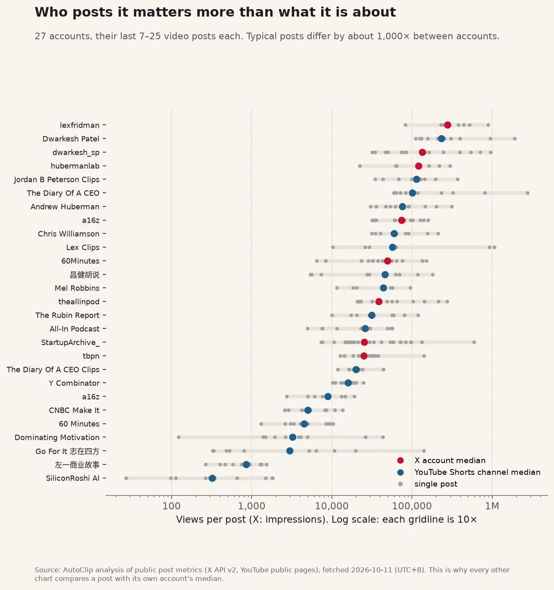

Lex Fridman's typical post gets 279,000 impressions. The smallest Chinese AI channel's typical Short gets 323 views. A flop from a big account still outdraws a hit from a small one. A study tracking 1.6 million Twitter users and 74 million diffusion events found that the largest cascades tend to come from users with many followers and past influence. Content rated interesting also spread more, but which post will explode remained hard to predict (Bakshy et al., 2011).

**For AutoClip:** we can't change a user's audience size. What we can do is **pick the better clip inside one account**. Within an account, the best and worst posts differ by a median **12.5×**. That's a lot of room.

## 4. Finding 2: topic class alone barely moves the typical post

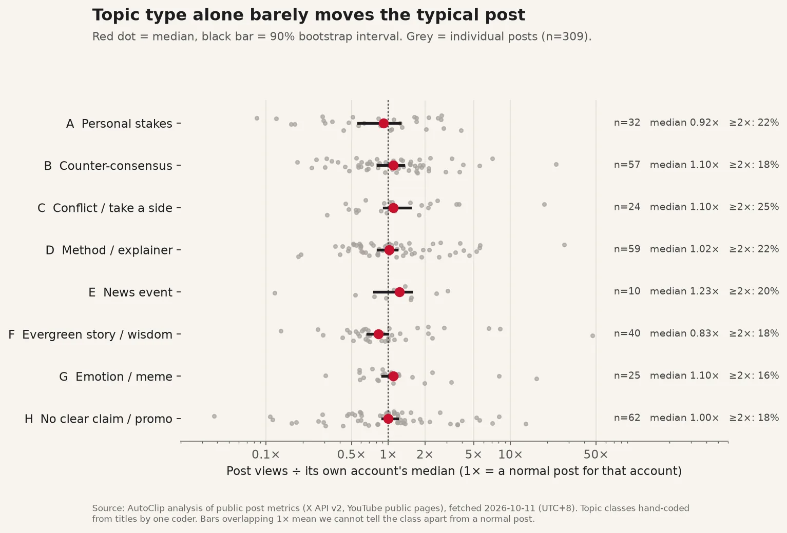

All eight medians sit close to 1×. **Choosing a class is not a useful switch on its own.** An account posting a counter-consensus take or a how-to usually lands about the same.

Two details:

- **Evergreen wisdom (F) has a median of 0.83×**, the only class clearly below 1. It also holds the biggest hit in the whole sample (Musk on "what advice to seek," 47× its channel). Evergreen clips **mostly do so-so and once in a while explode**.
- **News events (E) have the highest median (1.23×)**, but only 10 posts and a wide range, so no firm conclusion.

## 5. Finding 3: four traits that raise the hit rate

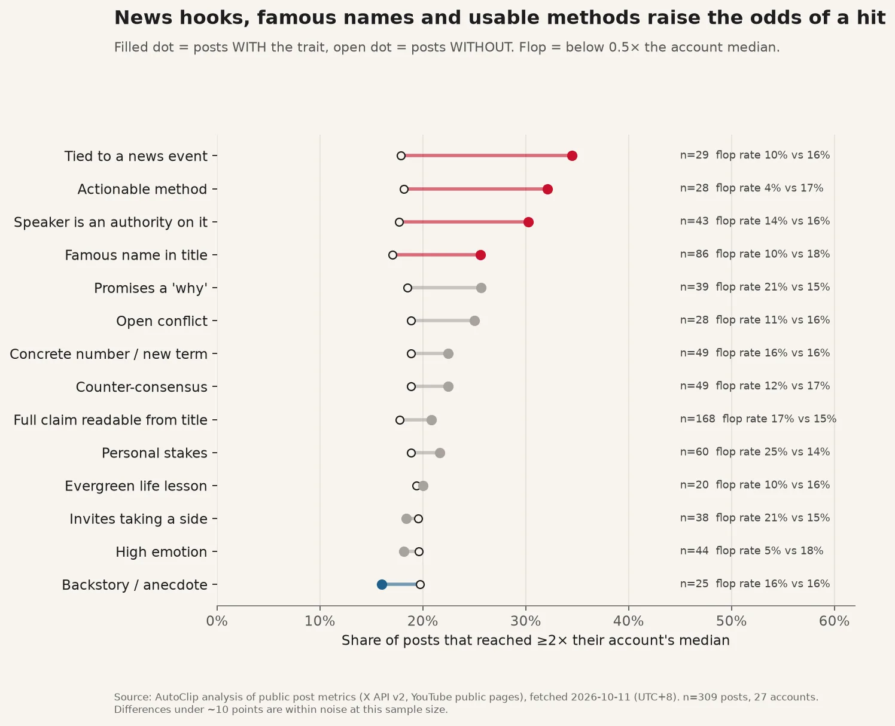

For each of the 14 traits, we compared posts with it and without it on the chance of reaching 2×:

| Trait | With | Without | Reading |
|---|---|---|---|
| Tied to a news event | **34%** | 18% | People attend to novelty, though the attention fades fast (Wu & Huberman, 2007) |
| Actionable method | **32%** | 18% | And only 4% flop: the safest trait |
| Speaker is an authority on it | **30%** | 18% | When people scroll fast and don't think hard, "who is saying it" works as a shortcut (Petty & Cacioppo, 1986); Jensen Huang on chips carries more weight than on parenting |
| Famous name in title | **26%** | 17% | Flop rate 10% vs 18% |
| Backstory / anecdote | 16% | 20% | **The only trait that clearly drags**: median 0.71× |

### Cases: what the four traits look like

Each breakdown below shows the cover, key frames, title, metrics, lift over the account median, and notes on title pattern, cover pattern, hook and why it hit or flopped. Covers and frames are reduced-size stills used for commentary; copyright stays with the original creators.

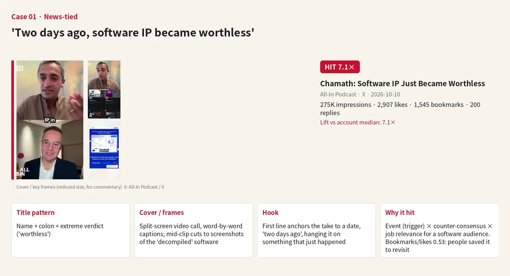

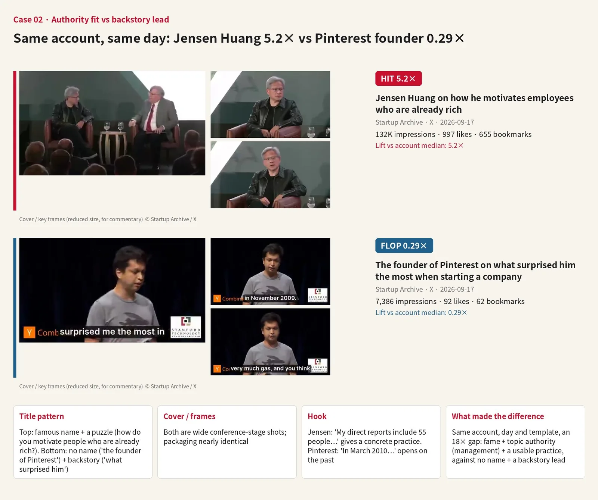

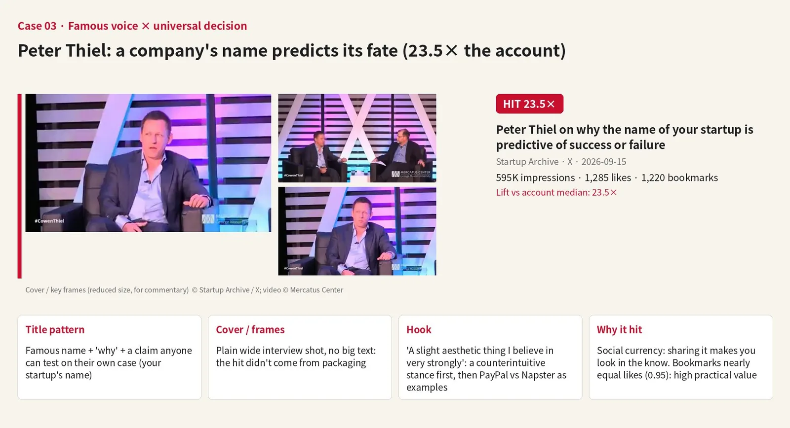

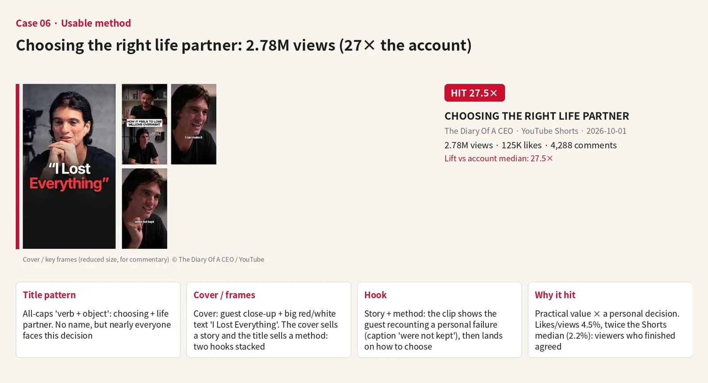

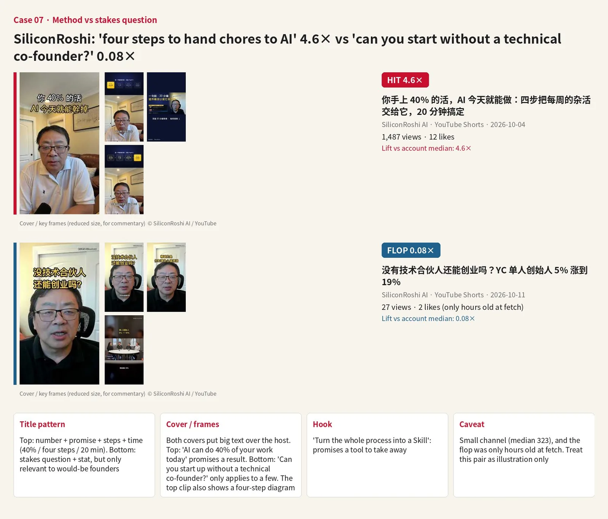

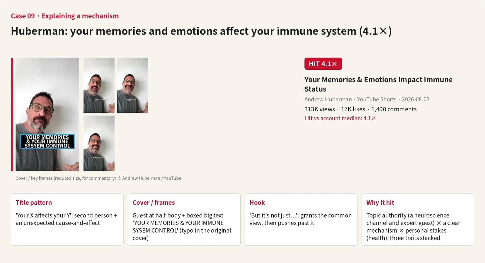

The traits that did **not** separate matter too:

- **Inviting a side and high emotion** don't raise the hit rate. High emotion does cut flops (5%). It works as a floor, not an amplifier. This differs from a study of New York Times articles, where high-arousal emotions (awe, anger, anxiety) clearly made articles more shared (Berger & Milkman, 2012). A possible reason: we code titles only and measure views, not shares.
- **Personal stakes** shows almost no hit-rate gain (22% vs 19%), and **flops more (25% vs 14%)**.

### Why personal stakes alone fall short

This contradicts our earlier intuition, so it gets a closer look. Take the Chinese channel 昌健胡说: same host, same template, ten Shorts in the same week.

| Title (translated) | Views |
|---|---|
| A billionaire predicts: no need to work in future, but the next 10 years are the hardest? | **181K** |
| Jensen Huang: AI made homework better but exams worse? | **117K** |
| Turing winner Yann LeCun: robots can do kung fu, so why not housework? | 70K |
| Immunology professor: hold on 10 years, maybe live 50 more? | 7.4K |
| Why is Google rushing to change locks before 2029? Can today's data be cracked later? | 5.6K |
| 2026 Nobel in Medicine: a light switch for the brain? | 5.4K |

"Live 50 more years" and "your data cracked" are personal too, but they sit far from a viewer's **next decision**. "No need to work" and "homework vs exams" touch jobs and children's schooling directly, and a name people recognise is saying it.

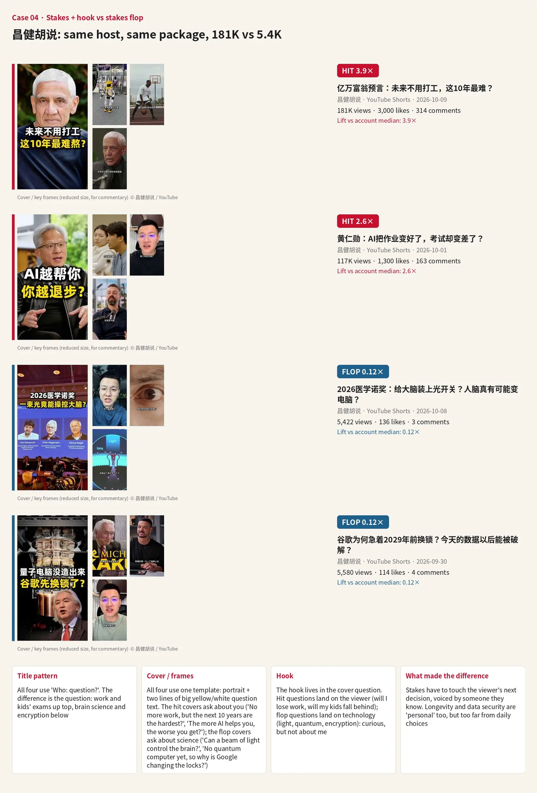

Psychology experiments show that information processed in relation to the self is remembered best (Rogers et al., 1977). But relevance needs a hook to pull people in: a credible voice, a surprising claim, or a live event. **Personal stakes are the base an amplifier sits on, not the amplifier.**

## 6. Finding 4: what the biggest hits look like

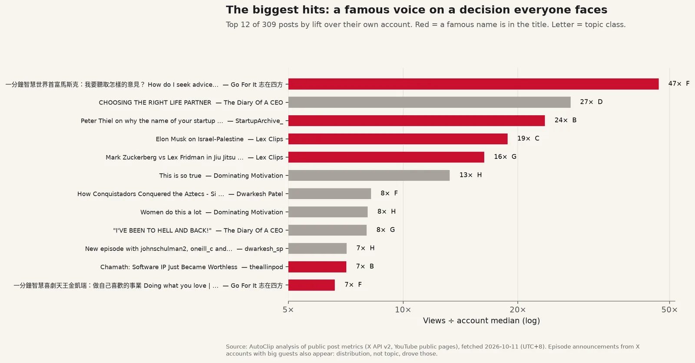

Only 11% of the 309 posts reached 3× their account. The biggest:

- Elon Musk: what kind of advice should I seek? (47×, evergreen)
- Choosing the right life partner (27×, method)
- Peter Thiel: your startup's name predicts success or failure (24×, counter-consensus)
- Elon Musk on Israel–Palestine (19×, conflict)

The shared shape is **a famous or authoritative voice plus a decision or stance nearly everyone faces**. That fits curiosity research: curiosity comes from an information gap, knowing a bit but missing a piece (Loewenstein, 1994), and more curious people spend more time or tokens to get the answer (Kang et al., 2009). Everyone holds half an answer to "whose advice do I listen to" or "who should I marry."

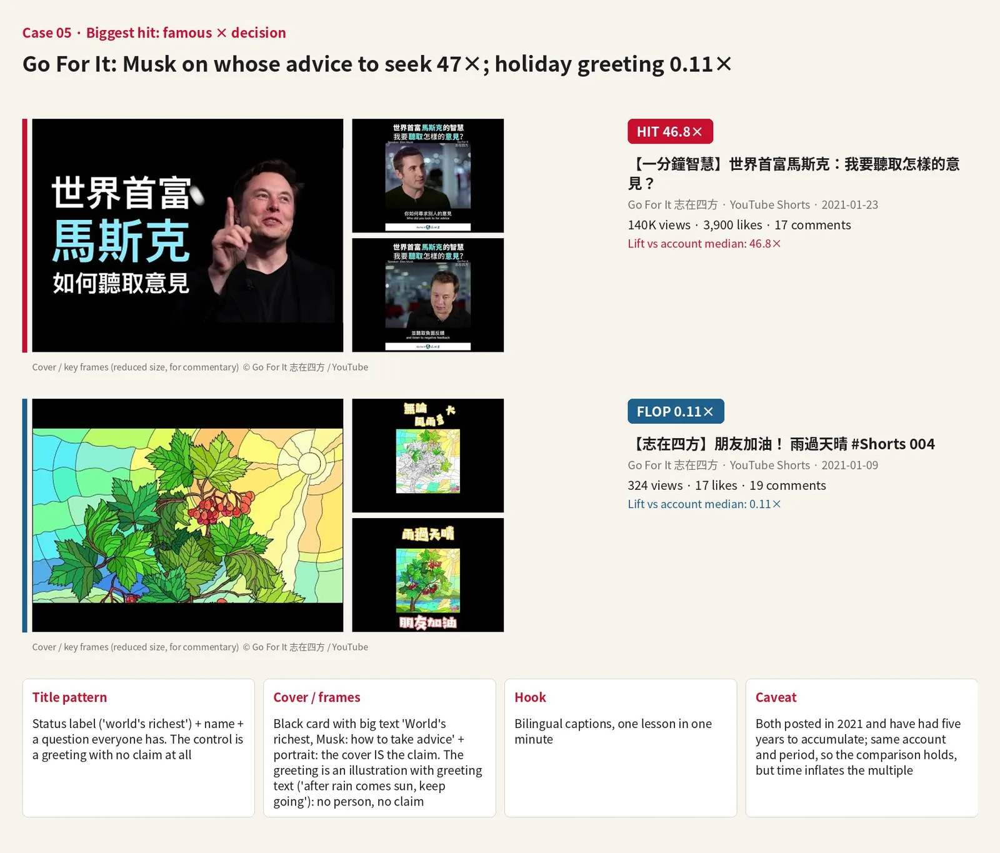

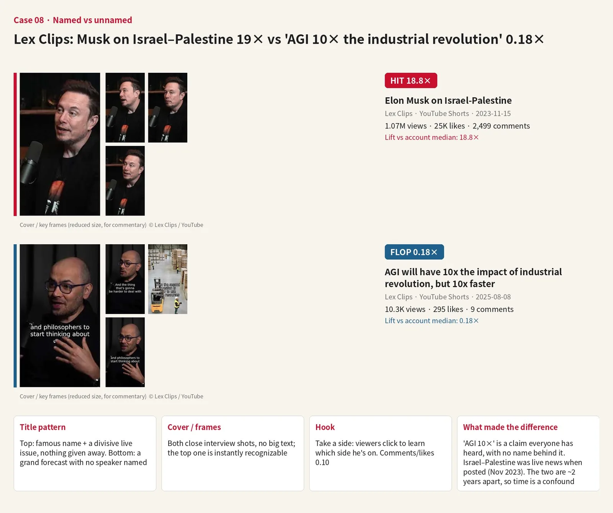

Two caveats:

- **Hits are hard to predict.** In a classic experiment, thousands of people rated and downloaded the same songs in parallel "worlds," and the same song ranked very differently from world to world; seeing others' downloads made success less predictable (Salganik et al., 2006). Rules can raise the odds, never guarantee them.
- **Some top entries are X episode announcements** (Dwarkesh, All-In). Those spread because of the guest and the account's reach, not the topic. We class them as H and leave them out of the topic conclusions.

## 7. Finding 5: Chinese platforms. Memes win likes; conflict and events win comments

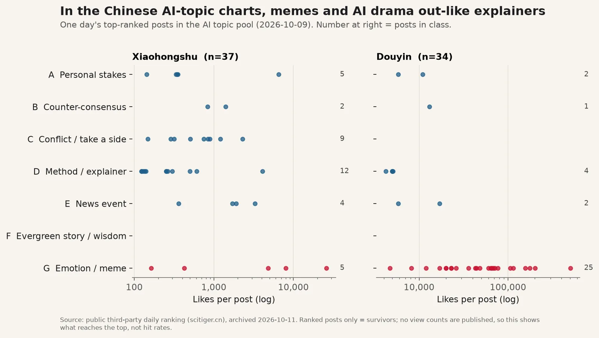

This part uses one day's public third-party AI-topic ranking (2026-10-09). It lists only ranked posts and gives no view counts, so **it shows what reaches the top, not hit rates**.

- **25 of 34 ranked Douyin posts are AI drama or emotion content**, with a median of 48,000 likes. Explainers top out in the thousands.
- **Xiaohongshu is more mixed.** Methods (D) are the largest class (12 posts) but have a median of 253 likes; memes have 4,800.
- **Comments per 100 likes** show the clearest split:

| Xiaohongshu class | Posts | Median likes | Comments per 100 likes |
|---|---|---|---|
| C Conflict / take a side | 9 | 748 | **27** |
| E News event | 4 | 1,800 | **31** |
| A Personal stakes | 5 | 345 | 6 |
| G Emotion / meme | 5 | 4,800 | 5 |
| D Method / explainer | 12 | 253 | **2** |

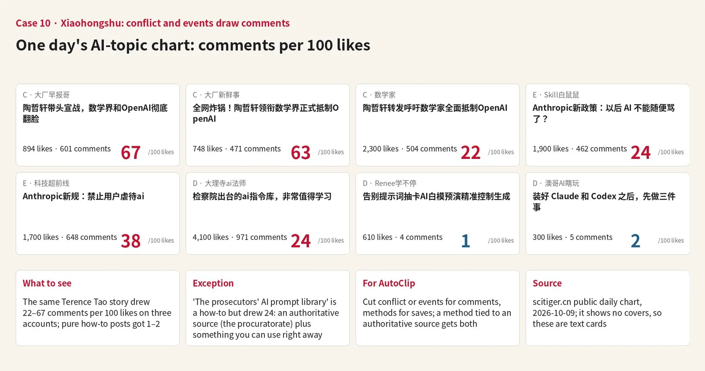

The seed account 硅谷好胖友 has no public timeline data, so we broke down Charlie's screenshots of its profile page (likes only):

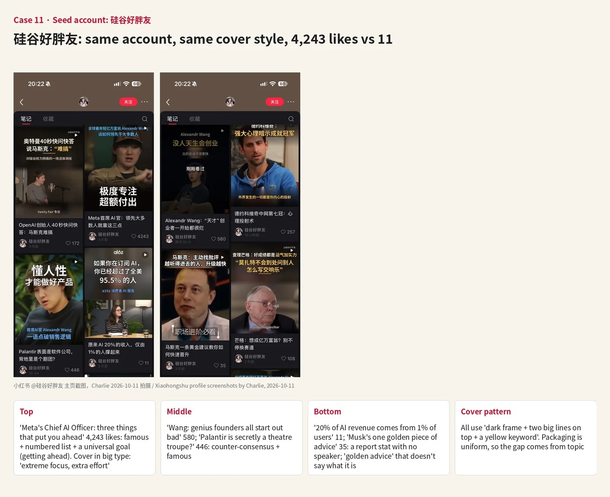

That matches research showing controversy drives conversation, though too much makes people hold back, so moderate controversy talks most (Chen & Berger, 2013), and in political tweets each additional moral-emotional word raised retweets by about 20% (Brady et al., 2017).

**For AutoClip:** interview clips won't out-like AI drama. Our route is **methods to earn saves, conflict and events to earn comments**, with comments pushing the post to more people. (The ranking's "🔁" column could be saves or shares on Xiaohongshu, and we couldn't confirm which, so we draw no conclusion from it.)

## 8. Finding 6: our own account

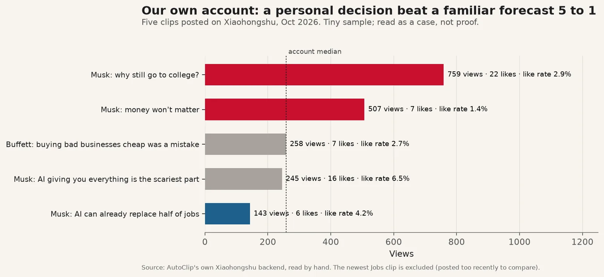

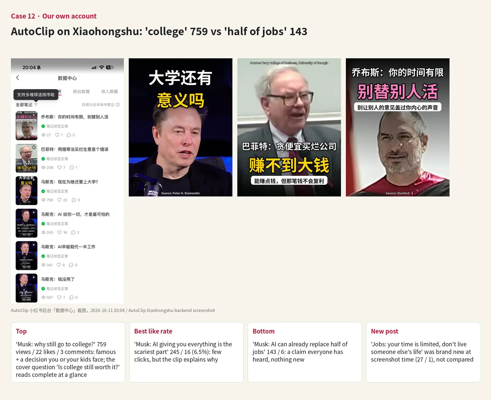

| Clip (translated title) | Views | Likes | Like rate |
|---|---|---|---|
| Musk: why still go to college? | 759 | 22 | 2.9% |
| Musk: money won't matter | 507 | 7 | 1.4% |
| Buffett: buying bad businesses cheap (cigar-butt investing) was a mistake | 258 | 7 | 2.7% |
| Musk: AI giving you everything is the scariest part (on universal high income) | 245 | 16 | **6.5%** |
| Musk: AI can already replace half of jobs | 143 | 6 | 4.2% |

(The newest Jobs clip is too recent to compare.)

- The two most-watched are both **a famous name plus a decision you make yourself** (college, saving).
- "AI can already replace half of jobs" is also Musk, but it's **a claim everyone has heard** with nothing new, and it came last. A famous name can't carry a stale claim.
- "AI giving you everything" (on universal high income) drew few clicks but the highest like rate. The topic is abstract, so fewer people opened it, but the clip explained the *why* and those who watched liked it.

Five posts are too few to prove anything, but they point the same way as the outside data.

## 9. What underperforms

Strongest evidence first:

1. **Greetings, trailers, bare links** (H). On one channel (Go For It), a celebrity quote drew 140K views and holiday greetings drew around 300.
2. **Leading with backstory**: "how he once…" titles have a median of 0.71×. Keep the story in the clip and put the conclusion in the title.
3. **Personal stakes with no hook**: health, security and longevity topics with no famous voice or surprising claim flop often.
4. **Claims everyone has heard**: "AI will take many jobs" did poorly on our account and in earlier batches.
5. **Evergreen philosophy that never lands on a decision**: F's median is 0.83×. Rewrite it as "should you…" to give it a chance.

## 10. What we change in AutoClip's selection radar

Full detail in [`radar-patch.md`](radar-patch.md). In short:

- **Score up**: live event link, speaker authority on the topic, actionable method, famous voice × universal decision.
- **Score down**: backstory-led titles; personal stakes with no famous voice, surprise or event behind them; claims everyone has heard.
- **Stop rewarding topic class itself.** Class only decides the platform and whether we aim for saves or comments.

## 11. Limitations (please read)

- **The sample leans English.** Only 4 of the 27 main-sample accounts are Chinese. Chinese-platform conclusions rest mostly on a one-day chart and are weak.
- **No Xiaohongshu timelines.** Xiaohongshu blocks scraping, and we did not use any login credentials to get around it. Metrics for the seed account 硅谷好胖友 still need to be collected by hand.
- **One coder, not blind to metrics.** X metrics were visible while coding, which could bias the labels. Next step: a second, blind coder and an agreement score.
- **X counts impressions, YouTube counts views.** They aren't comparable, so we only compare within an account.
- **Short window.** Each account contributes its latest 7–25 posts, so recent news can sway the results.
- **Correlation is not causation.** Event-linked posts may hit more partly because accounts put more effort into big moments.

## 12. Data and reproduction

- All posts: `data/posts.csv`, `data/posts.json` (links, metrics, hand labels, rule labels)
- Hand labels: `data/manual_codes.txt`
- Raw pulls: `data/raw/` (X API responses, YouTube scrape, archived ranking page)
- Stats: `data/stats.json`
- Rerun: `bash run_all.sh`

## References

- Bakshy, E., Hofman, J. M., Mason, W. A., & Watts, D. J. (2011). Everyone's an influencer: Quantifying influence on Twitter. *Proceedings of WSDM 2011*, 65–74.
- Berger, J. (2013). *Contagious: Why Things Catch On*. Simon & Schuster. (STEPPS: Social currency, Triggers, Emotion, Public, Practical value, Stories)
- Berger, J., & Milkman, K. L. (2012). What makes online content viral? *Journal of Marketing Research*, 49(2), 192–205.
- Brady, W. J., Wills, J. A., Jost, J. T., Tucker, J. A., & Van Bavel, J. J. (2017). Emotion shapes the diffusion of moralized content in social networks. *PNAS*, 114(28), 7313–7318.
- Chen, Z., & Berger, J. (2013). When, why, and how controversy causes conversation. *Journal of Consumer Research*, 40(3), 580–593.
- Kang, M. J., Hsu, M., Krajbich, I. M., Loewenstein, G., McClure, S. M., Wang, J. T., & Camerer, C. F. (2009). The wick in the candle of learning: Epistemic curiosity activates reward circuitry and enhances memory. *Psychological Science*, 20(8), 963–973.
- Loewenstein, G. (1994). The psychology of curiosity: A review and reinterpretation. *Psychological Bulletin*, 116(1), 75–98.
- Petty, R. E., & Cacioppo, J. T. (1986). The elaboration likelihood model of persuasion. *Advances in Experimental Social Psychology*, 19, 123–205.
- Rogers, T. B., Kuiper, N. A., & Kirker, W. S. (1977). Self-reference and the encoding of personal information. *Journal of Personality and Social Psychology*, 35(9), 677–688.
- Salganik, M. J., Dodds, P. S., & Watts, D. J. (2006). Experimental study of inequality and unpredictability in an artificial cultural market. *Science*, 311(5762), 854–856.
- Wu, F., & Huberman, B. A. (2007). Novelty and collective attention. *PNAS*, 104(45), 17599–17601.

### Mapping to Berger's STEPPS

| STEPPS | Trait in this study | What the data says |
|---|---|---|
| Social currency (sharing makes me look in the know) | Counter-consensus, concrete number / new term | Slightly positive, not significant |
| Triggers (cues that keep it top of mind) | Tied to a news event | **Strongest positive** (34% vs 18%) |
| Emotion | High emotion, open conflict | Doesn't amplify, but reduces flops |
| Public (visible use) | — (not observable in our data) | — |
| Practical value | Actionable method | **Strong positive**, most reliable |
| Stories | Backstory / anecdote | **Negative when it leads the title** |
