# 什么样的选题能让一条访谈切片多拿播放？——27 个账号、673 条帖子的实测

*AutoClip 研究笔记 #2 · 2026 年 10 月 11 日 · [English](article-en.md)*

> **一句话结论**：播放量的大头由「谁发的」决定，选题类型本身只能小幅拉开差距；但在同一个账号内部，最好的一条和最差的一条通常相差 12 倍以上。差距主要来自几个能写进规则的特征：**挂靠一个正在发生的事件、标题里有一个说话有分量的名人、给出一个能直接用的方法**。最大的爆款几乎都是「名人谈一个人人都要做的决定」。

---

## 要点

1. **账号量级远大于选题。** 27 个账号的普通帖子（中位数）从 323 到 27.9 万不等，相差约 1000 倍。所以本文所有比较都用「这条帖子 ÷ 本账号中位数」，我们叫它**放大倍数**。
2. **只看选题大类，普通帖子分不开。** 八个大类的放大倍数中位数都在 0.83×–1.23× 之间，误差区间互相重叠。「长尾经典」（F）是唯一中位数明显低于 1 的类（0.83×）。
3. **真正拉开命中率的是几个特征。** 挂靠新闻事件的帖子 34% 能到本号 2 倍以上（没有的只有 18%），可执行方法 32% 对 18%，说话人对这个话题有权威 30% 对 18%，标题点出名人 26% 对 17%。
4. **单靠「切身利益」不够。** 讲钱、工作、健康的帖子，如果没有名人或反常识的判断撑着，扑街率（低于本号一半）是 29%，比整体高一截。这修正了我们之前「切身题最强」的判断。
5. **小红书上，冲突和事件带评论，方法带不来评论。** 在单日 AI 话题榜上，冲突站队和事件类帖子每 100 个赞有 27–31 条评论，方法类只有 2 条。
6. **我们自己的号印证了这一点**：同样是马斯克，「现在为啥还要上大学？」759 播放，是「AI 早能取代一半工作」（143）的 5 倍多。

---

## 案例索引

| # | 案例 | 对应发现 | 结果 |
|---|---|---|---|
| 01 | Chamath：软件知识产权已经一文不值（X） | 事件外壳 | 7.1× |
| 02 | 黄仁勋 vs Pinterest 创始人（同号同日，X） | 权威匹配 / 往事开头 | 5.2× vs 0.29× |
| 03 | 彼得·蒂尔：公司名字能预测成败（X） | 名人 × 人人都面对的决定 | 23.5× |
| 04 | 昌健胡说：工作/考试 vs 大脑/加密 | 切身 + 钩子 vs 切身扑街 | 18.1 万 / 11.7 万 vs 5422 / 5580 |
| 05 | 志在四方：马斯克听取意见 vs 节日问候 | 最大爆款 | 46.8× vs 0.11× |
| 06 | DOAC：怎么选对人生伴侣 | 可执行方法 | 27.5× |
| 07 | SiliconRoshi：四步交给 AI vs 没技术合伙人 | 方法 vs 窄众切身问句 | 4.6× vs 0.08× |
| 08 | Lex Clips：马斯克谈以巴 vs 无名 AGI 预言 | 名人 vs 无名 | 18.8× vs 0.18× |
| 09 | Huberman：记忆和情绪影响免疫 | 讲清机制 + 权威 | 4.1× |
| 10 | 小红书 AI 日榜：陶哲轩事件 vs 方法帖 | 冲突和事件带评论 | 22–67 vs 1–2 条/100 赞 |
| 11 | 硅谷好胖友主页 | 种子号：名人清单 vs 无说话人数字 | 4243 赞 vs 11 赞 |
| 12 | AutoClip 自己的小红书 | 切身决定 vs 老生常谈 | 759 vs 143 播放 |

## 1. 为什么做这个研究

AutoClip 帮人把长访谈剪成短切片。我们在之前的[剪辑研究](../2026-10-what-drives-views/article-zh.md)里发现：**同一个账号、同一套包装，播放能差一百倍**，差别出在内容上，而不是剪辑技巧。那接下来的问题就是：**什么样的内容（选题）更容易被看？** 这决定了 AutoClip 的「选片雷达」应该先剪哪一段。

## 2. 数据和方法（尽量说人话）

### 2.1 样本

| 来源 | 内容 | 数量 | 能否复核 |
|---|---|---|---|
| X（推特）账号时间线 | 8 个访谈/播客号最近的视频帖，含曝光、赞、收藏、回复 | 122 条视频帖（共抓 272 条） | X 官方接口公开数据 |
| YouTube Shorts 频道 | 20 个访谈切片/知识频道，各取最近 10 条短视频 | 187 条 | YouTube 公开页面 |
| 小红书、抖音 AI 话题日榜 | 第三方公开榜单单日上榜帖，含赞、评论、转发 | 71 条（小红书 37、抖音 34） | 公开页面，已存档 |
| 之前几批精选案例 | 我们过去手挑的 X / Shorts 爆款和反例 | 135 条 | 有链接，但是挑过的 |
| 我们自己的小红书号 | 5 条已发切片 | 5 条 | 后台人工读取 |
| **合计** | | **673 条，212 个账号** | |

**主分析只用前两行**（309 条，27 个账号）。原因是：这两类是「一个账号最近发的所有帖子」，没有被我们挑过，好的坏的都在里面；榜单只有冲上去的帖子，精选案例是我们挑出来的，都会把结论往「爆款长什么样」那边带偏。

### 2.2 放大倍数

一条帖子的**放大倍数** = 它的播放 ÷ 同一账号这批帖子的中位数。1× 就是这个号的普通水平，2× 就是翻倍。这样大号和小号可以放在一起比。X 用的是「曝光」（被看到的次数），YouTube 用的是播放。

- **命中**：放大倍数 ≥ 2×。
- **扑街**：放大倍数 ≤ 0.5×。

### 2.3 编码：每条帖子打两种标签

**一个选题大类**（互斥，八选一）：

| 类 | 名称 | 例子 |
|---|---|---|
| A | 切身决策：钱、工作、学历、健康、家庭 | 「现在为啥还要上大学？」 |
| B | 反共识判断：不是 A 而是 B、反直觉的预言 | 「软件知识产权已经一文不值」 |
| C | 冲突站队：当面反驳、两方对立 | 「陶哲轩带头和 OpenAI 翻脸」 |
| D | 方法与机制：怎么做、为什么会这样 | 「四步把每周杂活交给 AI」 |
| E | 事件外壳：挂在一件正在发生的事上 | 「今天诺贝尔奖揭晓」 |
| F | 长尾经典：人生经验、往事、演讲 | 「金·凯瑞：做自己喜欢的事」 |
| G | 情绪与梗：搞笑、感动、AI 短剧 | AI 拟人短剧 |
| H | 无主张或推广：节目预告、问候、只有链接 | 「新一期上线了」 |

**14 个特征**（可以同时有多个）：切身利益、逼人站队、反常识、具体数字或新词、承诺讲清为什么、可执行方法、标题有名人、说话人对此题有权威、挂靠新闻事件、长尾人生经验、公开冲突、强情绪、往事与轶事、标题即完整主张。

**谁来打标签**：一名编码者根据标题（X 用正文第一段）逐条人工判断，全部 385 条（主样本 + 榜单 + 自己的号）都有记录，见 `data/manual_codes.txt`。我们也试了一套关键词规则自动打标，结果它和人工判断只有 29% 一致，所以规则版只保留在数据里做对照，不用于结论。

### 2.4 统计方法

只用中位数、占比和「自助法」区间（把样本有放回地重抽 2000 次，看中位数落在哪个范围，取中间 90%）。没有做回归。样本量是几百条的级别，**10 个百分点以内的差距都可能是噪声**，文中我们只强调比这更大的差别。

---

## 3. 发现一：谁发的，比发什么更重要

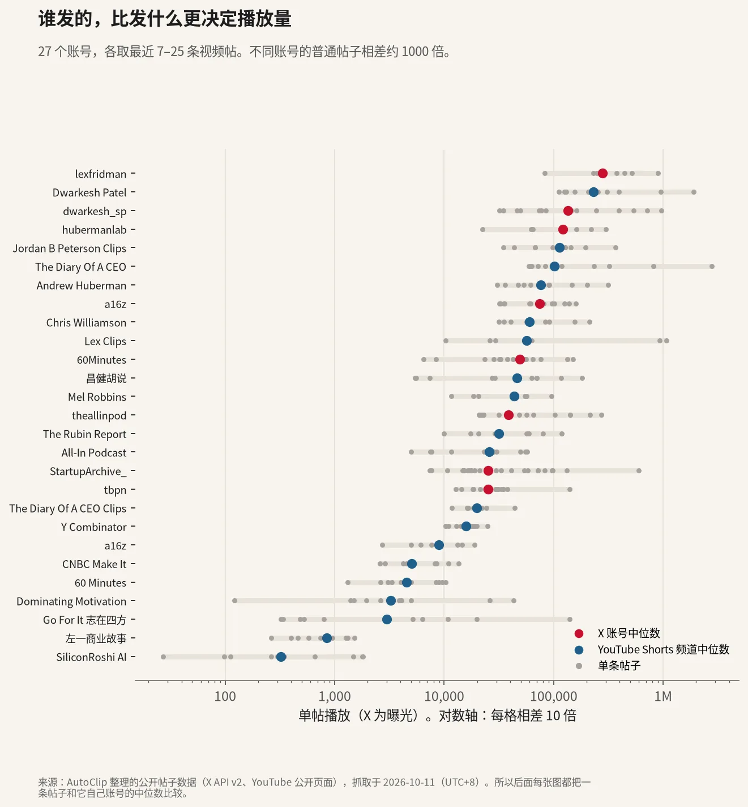

最上面的 Lex Fridman，普通一条有 27.9 万曝光；最下面的一个中文 AI 频道，普通一条 323 播放。一个大号的扑街帖，也比小号的爆款多。一项追踪 160 万推特用户、7400 万次转发的研究发现，最大的转发潮往往来自粉丝多、过去影响力大的账号；内容有趣也有帮助，但具体哪一条会爆，很难提前预测（Bakshy 等，2011）。

**对 AutoClip 的意思**：用户的账号量级我们改不了。我们能帮的是**在同一个账号里，把好的那条挑出来**。同一个账号内，最高和最低的帖子中位数相差 **12.5 倍**，这个空间足够大。

## 4. 发现二：只看选题大类，普通帖子分不开

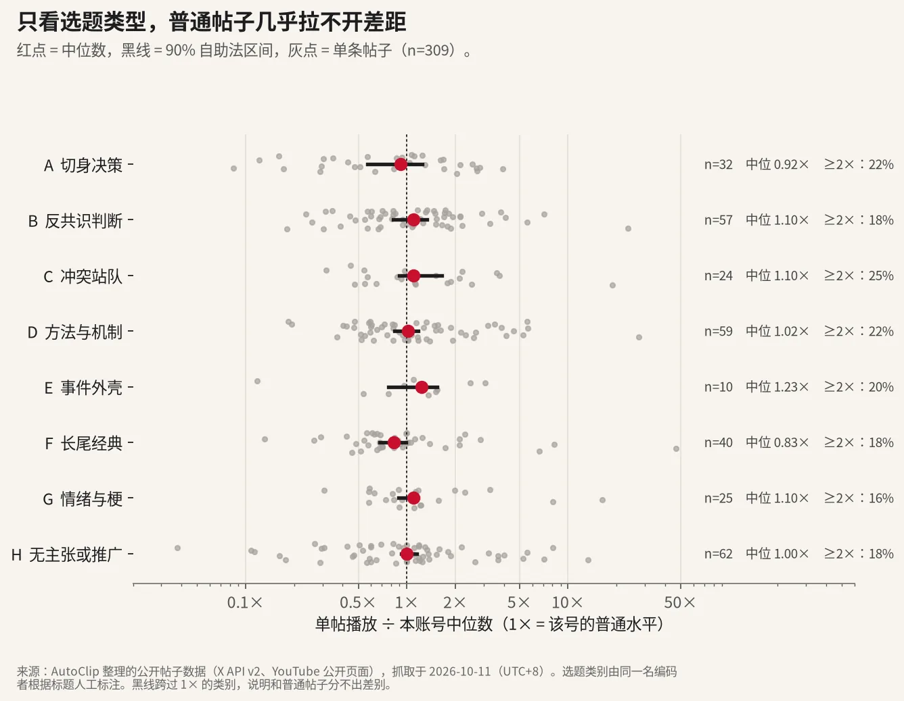

八个大类的中位数都贴着 1×。这说明**「选什么大类」不是一个好用的开关**：同一个号发反共识判断，和发方法讲解，普通情况下播放差不多。

两个细节值得注意：

- **长尾经典（F）中位数 0.83×**，是唯一明显低于 1 的类，但它同时有全样本最大的爆款（马斯克谈「我要听取怎样的意见」，本号 47 倍）。长尾题**大多数平平，偶尔大爆**。
- **事件外壳（E）中位数最高（1.23×）**，但样本只有 10 条，区间很宽，不能下结论。

## 5. 发现三：真正拉开命中率的四个特征

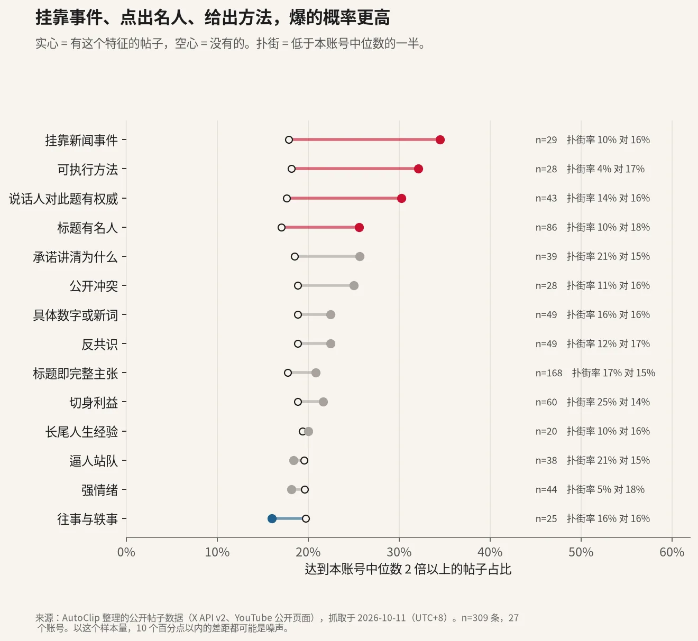

把 14 个特征逐个拿出来，比较「有」和「没有」的帖子命中 2 倍的概率：

| 特征 | 有 | 没有 | 怎么理解 |
|---|---|---|---|
| 挂靠新闻事件 | **34%** | 18% | 人对新东西天然更关注，但关注衰减很快（Wu & Huberman, 2007） |
| 可执行方法 | **32%** | 18% | 而且扑街率只有 4%，最稳 |
| 说话人对此题有权威 | **30%** | 18% | 人在快速刷、不细想的时候，会把「谁在说」当作判断的捷径（Petty & Cacioppo, 1986）；黄仁勋谈芯片比谈育儿更有分量 |
| 标题有名人 | **26%** | 17% | 扑街率 10%，没有名人的是 18% |
| 往事与轶事 | 16% | 20% | **唯一明显拖后腿的特征**，中位数 0.71× |

### 案例：四个特征长什么样

下面每张拆解图都包含：封面、关键帧、标题、指标、相对本号中位数的倍数，以及标题模式、封面模式、钩子和成败原因的标注。封面和画面为缩小后的截图，仅用于评论分析，版权归原作者。

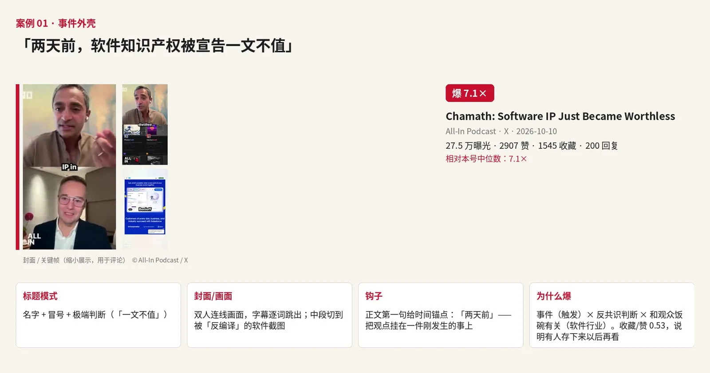

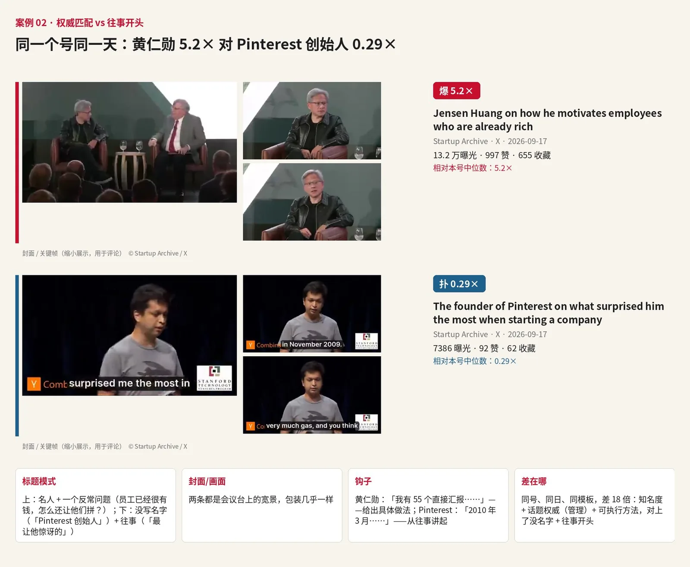

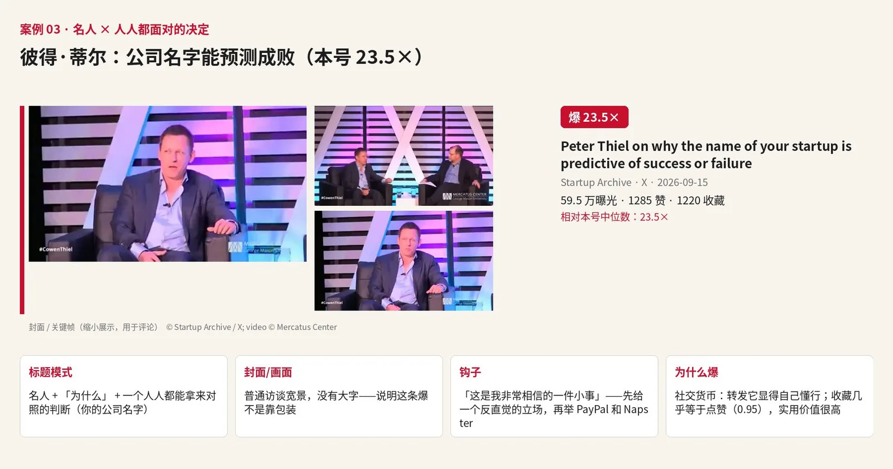

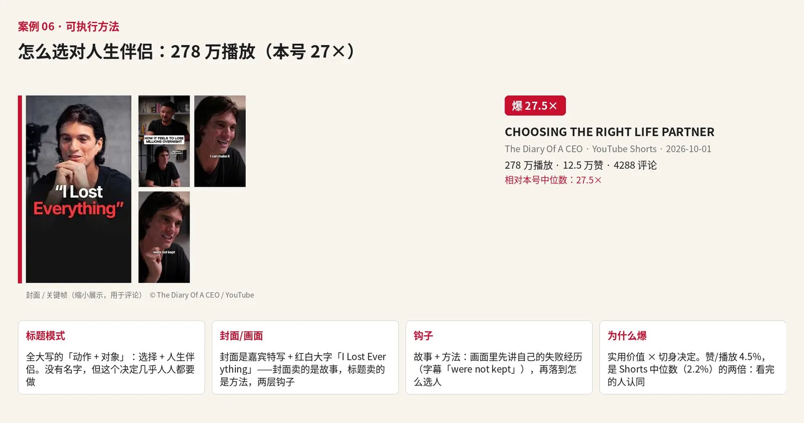

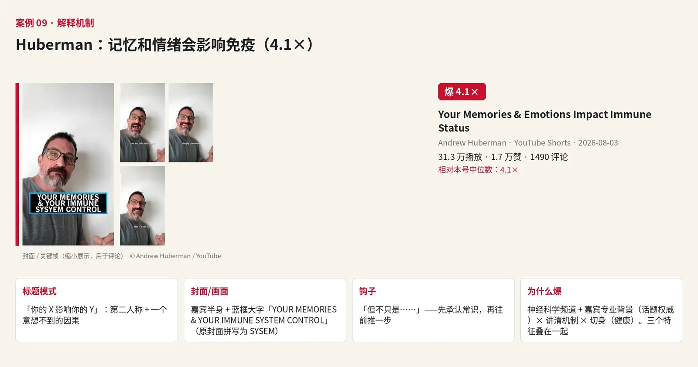

几个**没有拉开差距**的特征，同样重要：

- **逼人站队、强情绪**：单看命中率没有提升。但强情绪的扑街率很低（5%）——它像一个保底，而不是放大器。这和《纽约时报》文章的研究不完全一致：那里敬畏、愤怒、焦虑这类高唤起情绪明显让文章更常被转发（Berger & Milkman, 2012）。可能的原因是我们只看标题，而且是播放而不是转发。
- **切身利益**：命中率 22% 对 19%，几乎没差，**扑街率反而更高（25% 对 14%）**。

### 为什么「切身」单独不灵

这和我们之前的直觉相反，所以多看一眼。拿「昌健胡说」这个频道举例，同一个人、同一套包装、同一周发的 10 条：

| 标题 | 播放 |
|---|---|
| 亿万富翁预言：未来不用打工，这 10 年最难？ | **18.1 万** |
| 黄仁勋：AI 把作业变好了，考试却变差了？ | **11.7 万** |
| 图灵奖得主杨立昆：机器人会功夫，为什么还不会干家务？ | 7.0 万 |
| 免疫学教授：再撑 10 年，可能多活 50 年？ | 7382 |
| 谷歌为何急着 2029 年前换锁？今天的数据以后能被破解？ | 5580 |
| 2026 医学诺奖：给大脑装上光开关？ | 5422 |

「多活 50 年」「数据被破解」也很切身，但它们离普通人的**下一个决定**很远；「不用打工」「作业和考试」直接碰到工作和孩子上学，而且有一个大家认识的人在说。

心理学实验发现，用「这和我有关吗」去处理的信息，事后记得最牢（Rogers 等，1977）。但「有关」需要一个钩子把人拉进来：一个可信的人、一个反常的判断，或者一件正在发生的事。**切身是放大器的底座，不是放大器本身。**

## 6. 发现四：最大的爆款长什么样

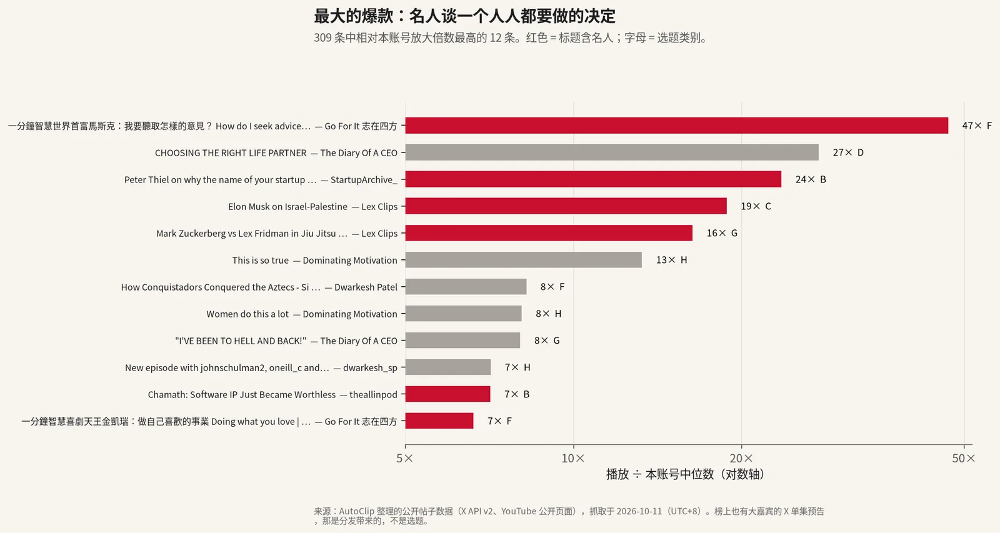

309 条里只有 11% 达到本号 3 倍以上。最大的几条：

- 马斯克：我要听取怎样的意见？（47×，长尾经典）
- 怎么选对人生伴侣（27×，方法）
- 彼得·蒂尔：创业公司的名字能预测成败（24×，反共识）
- 马斯克谈以巴冲突（19×，冲突）

共同点是：**一个名人（或权威） + 一个几乎所有人都要面对的决定或立场**。这和好奇心研究对得上：好奇心来自「知道一点，但缺一块」的信息缺口（Loewenstein, 1994）；越好奇的人，越愿意花时间或代价去拿到答案（Kang 等, 2009）。「我要听谁的意见」「该选什么样的伴侣」，每个人都有一半答案。

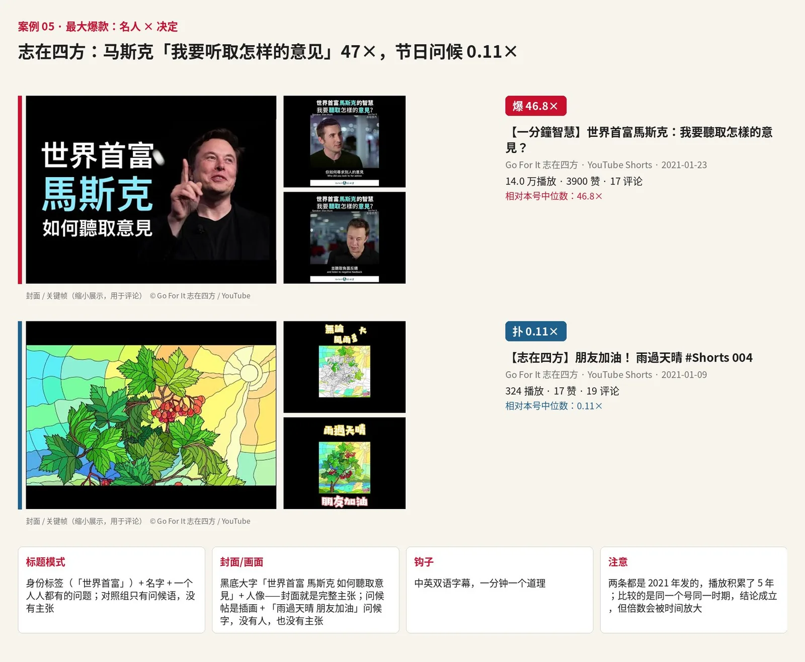

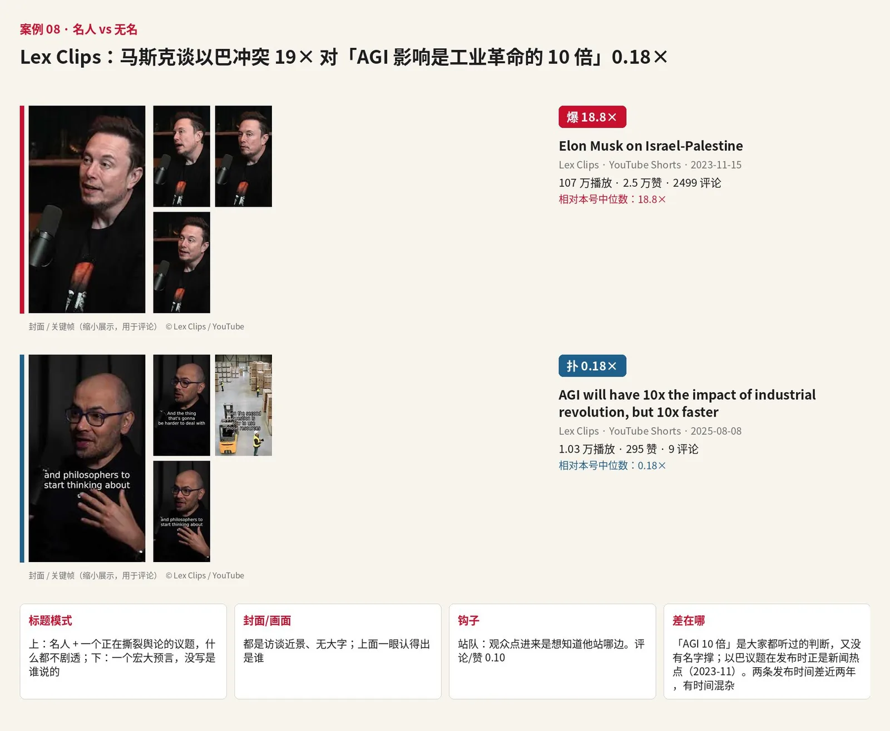

还要说清楚两点：

- **爆款很难预测。** 一项经典实验让上万人在同一批歌里打分下载，同一首歌在不同的「平行世界」里排名天差地别；参与者能看到别人下载量时，成败更难预测（Salganik 等, 2006）。规则只能提高命中的概率，没法保证。
- **榜上有几条 X 单集预告**（Dwarkesh、All-In），它们爆是因为嘉宾和账号分发，不是因为选题。我们把它们归为 H 类，没算进选题结论。

## 7. 发现五：中文平台——梗拿赞，冲突和事件拿评论

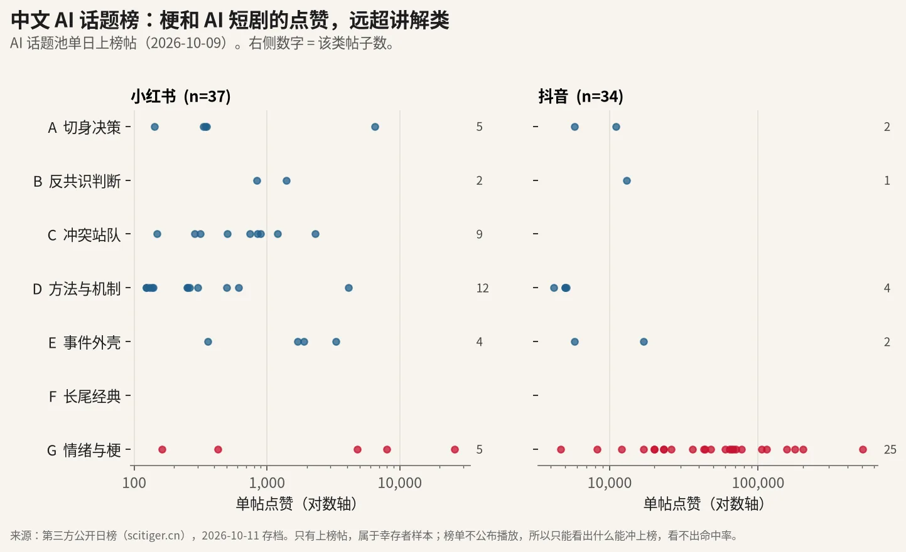

这部分用的是第三方公开的单日 AI 话题榜（2026-10-09），只有上榜帖，而且没有播放数，所以**只能看出什么能上榜，看不出命中率**。

- **抖音 34 条上榜帖里 25 条是 AI 短剧或情绪内容**，中位数 4.8 万赞；讲解类最多几千赞。
- **小红书更混合**：方法类（D）最多（12 条），但中位数只有 253 赞；梗类 4800 赞。
- **评论/赞**（每 100 个赞带来多少评论）差异最明显：

| 小红书类别 | 条数 | 中位赞 | 每 100 赞的评论 |
|---|---|---|---|
| C 冲突站队 | 9 | 748 | **27** |
| E 事件外壳 | 4 | 1800 | **31** |
| A 切身决策 | 5 | 345 | 6 |
| G 情绪与梗 | 5 | 4800 | 5 |
| D 方法与机制 | 12 | 253 | **2** |

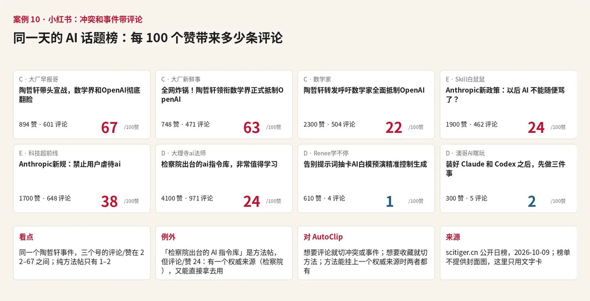

对标种子号「硅谷好胖友」没有公开时间线数据，我们用 Charlie 拍的主页截图（只有点赞数）做了一张拆解：

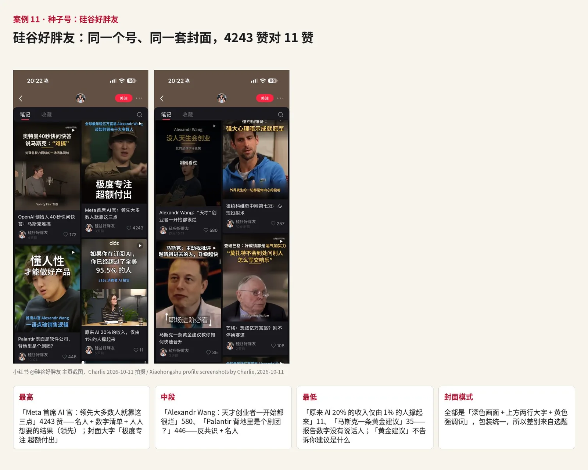

这和研究对得上：有争议的话题会带来讨论，但争议太大反而让人不敢开口，中等争议最能带评论（Chen & Berger, 2013）；在政治议题推文里，每多一个带道德情绪的词，转发约增加 20%（Brady 等, 2017）。

**对 AutoClip 的意思**：访谈切片不会去和 AI 短剧拼赞数。我们的路线是：**用方法类拿收藏、用冲突和事件类拿评论**，再用评论把帖子推给更多人。（注：榜单的「🔁」一栏我们无法确认在小红书上是收藏还是分享，所以没有用它下结论。）

## 8. 发现六：我们自己的号

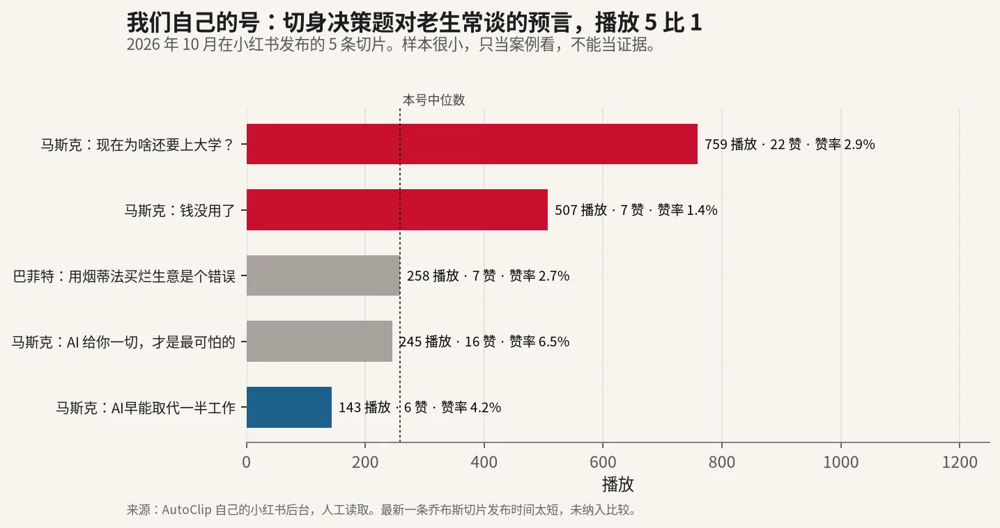

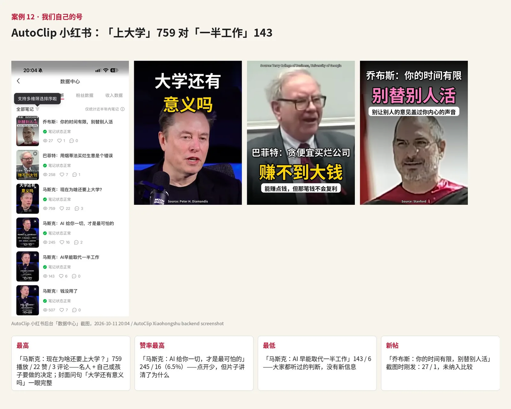

| 切片 | 播放 | 赞 | 赞率 |
|---|---|---|---|
| 马斯克：现在为啥还要上大学？ | 759 | 22 | 2.9% |
| 马斯克：钱没用了 | 507 | 7 | 1.4% |
| 巴菲特：用烟蒂法买烂生意是个错误 | 258 | 7 | 2.7% |
| 马斯克：AI 给你一切，才是最可怕的（讲全民高收入） | 245 | 16 | **6.5%** |
| 马斯克：AI早能取代一半工作 | 143 | 6 | 4.2% |

（标题为后台原文。乔布斯那条刚发，没有纳入。）

- 播放最高的两条，都是**名人 + 一个你自己要做的决定**（上不上大学、存不存钱）。
- 「AI 早能取代一半工作」同样是马斯克，但它是**大家都听过的判断**，没有新东西，垫底。说明名人撑不起一个老生常谈的判断。
- 「AI 给你一切」（讲全民高收入）点开的人少，但赞率最高：话题抽象，点开门槛高，但片子里把「为什么」讲清楚了，看完的人愿意点赞。

五条太少，只能当案例。但方向和外部数据一致。

## 9. 哪些选题表现差

按证据从强到弱：

1. **问候、预告、只有链接**（H 类）。「志在四方」同一个频道，名人金句 14 万播放，节日问候 300 多。
2. **往事与轶事开头**：「他当年怎么……」中位数 0.71×。往事可以放在片子里，但标题要落在结论上。
3. **切身但没有钩子**：健康、安全、长寿类话题，没有名人也没有反常判断，扑街率高。
4. **大家都听过的判断**：「AI 会取代很多工作」，我们的号和之前几批案例都证实效果差。
5. **长尾哲理不落到决定上**：F 类中位数 0.83×，要改写成「你要不要……」才有机会。

## 10. 我们对 AutoClip 选片雷达的改动

详见 [`radar-patch.md`](radar-patch.md)。简单说：

- **加分**：挂靠事件、说话人对此题有权威、给出可执行方法、名人 × 人人都面对的决定。
- **降分**：标题以往事开头；切身但没有名人、反常判断或事件撑着；大家都听过的判断。
- **不再奖励**「选题大类」本身，大类只用来决定走哪个平台、目标是收藏还是评论。

## 11. 局限（请务必读）

- **样本偏英文**：主样本 309 条里，中文频道只有 4 个（左一商业故事、SiliconRoshi、昌健胡说、志在四方）。中文平台的结论主要来自单日榜单，证据弱。
- **小红书没有账号时间线数据**：小红书有反爬保护，我们没有用任何登录凭证去抓取。对标号「硅谷好胖友」的指标待人工补录。
- **一名编码者，而且看得到数据**：X 的帖子在标注时能看到指标，可能下意识影响判断。下一步应该请第二个人盲标，算一致率。
- **X 用曝光，YouTube 用播放**，两者不能直接比，所以我们只在账号内部做比较。
- **时间窗口短**：每个号只有最近 7–25 条，近期的新闻会影响结果。
- **相关不等于因果**：带事件的帖子命中率高，也可能是因为账号会在大事件时更用心做。

## 12. 数据与复现

- 全部帖子：`data/posts.csv`、`data/posts.json`（含链接、指标、人工标签、规则标签）
- 人工标签：`data/manual_codes.txt`
- 原始抓取：`data/raw/`（X 接口返回、YouTube 抓取结果、榜单页面存档）
- 统计结果：`data/stats.json`
- 重跑：`bash run_all.sh`

## 参考文献

- Bakshy, E., Hofman, J. M., Mason, W. A., & Watts, D. J. (2011). Everyone's an influencer: Quantifying influence on Twitter. *Proceedings of WSDM 2011*, 65–74.
- Berger, J. (2013). *Contagious: Why Things Catch On*. Simon & Schuster.（STEPPS：社交货币、触发、情绪、公开、实用价值、故事）
- Berger, J., & Milkman, K. L. (2012). What makes online content viral? *Journal of Marketing Research*, 49(2), 192–205.
- Brady, W. J., Wills, J. A., Jost, J. T., Tucker, J. A., & Van Bavel, J. J. (2017). Emotion shapes the diffusion of moralized content in social networks. *PNAS*, 114(28), 7313–7318.
- Chen, Z., & Berger, J. (2013). When, why, and how controversy causes conversation. *Journal of Consumer Research*, 40(3), 580–593.
- Kang, M. J., Hsu, M., Krajbich, I. M., Loewenstein, G., McClure, S. M., Wang, J. T., & Camerer, C. F. (2009). The wick in the candle of learning: Epistemic curiosity activates reward circuitry and enhances memory. *Psychological Science*, 20(8), 963–973.
- Loewenstein, G. (1994). The psychology of curiosity: A review and reinterpretation. *Psychological Bulletin*, 116(1), 75–98.
- Petty, R. E., & Cacioppo, J. T. (1986). The elaboration likelihood model of persuasion. *Advances in Experimental Social Psychology*, 19, 123–205.
- Rogers, T. B., Kuiper, N. A., & Kirker, W. S. (1977). Self-reference and the encoding of personal information. *Journal of Personality and Social Psychology*, 35(9), 677–688.
- Salganik, M. J., Dodds, P. S., & Watts, D. J. (2006). Experimental study of inequality and unpredictability in an artificial cultural market. *Science*, 311(5762), 854–856.
- Wu, F., & Huberman, B. A. (2007). Novelty and collective attention. *PNAS*, 104(45), 17599–17601.

### 和 Berger STEPPS 的对应

| STEPPS | 本研究里对应的特征 | 数据怎么说 |
|---|---|---|
| 社交货币（转发显得我懂） | 反常识、具体数字或新词 | 小幅正向，不显著 |
| 触发（环境里常被想起） | 挂靠新闻事件 | **最强正向**（34% 对 18%） |
| 情绪 | 强情绪、公开冲突 | 不放大，但降低扑街 |
| 公开（别人看得见） | ——（我们的数据看不到） | — |
| 实用价值 | 可执行方法 | **强正向**，最稳 |
| 故事 | 往事与轶事 | **在标题里反而负向** |
